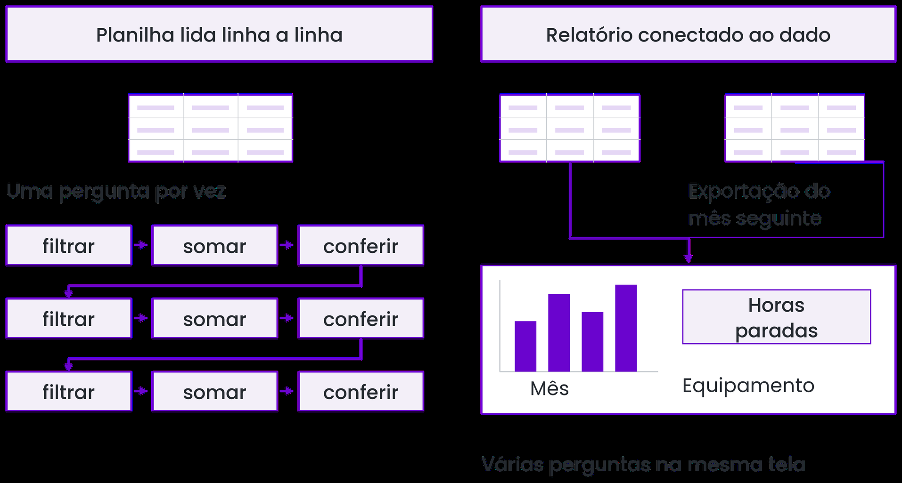
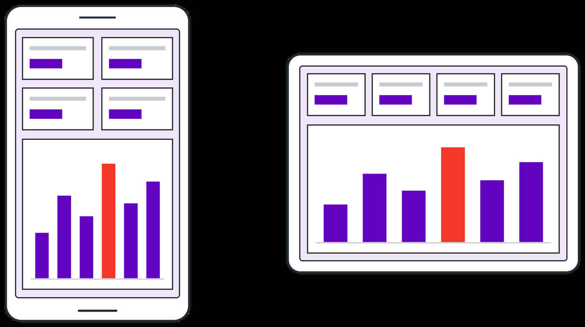
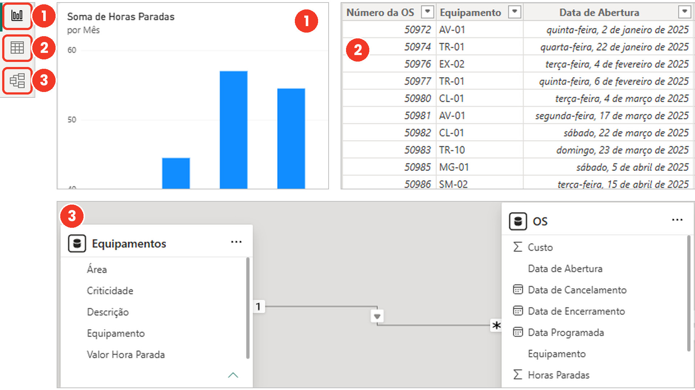
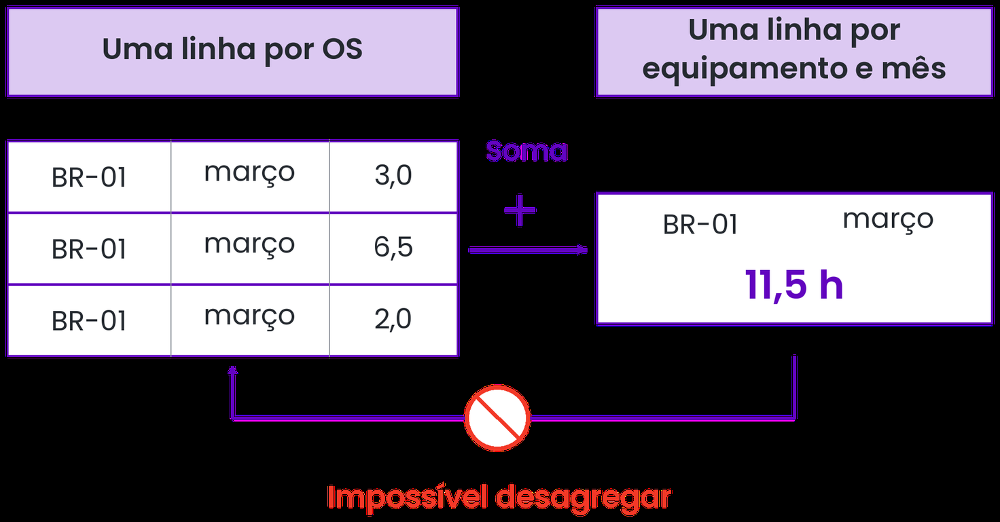
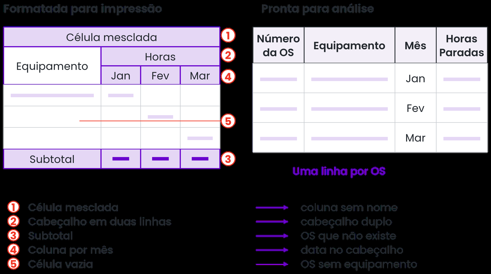
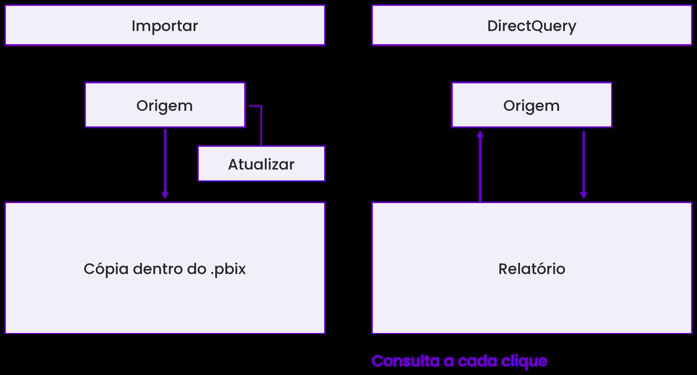
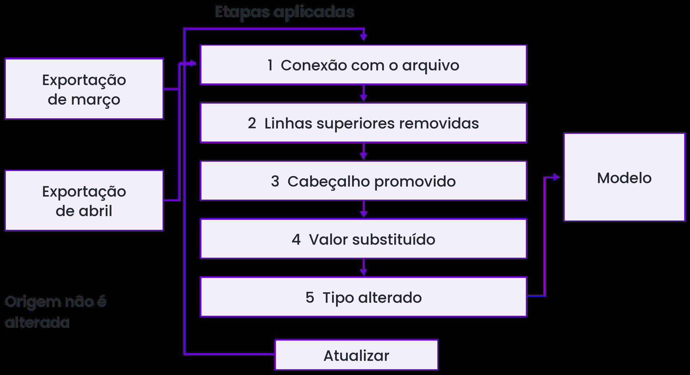

# Roteiro de Apoio para Explicação dos Temas — Aula 1 (Slide a Slide)
**Curso:** Power BI e DAX para Manutenção (CEDTEC Guarapari · Samarco)  
**Apresentação Oficial:** [`Aulas/Power BI e DAX para Manutenção — Dia 1 · Do sistema para o Power BI.pptx`](../../Aulas/Power%20BI%20e%20DAX%20para%20Manuten%C3%A7%C3%A3o%20%E2%80%94%20Dia%201%20%C2%B7%20Do%20sistema%20para%20o%20Power%20BI.pptx) *(32 Slides — Seções 1.1 a 2.2)*  
**Objetivo deste Guia:** Acompanhar exatamente a sequência dos **32 slides** da apresentação do Dia 1 (*Do sistema para o Power BI*), fornecendo ao professor o discurso didático, as contas de quadro branco (para a Sala sem computador), as pegadinhas e os testes rápidos.

---

## Mapa dos 32 Slides da Aula 1

```
┌────────────────────────────────────────────────────────────────────────────┐
│ ABERTURA E PROVA INICIAL (Slides 1 a 3): Pergunta do Dia e Cronograma      │
├────────────────────────────────────────────────────────────────────────────┤
│ BLOCO 1.1 · 1.2 (Slides 4 a 14): BI na Manutenção, Componentes e .pbix     │
│ • S05-06: 6 OS de março (ES-01 8,5h vs PR-02 5,0h) | S10-14: Desktop/Mobile │
├────────────────────────────────────────────────────────────────────────────┤
│ BLOCO 1.3 · 1.4 (Slides 15 a 22): Interface, Agregação e Dado Tabular      │
│ • S16: 4 áreas | S17-18: 1º gráfico e agregação | S20-22: Linha 37 e Tabular│
├────────────────────────────────────────────────────────────────────────────┤
│ BLOCO 1.5 · 1.6 (Slides 23 a 26): Excel, CSV, Pasta e Modos de Conexão     │
│ • S24: Navegador (OS + Equipamentos) | S25: CSV | S26: Pasta e Importar     │
├────────────────────────────────────────────────────────────────────────────┤
│ BLOCO 2.1 · 2.2 (Slides 27 a 32): Power Query, Etapas e Tipos de Dados     │
│ • S28: Etapas aplicadas | S29: Tipos | S30: Pegadinha "6,0 h" | S32: Check │
└────────────────────────────────────────────────────────────────────────────┘
```

---

# ABERTURA (Slides 1 a 3)

### Slide 1 a Slide 3 — Prova Inicial (08:00–09:00) e Abertura do Curso
- **08:00–09:00:** Aplicação da **Prova Inicial Impressa** (10 questões: 5 objetivas e 5 discursivas). Tranquilize a turma: ela é o diagnóstico do ponto de partida para compararmos a evolução na sexta-feira!
- **Pergunta do Dia (Slide 1):** *"Nas seis OS de março, qual equipamento passou mais horas parado?"*

---

# BLOCO 1.1 · 1.2: Inteligência de Negócio, Componentes e `.pbix` (Slides 4 a 14)

### Slide 4 a Slide 6 — Situação: "Qual equipamento parou mais em março?" (Conta no Quadro!)
Projete o **Slide 5** (ou copie no quadro) e dê 1 minuto para a turma somar de cabeça:

| OS | Equipamento | Tipo | Horas |
| :---: | :---: | :--- | :---: |
| `51.020` | **`PR-02`** (Ponte rolante) | Corretiva | `4,0` |
| `51.021` | **`ES-01`** (Espessador) | Preventiva | `6,0` |
| `51.022` | **`PR-02`** (Ponte rolante) | Preventiva | `2,0` |
| `51.023` | **`ES-01`** (Espessador) | Corretiva | `1,5` |
| `51.024` | **`PR-02`** (Ponte rolante) | Corretiva | `1,0` |
| `51.025` | **`ES-01`** (Espessador) | Preventiva | `1,0` |

- **Passe para o Slide 6 e compare os dois placares:**
  1. **Todas as OS (Total parado):**
     - `ES-01` = $6,0 + 1,5 + 1,0 = \mathbf{8,5\text{ h}}$
     - `PR-02` = $4,0 + 2,0 + 1,0 = \mathbf{7,0\text{ h}}$
     - *Vencedor no total:* **Espessador `ES-01`** (quase tudo em preventiva programada!).
  2. **Só Corretivas (Paradas por falha):**
     - `PR-02` = $4,0 + 1,0 = \mathbf{5,0\text{ h}}$
     - `ES-01` = $\mathbf{1,5\text{ h}}$
     - *Vencedor por falha:* **Ponte Rolante `PR-02`**!
- **Moral da história (Slide 6):** *"A pergunta certa muda o vencedor!"* Com 6 linhas você faz de cabeça; com 15.000 linhas exportadas do SAP na planilha, cada pergunta nova exige filtrar, somar e conferir tudo de novo.

---

### Slide 7 e Slide 8 — O Caminho do BI e o Limite da Ferramenta
- **As 5 etapas do curso (Slide 7):**
  $$\text{Trazer} \longrightarrow \text{Preparar} \longrightarrow \text{Modelar} \longrightarrow \text{Mostrar} \longrightarrow \text{Publicar}$$
- **BI de Autoatendimento:** Quem conhece a área de manutenção monta o próprio painel sem precisar abrir chamado na TI para cada gráfico novo.
- **Pegadinha do Slide 8 ("O painel mostra o erro da origem com um gráfico bonito"):**
  - O Power BI **não substitui** o sistema de gestão da manutenção (SAP/Maximo/Engeman). Ele **lê** a exportação!
  - Se o técnico apontou fim antes do início e gerou `-4,0 horas`, o Power BI vai denunciar esse erro no painel, mas **a correção volta para o sistema de origem**.


*Guia Visual 1 (Figura 1.1): Ciclo repetitivo da planilha vs atualização automática do relatório conectado.*

---

### Slides 9 a 14 — As Três Peças do Power BI, o Power Query e o Arquivo `.pbix`
- **Slide 10 (Três peças com papéis diferentes):**
  1. **Power BI Desktop:** Programa gratuito do Windows onde o painel é **construído**.
  2. **Serviço do Power BI (nuvem):** Site no navegador onde o painel é **publicado, compartilhado e atualizado automaticamente**.
  3. **Power BI Mobile:** App de celular/tablet onde o painel é apenas **consultado** na área.
- **Slide 11 (Power Query):** A "oficina de preparação e limpeza" embutida dentro do Power BI Desktop (e do Excel).
- **Slide 12 e Slide 13 (O que viaja dentro do `.pbix`):**
  - Dentro do `.pbix` moram **4 coisas juntas**: Consultas + Modelo + Relatório + **Cópia dos dados** (no modo Importar).
  - **Pegadinha (Slide 13):** Mandar o `.pbix` por e-mail entrega toda a base de custos e horas junto! E se outra pessoa clicar em *Atualizar* no computador dela sem ter acesso à sua pasta, dá erro de caminho.
  - Quando publicamos no Serviço (Slide 12), o `.pbix` se divide em **Relatório** (visual) e **Modelo Semântico** (dados e medidas).
- **Slide 14 (Teste Rápido):** *"Em qual peça o técnico de campo consulta o painel?"* ➔ **c) Power BI Mobile**!


*Guia Visual 2 (Figura 1.3): Do Power BI Desktop ao Serviço na nuvem e ao Power BI Mobile.*

---

# BLOCO 1.3 · 1.4: Interface, Agregação Implícita e Dado Tabular (Slides 15 a 22)

### Slides 15 a 18 — Quatro Áreas da Tela, Primeiro Gráfico e Agregação Implícita
- **Slide 16:** Mostre as 4 regiões no projetor:
  1. **Faixa de opções** (topo);
  2. **Modos de exibição** (esquerda: *Relatório*, *Tabela* e *Modelo*);
  3. **Tela do relatório** (centro);
  4. **Painéis à direita** (*Dados*, *Visualizações* e *Filtros*).
- **Slide 17 e Slide 18 (Agregação Implícita):**
  - Quando arrastamos `Horas Paradas` para o Eixo Y do gráfico de colunas, não escrevemos `=SOMA(...)`. Como a coluna é numérica, o visual **soma sozinho** para cada mês do Eixo X! Isso se chama **agregação implícita**.


*Guia Visual 3 (Figura 1.6): Os três modos de exibição usados na montagem do painel.*

---

### Slides 19 a 22 — Ordem de Serviço como Linha de Tabela e Granularidade
- **Slide 20 ("O que é a linha 37: uma OS, um equipamento ou um mês?"):**
  - Na tabela de fatos da manutenção, **cada linha é uma Ordem de Serviço** (`OS 48.213`, britador `BR-01`, corretiva, `14/03`, `6,5 h`).
- **Slide 21 (Dado Tabular e Granularidade):**
  - **Dado tabular:** Cabeçalho em uma linha só, cada linha = 1 registro completo, cada coluna = 1 atributo, sem células mescladas.
  - **Granularidade:** É o nível de detalhe da linha. **Regra de ouro:** Traga sempre a granularidade mais fina (1 linha por OS), porque o Power BI soma para cima facilmente, mas nunca consegue desagregar um total mensal de volta em OS individuais!
- **Slide 22 (Teste Rápido):** *"Planilha com subtotal por equipamento no meio é dado tabular? O que acontece com a soma das horas se o subtotal entrar no modelo?"*
  - **Resposta:** **Não é dado tabular!** Se o subtotal entrar junto com as OS, o Power BI trata a linha de subtotal como se fosse mais uma OS e **dobra (ou triplica) a soma das horas paradas no painel**!


*Guia Visual 4 (Figura 1.9): Da granularidade fina chega-se à grossa por soma; da grossa não se volta à fina.*


*Guia Visual 5 (Figura 1.10): O que ajuda na planilha impressa atrapalha a leitura tabular.*

---

# BLOCO 1.5 · 1.6: Importação, Conectores e Modos de Conexão (Slides 23 a 26)

### Slides 24 e 25 — Excel, CSV e `Carregar` × `Transformar Dados`
- **Slide 24 (Navegador do Excel):** Ao abrir uma pasta de trabalho com abas `OS`, `Equipamentos` e `Resumo`, marcamos apenas **`OS`** e **`Equipamentos`**, deixando `Resumo` de fora.
- **Slide 25 (CSV e os 2 botões):**
  - No CSV em português, a vírgula é usada nos decimais (`3,5`), então o delimitador de colunas é o **ponto e vírgula (`;`)** e a origem do arquivo é **UTF-8**.
  - **Carregar** joga direto no modelo; **Transformar dados** abre o Power Query para limpar antes de carregar.

### Slide 26 — Conector Pasta e `Importar` × `DirectQuery`
- **Conector Pasta:** Empilha automaticamente os 12 arquivos CSV mensais numa tabela única. **Cuidado:** Um arquivo estranho esquecido na pasta (como `desktop.ini`) quebra o empilhamento se não for filtrado no Power Query!
- **Importar × DirectQuery:**
  - **Importar:** Copia os dados para dentro do `.pbix` (rápido, libera todo o poder do Power Query e do DAX; renova ao clicar em *Atualizar*). É o padrão para arquivos e para a maioria dos painéis de manutenção.
  - **DirectQuery:** Não copia nada; consulta o banco de dados a cada clique na tela (só existe para bancos de dados gigantescos ou acompanhamento ao vivo minuto a minuto).


*Guia Visual 6 (Figura 1.16): Importar trabalha sobre uma cópia renovada pelo botão Atualizar; DirectQuery consulta o banco a cada clique.*

---

# BLOCO 2.1 · 2.2: Power Query, Etapas Aplicadas e Tipos de Dados (Slides 27 a 32)

### Slide 28 — "No Power Query, cada clique vira uma etapa"
- **Comparação Excel × Power Query:**
  - No Excel, todo mês você apaga cabeçalho, substitui texto e converte coluna no braço.
  - No Power Query, cada clique grava uma linha na lista **Etapas Aplicadas** (uma receita em linguagem M) sem tocar no arquivo original! Quando chega o arquivo do mês seguinte, basta clicar em **Atualizar** e toda a limpeza roda sozinha de cima para baixo!


*Guia Visual 7 (Figura 2.4): As etapas aplicadas funcionam como uma receita automática a cada atualização.*

---

### Slides 29 e 30 — Tipos de Dados e a Pegadinha do `"6,0 h"`
- **Slide 29 (Os ícones de tipo no cabeçalho):**
  - `ABC` (**Texto**): Filtra e conta (`Equipamento`, `Tipo de Manutenção`).
  - `123` (**Inteiro**) e `1.2` (**Decimal**): Soma e calcula (`Número da OS`, `Horas Paradas`).
  - 📅 (**Data**): Agrupa por ano e mês (`Data de Abertura`).
  - *Detecção automática:* Olha só as **200 primeiras linhas**! Se na linha 1.312 alguém escreveu `"6,0 h"`, vira `Erro`!
- **Slide 30 (Pegadinha: "Se as horas não somam, a coluna entrou como texto"):**
  - `"6,0 h"` tem letra, então é texto!
  - **Ordem certa do conserto:** Primeiro **Substituir Valores** (trocar `" h"` por vazio) **antes** da etapa `Tipo Alterado`, e só depois mudar o tipo para **Número decimal (`1.2`)**.
  - **Dica extra de Ouro (Seção 2.2 — Localidade):** Se a data veio de sistema em inglês (`03/14/2026`), use **Alterar Tipo › Usando a Localidade... › Data › Inglês (Estados Unidos)**.

---

### Slides 31 e 32 — Resumo e Checkpoint do Dia 1
- **Checkpoint para liberar a turma:**
  1. Base de OS e Equipamentos importada com os tipos de dados corretos.
  2. Arquivo `.pbix` salvo com o primeiro gráfico de colunas (*Horas paradas por mês*).
- **Prévia do Dia 2:** Teoria de conjuntos na sala, limpeza pesada de base suja e modelagem Fato × Dimensão (Esquema Estrela).
