# Roteiro Prático: Interação com os Datasets da Aula 1 no Power BI Desktop
**Curso:** Power BI e DAX para Manutenção (CEDTEC Guarapari · Samarco)  
**Apresentação de Referência:** [`Aulas/Power BI e DAX para Manutenção — Dia 1 · Do sistema para o Power BI.pptx`](../../Aulas/Power%20BI%20e%20DAX%20para%20Manuten%C3%A7%C3%A3o%20%E2%80%94%20Dia%201%20%C2%B7%20Do%20sistema%20para%20o%20Power%20BI.pptx) *(Slides 1 a 32 — Seções 1.1 a 2.2)*  
**Arquivos de Dados na Pasta `Dataset/Aula 1/`:**
- [`Dataset_PowerBI_Manutencao.xlsx`](./Dataset_PowerBI_Manutencao.xlsx) *(Base principal do curso: abas `OS` e `Equipamentos`)*
- [`Casos_Dia1_Slide_a_Slide.xlsx`](./Casos_Dia1_Slide_a_Slide.xlsx) *(Mini-tabelas dos Slides 5, 20, 22 e 24 para prática guiada)*
- [`Exportacao_Forno_Tipos.csv`](./Exportacao_Forno_Tipos.csv) *(Arquivo CSV com delimitador `;`, texto `"6,0 h"` e datas em formato americano para praticar os Slides 25 a 30)*

---

## Mapa Prático Alinhado aos 32 Slides da Aula 1

| Bloco dos Slides | Seções | O que fazer no Power BI Desktop |
| :--- | :---: | :--- |
| **Slides 4 a 14** | **1.1 · 1.2** | Conferir o caso das **6 OS de março (`PR-02` vs `ES-01`)**, entender o papel do arquivo `.pbix` e a diferença entre **Desktop**, **Serviço** e **Mobile**. |
| **Slides 15 a 22** | **1.3 · 1.4** | Fazer o tour pelas **4 áreas da interface** e pelos **3 modos de exibição**, criar o **primeiro gráfico de colunas com agregação implícita**, salvar o `.pbix` e comparar **dado tabular** vs **planilha com subtotal**. |
| **Slides 23 a 26** | **1.5 · 1.6** | Importar Excel selecionando `OS` e `Equipamentos` (deixando `Resumo` de fora), importar CSV ajustando **UTF-8** e **Ponto e vírgula (`;`)**, e diferenciar **Importar × DirectQuery**. |
| **Slides 27 a 32** | **2.1 · 2.2** | Abrir o **Editor do Power Query**, inspecionar **Etapas Aplicadas**, corrigir `"6,0 h"` antes de `Tipo Alterado`, converter datas com **Usando a Localidade** e fechar o **Checkpoint do Dia 1**. |

---

# BLOCO 1: Da Ordem de Serviço ao `.pbix` (Slides 4 a 14 · Seções 1.1 e 1.2)

### Passo 1.1: O Placar que Muda com a Pergunta — `PR-02` vs `ES-01` (Slides 5 e 6)
*Pergunta do Dia (Slide 1 e Slide 5): "Nas seis OS de março, qual equipamento passou mais horas parado?"*

| Número da OS | Equipamento | Tipo de Manutenção | Horas Paradas |
| :---: | :--- | :--- | :---: |
| `51.020` | Ponte rolante **`PR-02`** | Corretiva | `4,0` |
| `51.021` | Espessador **`ES-01`** | Preventiva | `6,0` |
| `51.022` | Ponte rolante **`PR-02`** | Preventiva | `2,0` |
| `51.023` | Espessador **`ES-01`** | Corretiva | `1,5` |
| `51.024` | Ponte rolante **`PR-02`** | Corretiva | `1,0` |
| `51.025` | Espessador **`ES-01`** | Preventiva | `1,0` |

1. Antes mesmo de abrir o Power BI, confira os dois placares do **Slide 6**:
   - **Todas as OS (indisponibilidade total):** `ES-01` = $6,0 + 1,5 + 1,0 = \mathbf{8,5\text{ h}}$ vs `PR-02` = $4,0 + 2,0 + 1,0 = \mathbf{7,0\text{ h}}$.
   - **Só Corretivas (paradas por falha):** `PR-02` = $4,0 + 1,0 = \mathbf{5,0\text{ h}}$ vs `ES-01` = $\mathbf{1,5\text{ h}}$.
2. **Lição do Slide 7 e Slide 8:** Na planilha, cada pergunta nova exige filtrar e somar de novo; no Power BI (**Trazer → Preparar → Modelar → Mostrar → Publicar**), um único clique num filtro vira o placar na hora!

*Figura 1 (Figura 1.1): Na planilha, cada pergunta repete o ciclo manual; no relatório conectado, a mesma base responde a várias perguntas.*

*Figura 2 (Figura 1.2): O Power BI lê a exportação e mostra; a OS nasce, é apontada e é corrigida no sistema de gestão da manutenção.*

---

### Passo 1.2: As Três Peças do Power BI e o Arquivo `.pbix` (Slides 9 a 14)
1. **Power BI Desktop (no Windows):** Onde estamos agora — conecta, limpa no Power Query, modela e desenha os visuais.
2. **Serviço do Power BI (no navegador/nuvem):** Onde o relatório é publicado, compartilhado e tem atualização agendada (separa o `.pbix` em **Relatório** e **Modelo Semântico** — Slide 12).
3. **Power BI Mobile (celular/tablet):** Onde o técnico e o supervisor consultam o painel em campo (**Resposta do Teste Rápido do Slide 14: letra C**).

*Figura 3 (Figura 1.3): O dado entra no Desktop, vira um `.pbix` com consulta, modelo e relatório, é publicado no Serviço e chega ao celular.*

---

# BLOCO 2: Interface, Primeiro Gráfico e Dado Tabular (Slides 15 a 22 · Seções 1.3 e 1.4)

### Passo 2.1: Tour Guiado pelas 4 Áreas e 3 Modos de Exibição (Slides 15 e 16)
Abra o **Power BI Desktop** e localize na tela:
1. **Faixa de opções (topo):** Guia **Página Inicial** (*Obter dados*, *Transformar dados*, *Atualizar*, *Publicar*).
2. **Modos de exibição (barra esquerda):**
   - 📊 **Exibição de Relatório:** Tela branca onde montamos os gráficos.
   - 🔢 **Exibição de Tabela:** Grade para conferir as linhas e colunas carregadas.
   - 🕸️ **Exibição de Modelo:** Diagrama de caixas e linhas que ligam as tabelas.
3. **Tela do relatório (centro):** Páginas na barra inferior (`+` cria página nova).
4. **Painéis à direita:** **Dados**, **Visualizações** e **Filtros**.

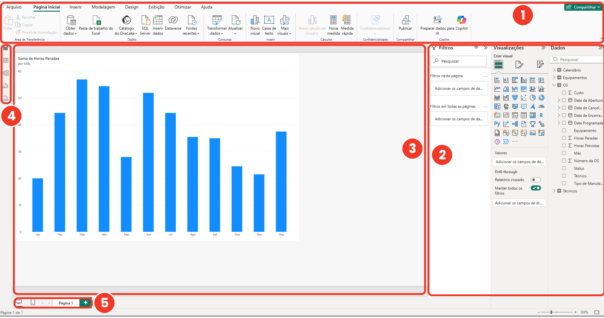
*Figura 4 (Figura 1.5): As quatro áreas fixas do Power BI Desktop.*

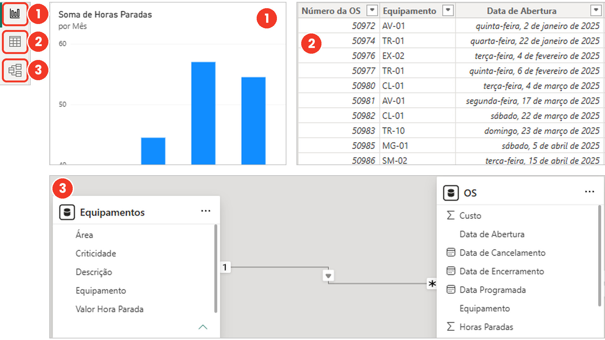
*Figura 5 (Figura 1.6): Relatório para mostrar, Tabela para conferir o dado e Modelo para ligar as tabelas.*

---

### Passo 2.2: O Primeiro Gráfico e a Agregação Implícita (Slides 17 e 18)
1. Clique em **Página Inicial › Pasta de trabalho do Excel** e abra [`Dataset_PowerBI_Manutencao.xlsx`](./Dataset_PowerBI_Manutencao.xlsx).
2. Marque a tabela **`OS`** e clique em **Carregar** (faremos o primeiro teste rápido como no **Slide 17**).
3. Siga os **5 passos do Slide 17**:
   - **Passo 1:** No painel **Visualizações**, clique no ícone **Gráfico de colunas clusterizado**.
   - **Passo 2:** Do painel **Dados**, arraste `Data de Abertura` (ou `Mês` da hierarquia) para o **Eixo X**.
   - **Passo 3:** Arraste `Horas Paradas` para o **Eixo Y**. Repare que o Power BI somou sozinho as horas de cada mês (**Agregação implícita — Slide 18**).
   - **Passo 4:** No painel **Filtros**, arraste `Equipamento` (ou `Tipo de Manutenção`) e filtre um equipamento para ver o gráfico responder na hora!
   - **Passo 5:** Clique em **Arquivo › Salvar como** e salve seu arquivo como `Painel_Manutencao_Dia1.pbix`.

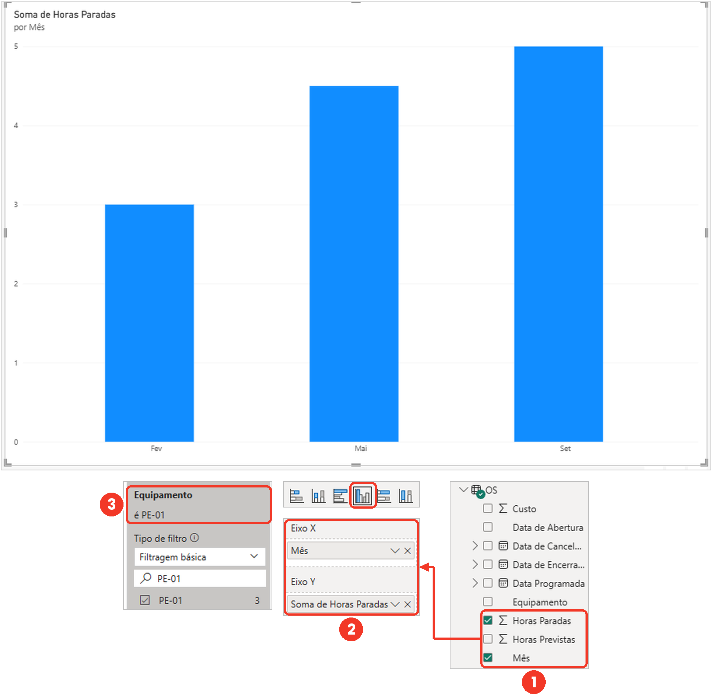
*Figura 6 (Figura 1.7): A coluna sai do painel Dados, cai numa caixa do painel Visualizações e o painel Filtros restringe quais linhas entram na soma.*

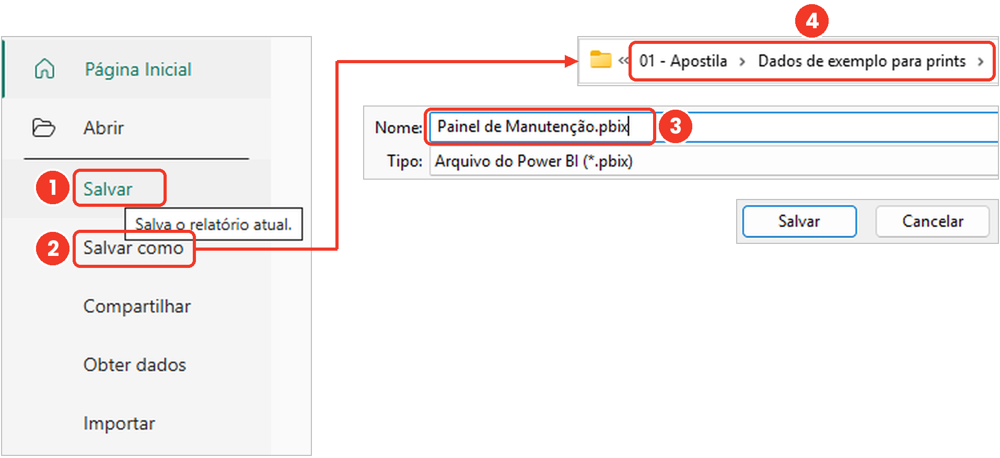
*Figura 7 (Figura 1.8): Arquivo › Salvar como grava consultas, modelo e páginas num único arquivo `.pbix`.*

---

### Passo 2.3: Dado Tabular, Granularidade e a Pegadinha do Subtotal (Slides 19 a 22)
1. Importe [`Casos_Dia1_Slide_a_Slide.xlsx`](./Casos_Dia1_Slide_a_Slide.xlsx) e compare na **Exibição de Tabela** as abas `Slide20_Britadores_Tabular` e `Slide22_Planilha_Com_Subtotal`:
   - Em `Slide20_Britadores_Tabular`, cada linha é **uma Ordem de Serviço** (`48.211` a `48.214`, somando **`20,0 h`**).
   - Em `Slide22_Planilha_Com_Subtotal`, alguém deixou linhas de `"Subtotal BR-01"`, `"Subtotal BR-02"` e `"TOTAL GERAL"` no meio da tabela. Se você colocar num cartão ou gráfico, a soma salta de `20,0 h` para **`60,0 h`** (triplicada!).

*Figura 8 (Figura 1.9): Da granularidade fina (uma linha por OS) chega-se à grossa por soma; da grossa nunca se volta à fina.*

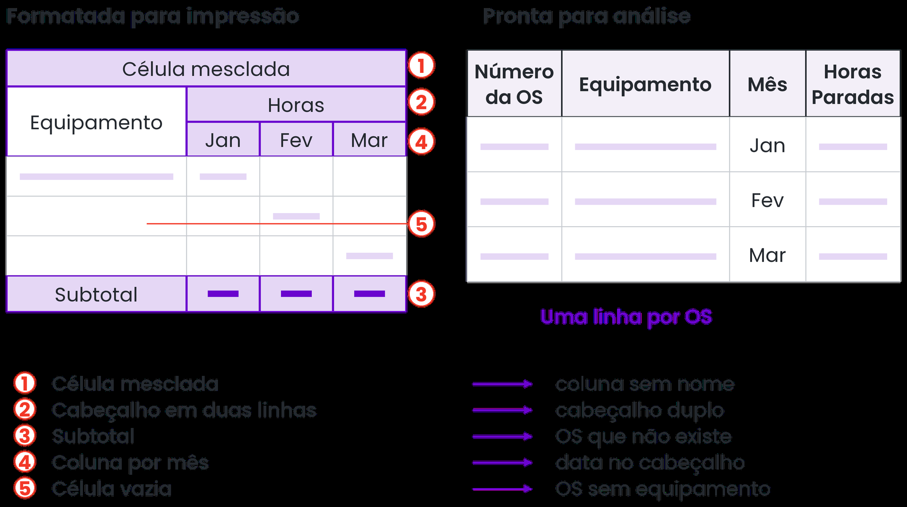
*Figura 9 (Figura 1.10): Título mesclado, subtotal no meio e células vazias ajudam no papel impresso, mas quebram a análise no Power BI.*

---

# BLOCO 3: Importação de Excel, CSV e Modos de Conexão (Slides 23 a 26 · Seções 1.5 e 1.6)

### Passo 3.1: O Navegador do Excel — `Carregar` vs `Transformar Dados` (Slides 24 e 25)
1. Clique em **Página Inicial › Obter dados › Pasta de trabalho do Excel** e selecione [`Dataset_PowerBI_Manutencao.xlsx`](./Dataset_PowerBI_Manutencao.xlsx) (ou [`Casos_Dia1_Slide_a_Slide.xlsx`](./Casos_Dia1_Slide_a_Slide.xlsx)).
2. Na janela **Navegador** (**Slide 24**):
   - Marque as caixas **`OS`** e **`Equipamentos`**.
   - **Deixe qualquer aba de `Resumo` de fora** (pois o resumo é uma conta já pronta que dobraria valores ou ficaria solta no modelo).
   - Clique em **Transformar dados** (em vez de *Carregar*) para abrir o **Editor do Power Query**.

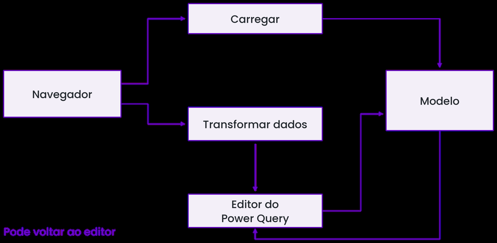
*Figura 10 (Figura 1.11): O Navegador mostra as abas da planilha e oferece os botões Carregar ou Transformar dados.*

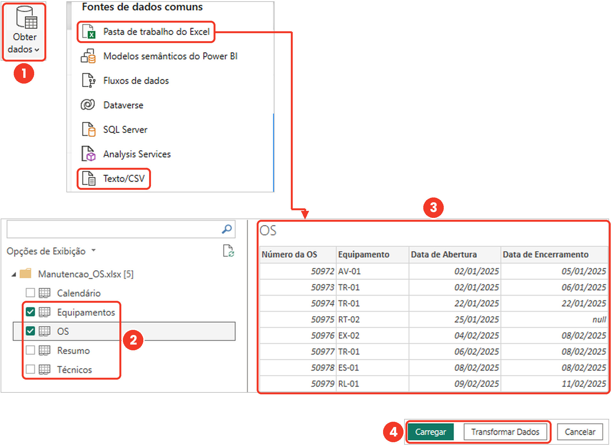
*Figura 11 (Figura 1.12): Carregar envia direto ao modelo; Transformar dados passa antes pela bancada de limpeza do Power Query.*

---

### Passo 3.2: Importando um Arquivo CSV em Português (Slide 25)
1. No Power BI Desktop (ou dentro do Power Query em **Nova Fonte › Texto/CSV**), selecione o arquivo [`Exportacao_Forno_Tipos.csv`](./Exportacao_Forno_Tipos.csv).
2. Confira as **3 listas suspensas** no topo da janela de pré-visualização:
   - **Origem do Arquivo:** `65001: Unicode (UTF-8)` *(para não quebrar acentos e `ç`)*.
   - **Delimitador:** **Ponto e vírgula (`;`)** *(como usamos vírgula decimal em `"4,5"` e `"12,25"`, o separador de colunas em português é o ponto e vírgula!)*.
   - **Detecção de tipo de dados:** *Com base nas primeiras 200 linhas*.
3. Clique em **Transformar dados**.

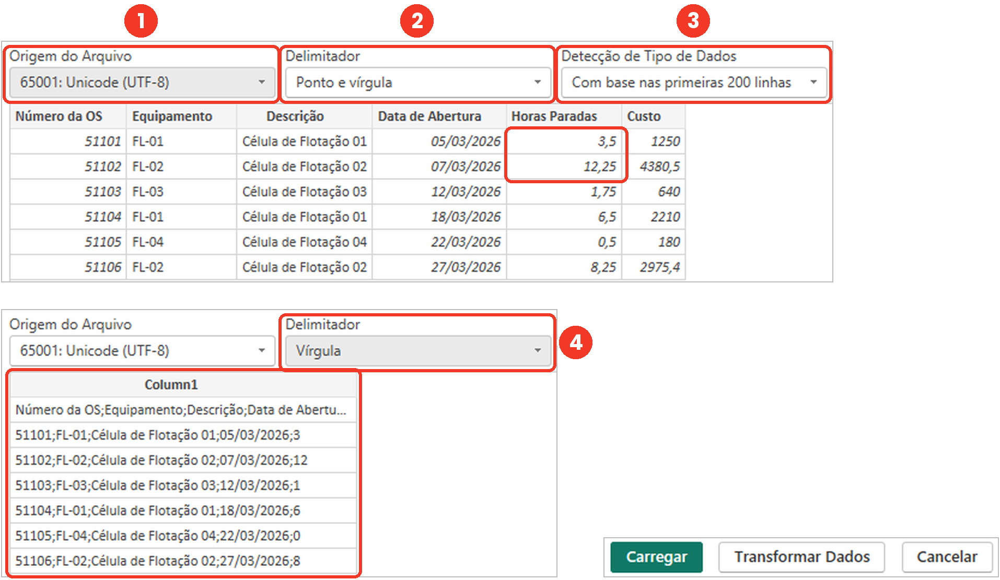
*Figura 12 (Figura 1.13): As três listas do CSV decidem como o texto vira tabela; com o delimitador errado, tudo gruda numa coluna só.*

---

# BLOCO 4: Power Query, Etapas Aplicadas e Tipos de Dados (Slides 27 a 32 · Seções 2.1 e 2.2)

### Passo 4.1: As 6 Áreas do Power Query e as Etapas Aplicadas (Slides 27 e 28)
Com o **Editor do Power Query** aberto sobre a consulta `Exportacao_Forno_Tipos`:
1. Identifique as **6 áreas da janela** (Figura 2.1):
   - **Faixa de opções** no topo;
   - **Consultas** à esquerda;
   - **Barra de fórmulas (linguagem M)** e **Prévia da tabela** no centro;
   - **Configurações de Consulta / Etapas Aplicadas** à direita;
   - **Barra de status** no rodapé.
2. Clique nas etapas `Fonte`, `Cabeçalhos Promovidos` e `Tipo Alterado` no painel **Etapas Aplicadas** à direita para ver como a tabela estava em cada passo!

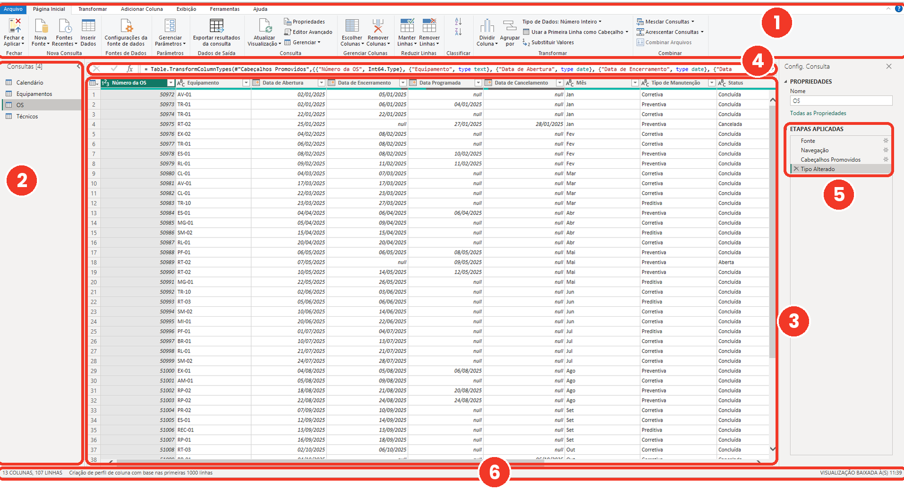
*Figura 13 (Figura 2.1): As seis áreas do Editor do Power Query.*

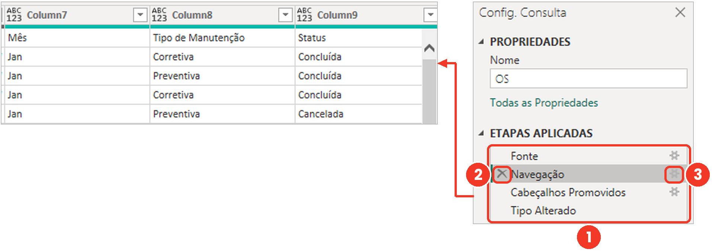
*Figura 14 (Figura 2.2): O `X` exclui a etapa e o ícone de engrenagem reabre a janela de configuração.*

---

### Passo 4.2: Corrigindo a Pegadinha do `"6,0 h"` na Coluna de Horas (Slides 29 e 30)
1. Olhe para a coluna `Horas_Paradas` na consulta `Exportacao_Forno_Tipos`:
   - Na linha da OS `61003` (`FO-01`), alguém digitou **`"6,0 h"`** com a letra `h`!
   - Por causa dessa única linha com letra, a coluna inteira entrou como **Texto (`ABC`)** (ou gerou `Erro` ao converter para número)!
2. **Como consertar na ordem certa (Slide 30):**
   - No painel **Etapas Aplicadas** à direita, se a etapa `Tipo Alterado` já tiver gerado `Erro`, clique no **`X`** ao lado de `Tipo Alterado` para voltar à etapa `Cabeçalhos Promovidos`.
   - Clique com o botão direito no cabeçalho da coluna `Horas_Paradas` ➔ **Substituir os Valores**.
   - Em *Valor a Localizar*, digite ` h` (espaço + h); deixe *Substituir por* vazio ➔ **OK**.
   - Agora clique no ícone **`ABC`** no cabeçalho de `Horas_Paradas` e escolha **`1.2` Número decimal**!

---

### Passo 4.3: Convertendo Data e Moeda de Sistema em Inglês com `Usando a Localidade` (Seção 2.2)
1. Na mesma consulta `Exportacao_Forno_Tipos`, olhe a coluna `Data_Abertura_EUA`:
   - As datas vieram no padrão americano (`MM/DD/AAAA`: `03/05/2026`, `03/08/2026`, `03/14/2026`).
   - Se você converter direto para **Data**, `03/14/2026` vira **`Erro`** (não existe mês 14!) e `03/08/2026` vira **3 de agosto** em vez de **8 de março**!

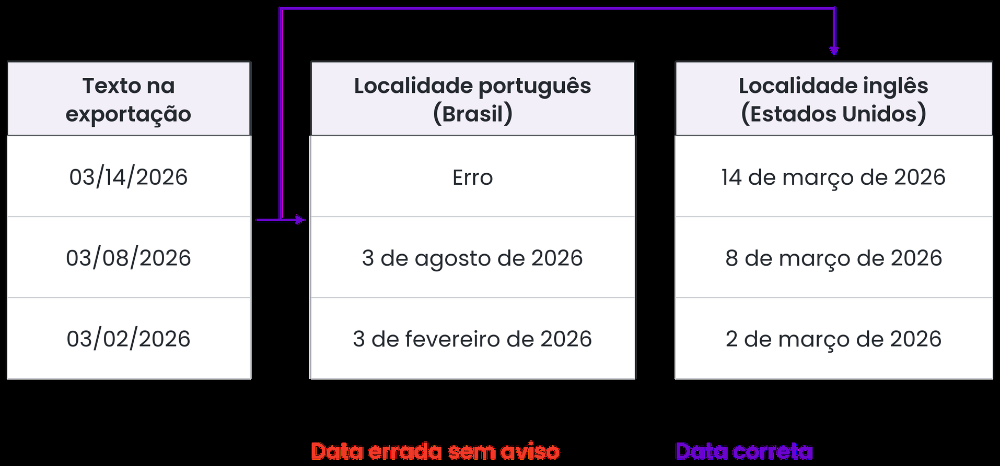
*Figura 15 (Figura 2.6): Lida com a localidade errada, `03/14/2026` dá Erro e `03/08/2026` vira agosto sem avisar.*

2. **Consertando com Localidade (Figura 2.7):**
   - Clique no ícone ao lado do nome da coluna `Data_Abertura_EUA` ➔ **Usando a Localidade...**.
   - Em **Tipo de Dados**, escolha **Data**.
   - Em **Localidade**, escolha **Inglês (Estados Unidos)** ➔ **OK**. Todas as datas viram março de 2026 (`05/03/2026`, `08/03/2026`, `14/03/2026`)!
3. Faça o mesmo na coluna `Custo_USD` (`1250.50` com ponto decimal):
   - Botão direito no cabeçalho ➔ **Alterar Tipo › Usando a Localidade...** ➔ **Número decimal fixo** + **Inglês (Estados Unidos)**.

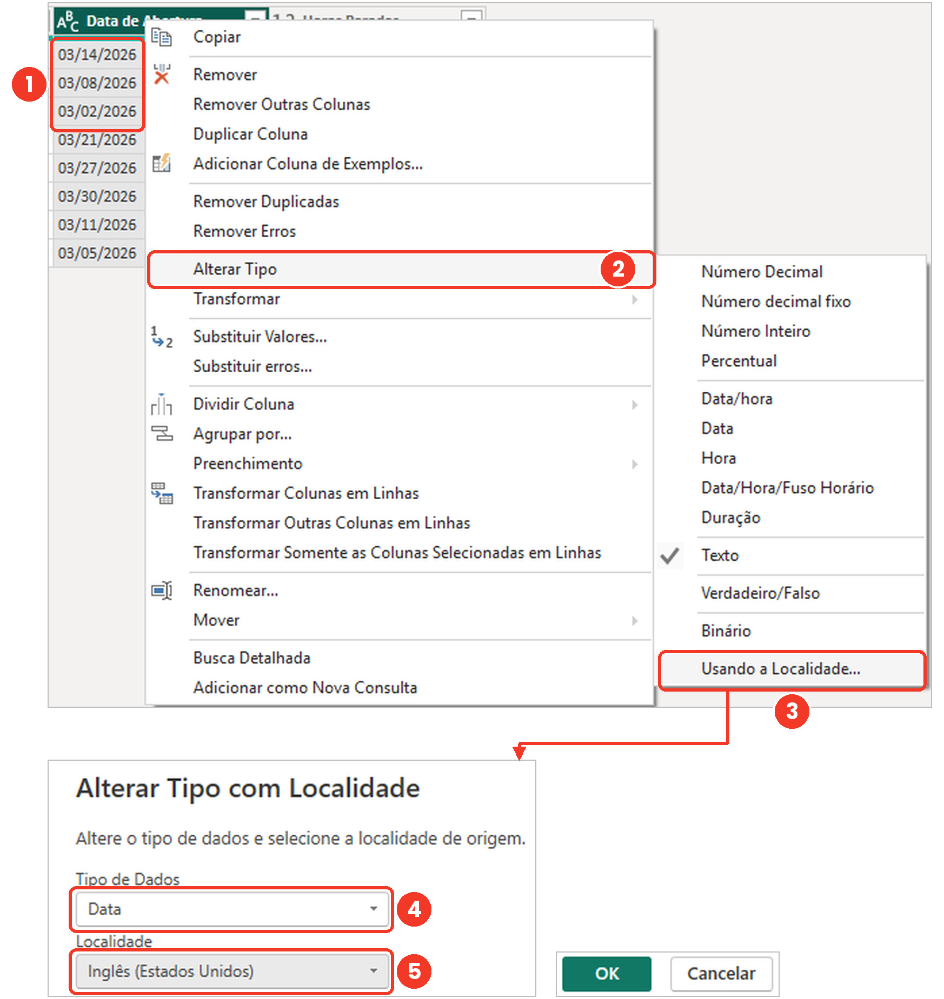
*Figura 16 (Figura 2.7): A janela Alterar Tipo com Localidade converte datas `MM/DD/YYYY` e números com ponto decimal.*

---

### Passo 4.4: Conferindo os Tipos da Base Principal (`OS` e `Equipamentos`) e Fechar e Aplicar (Slides 31 e 32)
1. Selecione a consulta **`OS`** (de `Dataset_PowerBI_Manutencao.xlsx`) no painel esquerdo do Power Query e confira os ícones de todas as colunas:
   - `Número da OS` ➔ **`123`** (Número inteiro)
   - `Equipamento`, `Tipo de Manutenção`, `Status`, `Prioridade`, `Equipe Responsável` ➔ **`ABC`** (Texto)
   - `Data de Abertura`, `Data de Encerramento`, `Data Programada` ➔ **📅** (Data)
   - `Horas Paradas`, `Horas Previstas` ➔ **`1.2`** (Número decimal)
   - `Custo (R$)` ➔ **`$`** (Número decimal fixo)
2. Na guia **Página Inicial** do Power Query, clique no primeiro botão: **Fechar e Aplicar**.

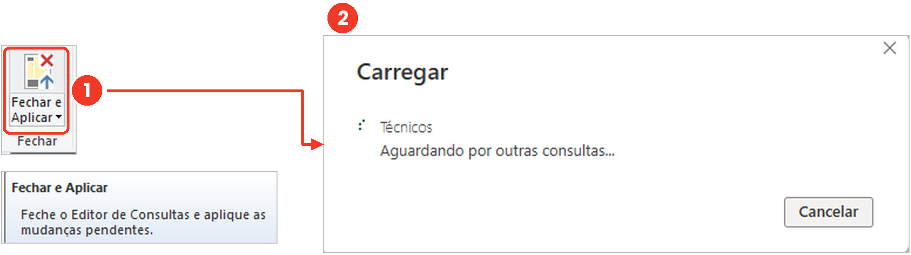
*Figura 17 (Figura 2.5): Fechar e Aplicar executa a receita de etapas e carrega as tabelas limpas no modelo.*

---

## Checkpoint do Dia 1 (Slide 32)
- [ ] Tabelas `OS` e `Equipamentos` importadas com os tipos de dados corretos no Power Query.
- [ ] Tratamento de `"6,0 h"` e conversão com **Localidade** praticados em `Exportacao_Forno_Tipos.csv`.
- [ ] Arquivo `.pbix` salvo com o gráfico de colunas de **Horas Paradas por Mês** funcionando com agregação implícita.
