# Roteiro de Apoio para Explicação dos Temas (Guia do Professor)
**Curso:** Power BI e DAX para Manutenção (CEDTEC Guarapari · Samarco)  
**Escopo:** Temas da Aula 2 (com foco em `Exportacao_OS_Lote2.csv` e `complemento_2-7.csv`, Seções 2.3 a 2.8) + Aula 3 Completa (Capítulo 3: Seções 3.1 a 3.9)  
**Objetivo deste Documento:** Servir como guia expositivo de sala de aula para o professor explicar **o porquê** de cada conceito, usando analogias do chão de fábrica da manutenção, perguntas provocativas, quadros de lousa e dinâmicas rápidas.

---

## Mapa Pedagógico da Explicação

```
┌────────────────────────────────────────────────────────────────────────────┐
│ BLOCO 1: DO SISTEMA BRUTO AO DADO LIMPO (Base: Exportacao_OS_Lote2.csv)    │
│ • Ruído de Relatório vs Dado Tabular (2.3)                                 │
│ • O Caos dos TAGs e Padronização de Chaves (2.4)                           │
│ • Teoria de Conjuntos nas Junções: Mesclar vs Acrescentar (2.6)            │
└────────────────────────────────────┬───────────────────────────────────────┘
                                     ▼
┌────────────────────────────────────────────────────────────────────────────┐
│ BLOCO 2: FORMA E QUALIDADE DOS DADOS (Base: complemento_2-7.csv)           │
│ • Despivotar (2.7): "Uma observação por linha" e a armadilha do Total      │
│ • Perfil de Dados (2.8): A "análise de óleo" antes de carregar no modelo   │
└────────────────────────────────────┬───────────────────────────────────────┘
                                     ▼
┌────────────────────────────────────────────────────────────────────────────┐
│ BLOCO 3: O MODELO ESTRELA E OS RELACIONAMENTOS (Seções 3.1 a 3.3)          │
│ • Fato vs Dimensão (3.1): Analogia do Histórico do Celular × Agenda        │
│ • Relacionamentos (3.2): A síndrome das barras iguais e a Válvula Check    │
│ • Hierarquias e Limpeza Visual (3.3): Drill-down e ocultação de chaves     │
└────────────────────────────────────┬───────────────────────────────────────┘
                                     ▼
┌────────────────────────────────────────────────────────────────────────────┐
│ BLOCO 4: VISUAIS, INTERATIVIDADE E GOVERNANÇA (Seções 3.4 a 3.9)           │
│ • Escolha do Visual pela Pergunta da Manutenção (3.4 a 3.6)                │
│ • Segmentações, Filtrar vs Realçar e Sincronização (3.7)                   │
│ • Publicação, Gateway Corporativo e o Caso das "Horas em Dobro" (3.8 e 3.9)│
└────────────────────────────────────────────────────────────────────────────┘
```

---

# BLOCO 1: Explicando a Limpeza de Dados (`Exportacao_OS_Lote2.csv`)
*Referência: Seções 2.2, 2.3, 2.4 e 2.6 da Apostila*

### 1.1. Relatório Formatado para Humanos × Tabela para Análise (Seção 2.3)
- **Como puxar o assunto na sala:**
  > *"Pessoal, quando vocês exportam um relatório lá do SAP ou do SIGMA na Samarco, ele já vem pronto para fazer conta ou ele vem 'enfeitado' para impressão?"*
- **A Explicação Conceitual:**
  - Mostre o arquivo `Exportacao_OS_Lote2.csv` aberto no bloco de notas ou projetado.
  - Aponte para as **4 primeiras linhas** (`SISTEMA INTEGRADO DE GESTÃO...`, `Período de Extração...`): explique que para o olho humano isso é contexto, mas para o Power BI isso é **sujeira estrutural** que empurra os nomes reais das colunas para baixo, gerando `Column1, Column2, Column3...`.
  - Aponte para a **última linha (`Total Geral`)**:
    > *"O que acontece se eu tiver 19 ordens de serviço somando 66,92 horas e deixar a linha 'Total Geral' dentro da tabela quando for montar um Cartão de Soma no Power BI?"*  
    > **Resposta esperada da turma:** O cartão vai mostrar o dobro (`133,84 horas`), porque ele vai somar as 19 linhas mais a linha do Total Geral!
  - Aponte para a **OS `51878` repetida nas linhas 14 e 15**:
    > *"Se a mesma OS saiu duas vezes na falha de exportação, é uma falha real dupla no guincho `PR-02` ou é erro de registro?"*  
    > Explique que na tabela Fato de OS, o `Número da OS` é a **identidade única** do evento. Duplicata de chave primária infla indicadores de MTTR, custo e quantidade de falhas.

---

### 1.2. O Problema dos TAGs Despadronizados (Seção 2.4)
- **A Pergunta Disparadora (Slide de Abertura):**
  Escreva no quadro branco:
  ```
  TR-01
  TR 01
  TR-02␣   (com espaço invisível no final)
  MO-02 - Moinho de bolas 2
  ```
  Pergunte: *"Na usina, quantos equipamentos físicos existem nas duas primeiras linhas?"* (Um só: a Torre/Transportador 01). *"E para o Power BI, quantos existem?"* (**Dois!**).
- **A Explicação Técnica Simplificada:**
  - O computador compara texto caractere por caractere (código ASCII). Um espaço (` `) é diferente de um hífen (`-`). E um espaço no final (`"TR-02 "`) tem 6 caracteres, enquanto `"TR-02"` tem 5!
  - Se não padronizarmos no Power Query com **Cortar (Trim)**, **Substituir Valores** e **Extrair Antes do Delimitador**, o gráfico de barras vai dividir as horas da mesma máquina em duas barras separadas, escondendo o verdadeiro vilão da manutenção!

---

### 1.3. Texto Misturado em Coluna Numérica: O Caso do `"5,5 h"` (Seção 2.2)
- **O Caso Real no Dataset:** Na linha da OS `51873` (Forno de grelha `FO-01`), o apontador escreveu `5,5 h` na coluna `Horas Paradas`.
- **Como Explicar:**
  - Coluna numérica só aceita algarismos e separador decimal. A letra `"h"` transforma o dado em **Texto (ABC)**.
  - Texto não soma! Se você forçar a conversão para Número Decimal sem limpar o `" h"` antes, o Power Query gera uma célula com `Error` (vermelho).
  - **Regra de ouro da aula:** *Primeiro limpa o texto (`Substituir Valores`), depois converte o tipo de dado!*

---

# BLOCO 2: Forma e Qualidade dos Dados (`complemento_2-7.csv`)
*Referência: Seções 2.7 e 2.8 da Apostila*

### 2.1. Conversão de Colunas em Linhas — Despivotar (Seção 2.7)
- **A Situação Real na Reunião de PCM:**
  Desenhe ou projete a estrutura do arquivo `complemento_2-7.csv`:
  | Equipamento | Descrição | Jan | Fev | Mar | Abr | Total |
  | :--- | :--- | :---: | :---: | :---: | :---: | :---: |
  | BR-01 | Britador primário | 14.5 | 8.0 | 12.0 | 16.5 | 51.0 |
  | MO-01 | Moinho de bolas 1 | 22.0 | 15.5 | 18.0 | 14.0 | 69.5 |

- **As Duas Perguntas que Travam o Aluno:**
  1. *"Se eu carregar essa tabela exatamente assim no Power BI e pedir um gráfico de linhas mostrando a evolução de Janeiro até Abril no Eixo X, qual coluna eu arrasto para o Eixo X?"*  
     ➔ **Silêncio na sala!** Não existe a coluna `Mês`! O mês está espalhado no cabeçalho de 4 colunas diferentes.
  2. *"E quando chegar o fechamento de Maio e alguém colocar mais uma coluna 'Mai' lá no Excel?"*  
     ➔ Você teria que abrir o Power BI e arrastar manualmente a nova coluna em todos os visuais.

- **A Regra de Ouro ("Uma Observação por Linha"):**
  - Em banco de dados e BI, **lugar de dado é na linha, não no cabeçalho**.
  - O comando **Transformar outras colunas em linhas** (*Unpivot Other Columns*) pega as colunas de meses e "tomba" na vertical, criando duas colunas:
    - `Atributo` (que renomeamos para **Mês**)
    - `Valor` (que renomeamos para **Horas Paradas**)

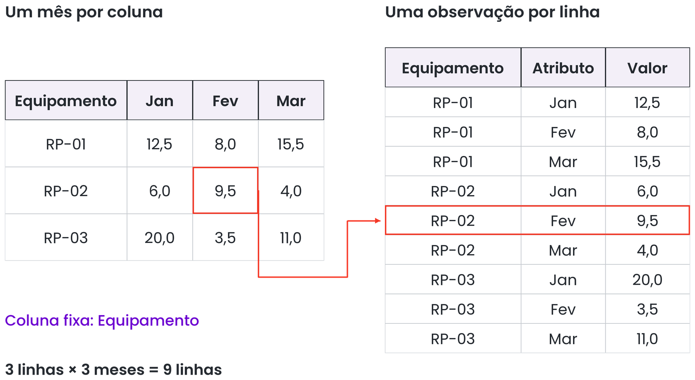
*Guia Visual 1 (Figura 2.20 da Apostila): Como o comando desdobra a matriz horizontal em linhas verticais.*

- **A Pegadinha Crucial para Destacar na Explicação:**
  - **Por que clicar em `Equipamento` e `Descrição` e escolher *"Transformar OUTRAS colunas em linhas"* em vez de selecionar `Jan, Fev, Mar, Abr` e clicar em *"Transformar colunas em linhas"*?**
  - *Explicação:* Quando você escolhe **"Transformar outras colunas em linhas"**, a regra gravada na etapa é: *"Mantenha Equipamento e Descrição fixos, e transforme tudo o que vier ao lado em linhas"*. Assim, quando Maio, Junho e Julho entrarem na planilha, eles entram automaticamente no gráfico sem ninguém mexer no Power BI!
  - **Cuidado com a coluna `Total`:** Lembre de explicar por que deletamos a coluna `Total` antes de despivotar (para que `"Total"` não vire um 5º mês fictício dobrando as horas do quadrimestre).

---

### 2.2. Perfil e Qualidade das Colunas (Seção 2.8)
- **A Analogia da Manutenção Preditiva (Análise de Óleo):**
  > *"Ninguém libera um moinho de bolas para rodar depois de uma grande parada sem checar a contaminação do óleo e alinhamento. No Power Query, a guia Exibição tem o nosso 'laboratório de inspeção' antes de dar Carga para o relatório."*

- **O que Explicar nos 3 Recursos da Guia Exibição:**
  1. **Qualidade da Coluna:** Mostra a saúde imediata em 3 cores:
     - 🟢 **Válido:** Dado limpo e pronto.
     - 🔴 **Erro:** Falha de conversão de tipo (ex: o `"5,5 h"` se não fosse limpo).
     - ⚪ **Vazio (Null):** Campo sem preenchimento (ex: `Data de Encerramento` vazia numa OS que ainda está `Aberta` — o que é normal! Mas um `Equipamento` vazio é erro grave de apontamento).

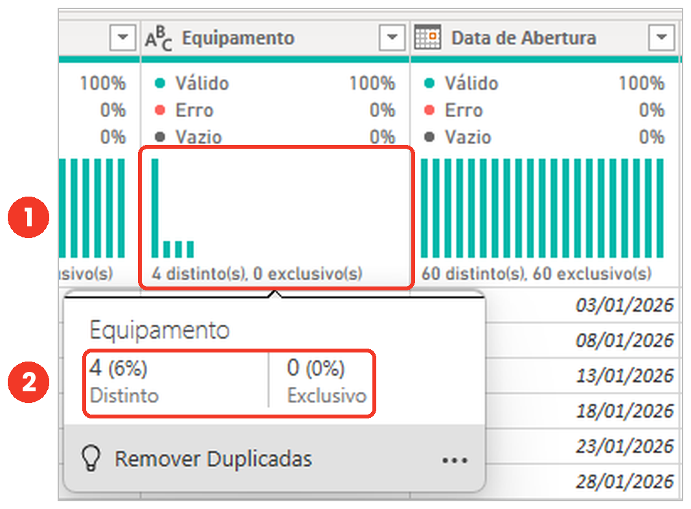
*Guia Visual 2 (Figura 2.22 da Apostila): A barra de qualidade denuncia erros e vazios imediatamente abaixo do cabeçalho.*

  2. **Distribuição de Colunas (Distintos × Únicos):**
     - *Essa distinção sempre cai em prova e gera dúvida! Explique no quadro:*
     - Imagine a lista de TAGs nas OS: `BR-01, BR-01, MO-01, FO-01`.
     - **Distintos (3):** Quantos equipamentos diferentes existem na lista? Três (`BR-01`, `MO-01`, `FO-01`).
     - **Únicos (2):** Quantos equipamentos apareceram **uma única vez** sem repetir? Apenas dois (`MO-01` e `FO-01`).
     - *Aplicação prática:* Na tabela Dimensão `Equipamentos`, o número de **Distintos** e **Únicos** na coluna `Equipamento` TEM que ser igual ao total de linhas! Se houver diferença, há cadastro duplicado.

  3. **Perfil da Coluna e a Armadilha das 1.000 Linhas:**
     - Mostra estatísticas (Mínimo, Máximo, Média, Desvio Padrão). Se aparecer `Mínimo: -4,5 horas` em Horas Paradas, você já descobre na hora uma OS onde digitaram a hora de fim menor que a hora de início!
     - **Alerta obrigatório:** Mostre o rodapé esquerdo (`Criação de perfil com base nas primeiras 1.000 linhas`) e explique que em bases grandes da Samarco é preciso trocar para **Conjunto de dados inteiro** para não deixar passar erros na linha 2.500.

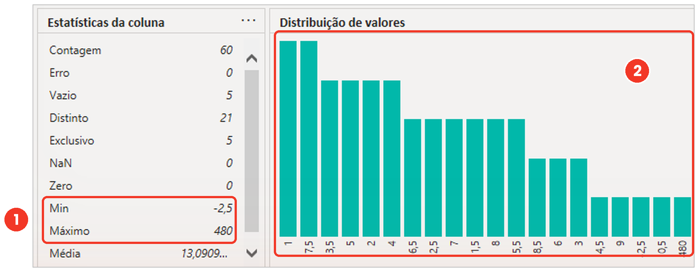
*Guia Visual 3 (Figura 2.24 da Apostila): O painel de estatísticas aponta valores negativos ou fora de escala antes da carga.*

---

# BLOCO 3: O Modelo de Dados e Esquema Estrela (Seções 3.1 a 3.3)
*Transição da limpeza (Power Query) para a modelagem (Power BI Desktop)*

### 3.1. Tabelas Fato e Dimensão no Esquema Estrela (Seção 3.1)
- **A Analogia Imbatível: Histórico de Chamadas × Agenda do Celular**
  - Pergunte à turma: *"Quando um colega da usina te liga, o histórico de chamadas do seu celular grava o nome completo, a foto e o cargo dele repetidos a cada ligação?"*
  - **Não!** O histórico grava só: `Número + Data/Hora + Duração`.
  - Onde mora o nome, a foto e a área dele? Na **Agenda de Contatos**, escrito **uma única vez**!
  - Quando a ligação entra, o celular junta o histórico com a agenda usando o **Número** como chave.

- **Quadro Comparativo para Desenhar na Lousa:**

| Característica | Tabela FATO (Ex: `OS`) | Tabela DIMENSÃO (Ex: `Equipamentos`, `Calendario`) |
| :--- | :--- | :--- |
| **Papel na Manutenção** | Registra os **eventos/acontecimentos** (ordens de serviço, falhas, paradas). | Descreve os **cadastros/contextos** (quem é a máquina, qual é a área, qual é o dia). |
| **Granularidade** | Uma linha por evento (1 linha = 1 OS). Cresce todo dia (milhares de linhas). | Uma linha por item único (1 linha = 1 Equipamento). Pequena e estável. |
| **Tipo de Colunas** | Números que fazem sentido somar (`Horas Paradas`, `Custo R$`) + Chaves. | Textos e atributos usados para **filtrar e agrupar** (`Área`, `Criticidade`, `Mês`). |
| **Comportamento da Chave** | A chave **se repete** várias vezes (`BR-01` teve 30 OS no ano). | A chave é **única / sem repetição** (`BR-01` cadastrado 1 só vez). |

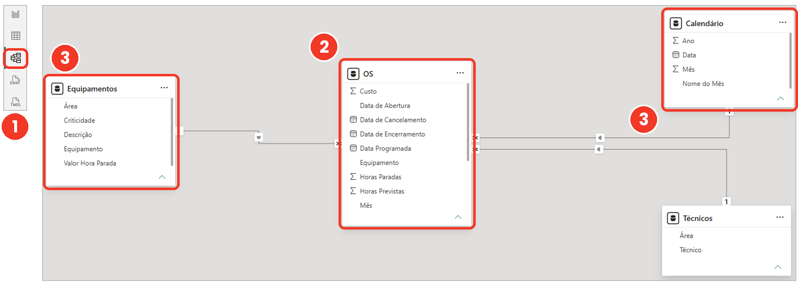
*Guia Visual 4 (Figura 3.3 da Apostila): O Esquema Estrela na Exibição de Modelo — Fato OS no centro cercada pelas Dimensões.*

---

### 3.2. Relacionamentos, Cardinalidade e Direção do Filtro (Seção 3.2)
- **O Sintoma Clássico ("Por que todas as barras ficaram do mesmo tamanho?"):**
  - Conte aos alunos: *"Metade de quem monta o primeiro gráfico de Horas Paradas por Área leva um susto: Britagem aparece com 2.500h, Moagem com 2.500h, Pelotização com 2.500h... Todas as barras da mesma altura!"*
  - **Por que isso acontece?** Porque o aluno pegou `Área` da tabela `Equipamentos` e `Horas Paradas` da tabela `OS`, mas **não ligou as duas tabelas**! Sem a ponte (relacionamento), o filtro de Área não chega na tabela de OS.

- **Como Explicar Cardinalidade (`1:*`) e Direção do Filtro (`Único`):**
  - **Cardinalidade `1:*` (Um para Muitos):** Na ponta `1` fica a Dimensão (`Equipamentos`, onde o TAG é único); na ponta `*` fica a Fato (`OS`, onde o TAG aparece muitas vezes).
  - **A Analogia da Válvula de Retenção (*Check Valve*) para o Filtro Único:**
    - Na hidráulica industrial, a válvula de retenção deixa o fluido passar num sentido e bloqueia o retorno.
    - No relacionamento com direção **Único**, a seta na linha aponta da **Dimensão (`1`) para a Fato (`*`)**.
    - Quando você clica na área `"Britagem"` na Dimensão, o filtro atravessa a ponte e filtra as OS da Britagem. Mas o caminho inverso fica fechado, protegendo o modelo!

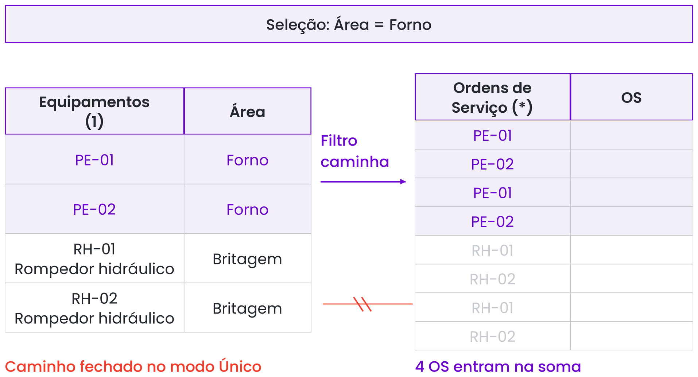
*Guia Visual 5 (Figura 3.5 da Apostila): No filtro único, a seleção na dimensão filtra a fato; o caminho inverso permanece bloqueado.*

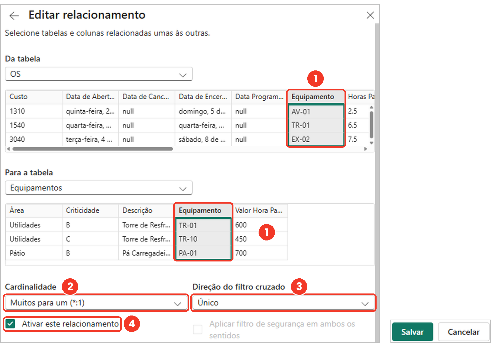
*Guia Visual 6 (Figura 3.4 da Apostila): Configuração correta — Muitos para um (*:1) e Direção única.*

- **Por que NÃO usar Direção "Ambas" (Bidirecional) por padrão?**
  - Quando adicionamos mais tabelas (como `Metas por Área` ou `Técnicos`), o filtro "Ambas" cria múltiplos caminhos entre as mesmas tabelas (um anel fechado). O Power BI trava com erro de ambiguidade ou fica lento.

---

### 3.3. Hierarquias e Organização dos Campos (Seção 3.3)
- **O Conceito de Hierarquia (`Área > Equipamento`):**
  - Explique que o gerente olha a **Área** (ex: *Britagem*), o supervisor olha o **Equipamento** (ex: *BR-01*), e o engenheiro olha o **Subconjunto**.
  - Criar uma hierarquia empacota essa escada num objeto só. Com as setinhas no topo do gráfico (**Drill Down**), o gestor clica em `"Britagem"` e o mesmo gráfico se abre mostrando apenas as máquinas da Britagem (`BR-01`, `BR-02`, `PN-01`)!

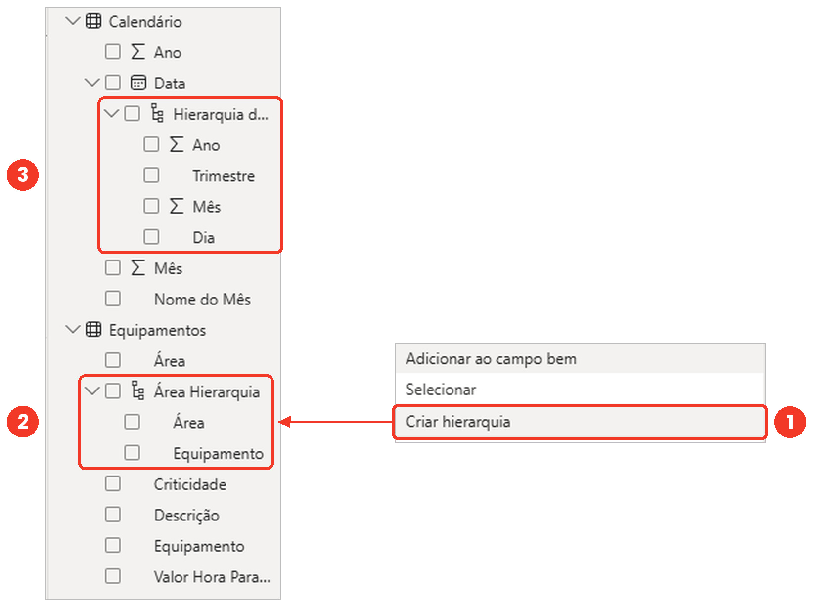
*Guia Visual 7 (Figura 3.7 da Apostila): A hierarquia organiza os níveis de navegação de forma nativa.*

- **Por que Ocultar Colunas Técnicas (Olho Cortado)?**
  - Pergunte: *"Se a coluna `Equipamento` existe tanto na tabela `Equipamentos` quanto na tabela `OS`, qual das duas o usuário deve arrastar para o gráfico?"*
  - **Sempre a da Dimensão (`Equipamentos`)!** Se ele arrastar a da Fato, equipamentos que tiveram zero falhas no mês nem aparecem na lista, e filtros cruzados quebram.
  - Por isso clicamos com o botão direito em `OS[Equipamento]` e escolhemos **Ocultar da visualização de relatório**. Ela continua fazendo a ponte por trás dos panos, mas não confunde quem monta os visuais.

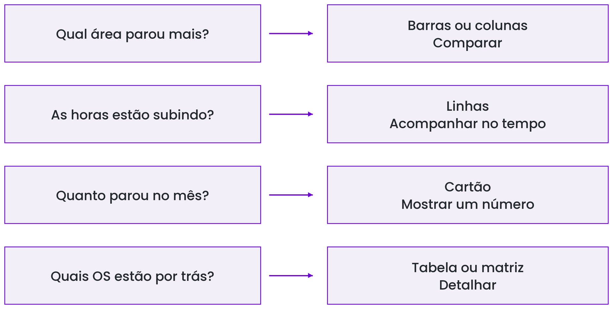
*Guia Visual 8 (Figura 3.8 da Apostila): Ocultar as chaves da tabela fato deixa o painel de Dados limpo e à prova de erros.*

---

# BLOCO 4: Visuais, Interatividade e Publicação (Seções 3.4 a 3.9)
*Construindo o Painel que Responde Perguntas em 30 Segundos*

### 4.1. Escolha do Visual pela Pergunta da Manutenção (Seção 3.4)
- **Dinâmica de Sala ("Jogo Pergunta ➔ Visual"):**
  Antes de falar a teoria, jogue 4 perguntas rápidas para a turma e peça para eles escolherem qual visual usariam:
  1. *"Qual foi o total exato de horas paradas da usina no mês?"* ➔ **Cartão** (1 número só, grande e direto).
  2. *"Qual equipamento mais parou no trimestre, do pior para o melhor?"* ➔ **Gráfico de Barras / Colunas** (comparação e ranking).
  3. *"A indisponibilidade do resfriador RA-01 está subindo ou caindo desde janeiro?"* ➔ **Gráfico de Linhas** (evolução contínua no tempo).
  4. *"Quero ver o cruzamento das Áreas nas linhas com os Tipos de Manutenção nas colunas, destacando onde há mais horas."* ➔ **Matriz com Formatação Condicional**.

- **A Ordem de Leitura na Tela (Layout do Painel):**
  - Explique que lemos uma tela em "Z" (de cima para baixo, da esquerda para a direita):
    - **Topo:** Cartões com os grandes números de resumo (Horas Paradas, Quantidade de OS, Custo).
    - **Esquerda (ou faixa superior):** Segmentações de dados (filtros de Ano, Mês, Área).
    - **Centro:** Gráficos de comparação (Barras) e tendência no tempo (Linhas).
    - **Base (Rodapé):** Matriz ou Tabela de detalhe das OS.

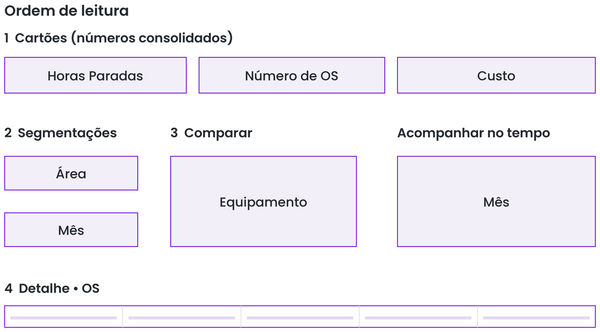
*Guia Visual 9 (Figura 3.11 da Apostila): Arquitetura ideal de uma página de relatório de manutenção.*

---

### 4.2. Gráficos de Barras, Colunas e Linhas (Seção 3.5)
- **A Diferença entre Empilhado × Clusterizado (Agrupado):**
  - **Empilhado:** Coloca Preventiva e Corretiva uma em cima da outra na mesma barra. Bom para ver o **total geral da Área** e ter noção da fatia de cada tipo.
  - **Clusterizado (Agrupado):** Coloca a barra da Corretiva ao lado da barra da Preventiva. Ideal quando a pergunta é: *"Na Moagem, fizemos mais horas de corretiva ou de preventiva?"* (comparar alturas lado a lado é muito mais fácil).

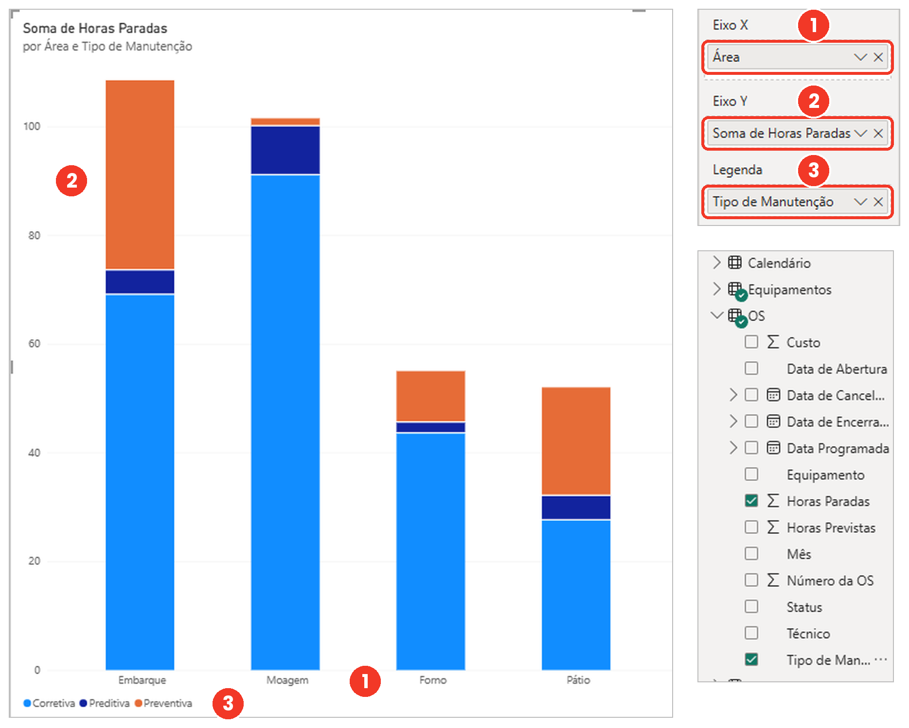
*Guia Visual 10 (Figura 3.12 da Apostila): Anatomia do visual — Eixo X (categoria), Eixo Y (valor numérico) e Legenda (divisão por cor).*

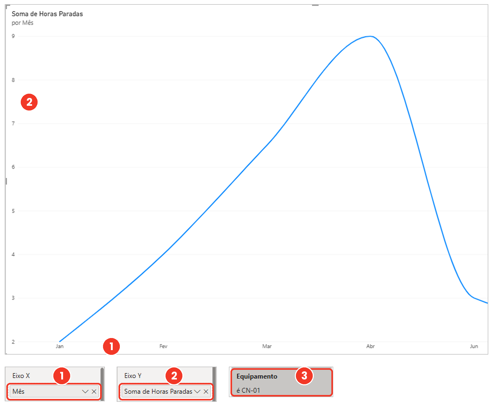
*Guia Visual 11 (Figura 3.13 da Apostila): O gráfico de linhas exige o tempo ordenado no eixo X para revelar tendências.*

- **Agregação Implícita (Resumo do Campo):**
  - Mostre que quando arrastamos `Horas Paradas` para um visual, o Power BI aplica **Soma** automaticamente. Mas clicando na setinha do campo, podemos trocar para **Média** (ex: tempo médio de reparo por OS) ou **Contagem** (quantidade de OS).

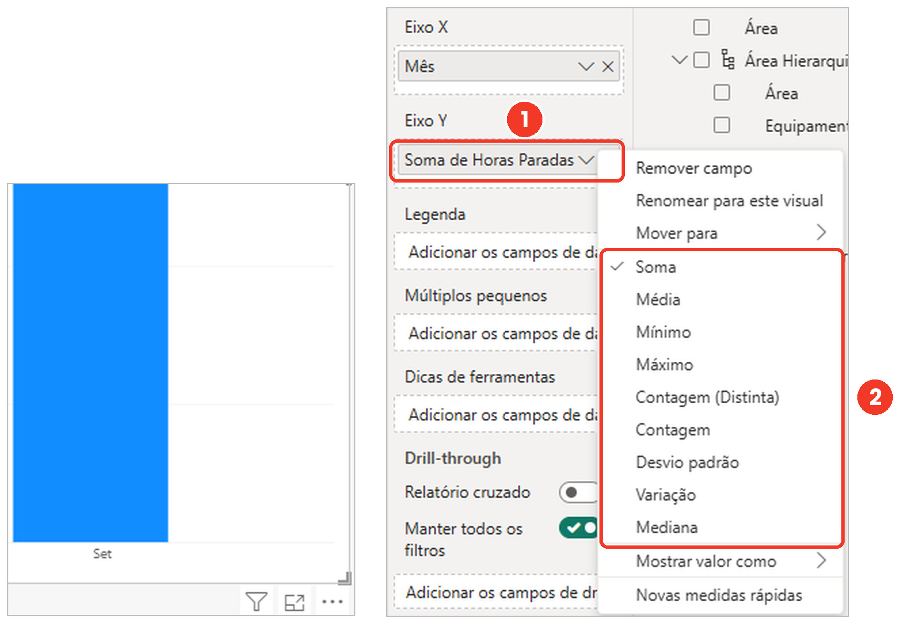
*Guia Visual 12 (Figura 3.15 da Apostila): Trocando a agregação padrão de Soma para Média ou Contagem.*

---

### 4.3. Cartão e Matriz com Formatação Condicional (Seção 3.6)
- **Tabela × Matriz:**
  - *Tabela:* Apenas lista colunas lado a lado (Número da OS, Data, Equipamento, Horas).
  - *Matriz:* É a "Tabela Dinâmica" do Power BI. Cruza duas dimensões (ex: `Área` nas linhas $\times$ `Tipo de Manutenção` nas colunas) e resume o número no meio.
- **Formatação Condicional (O Semáforo Visual):**
  - Explique que ninguém quer ler 50 números numa tabela às 7h da manhã na reunião diária.
  - Usando **Cor de Fundo**, **Barras de Dados** ou **Ícones**, o olho bate direto na célula vermelha ou na maior barra.

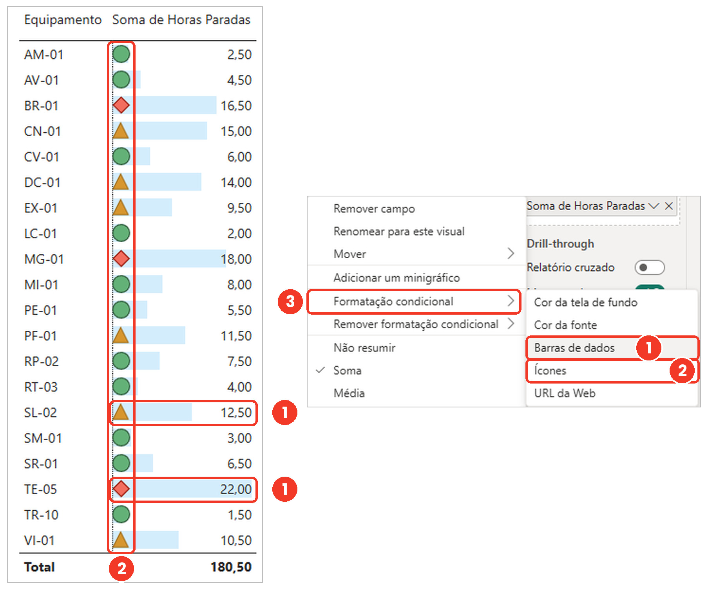
*Guia Visual 13 (Figura 3.19 da Apostila): Barras de dados proporcionais e ícones de alerta aplicados dentro da matriz.*

---

### 4.4. Segmentação de Dados, Filtros e Interações (Seção 3.7)
- **Segmentação de Dados × Painel Filtros:**
  - **Segmentação (Slicer):** Fica no palco do relatório para qualquer operador clicar (Ano, Mês, Criticidade).
  - **Painel Filtros:** Fica na lateral direita, dividido em 3 níveis de alcance:
    1. *Filtros neste visual* (afeta só um gráfico específico).
    2. *Filtros nesta página* (afeta toda a aba atual).
    3. *Filtros em todas as páginas* (afeta o relatório inteiro — ótimo para fixar uma regra global, como excluir OS `Canceladas`).

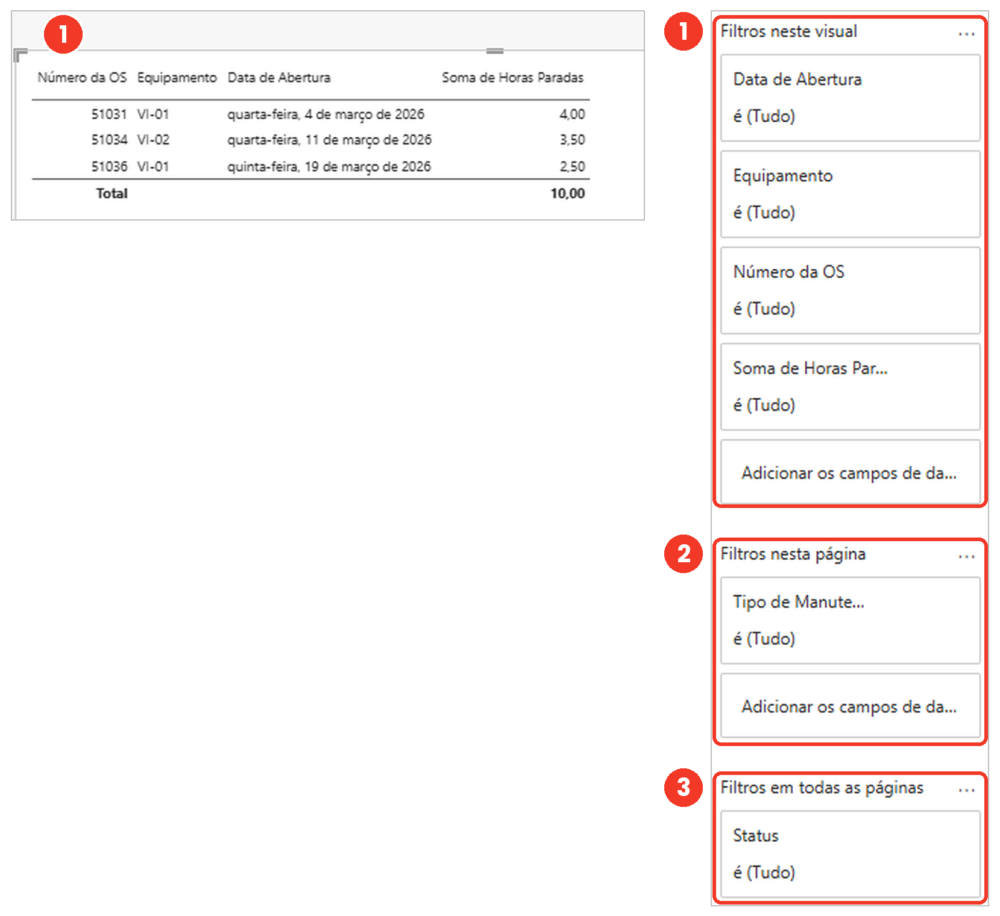
*Guia Visual 14 (Figura 3.21 da Apostila): Os três níveis de escopo do painel Filtros.*

- **Editar Interações: Filtrar × Realçar:**
  - Explique o incômodo do padrão **Realçar (Highlight)**: quando você clica numa área, as outras barras ficam meio transparentes e a linha do tempo fica difícil de ler.
  - Mostre como ir em `Formato > Editar Interações` e clicar no ícone de **Funil (Filtrar)** para que todo o painel recalcule os eixos exclusivamente para o item clicado.

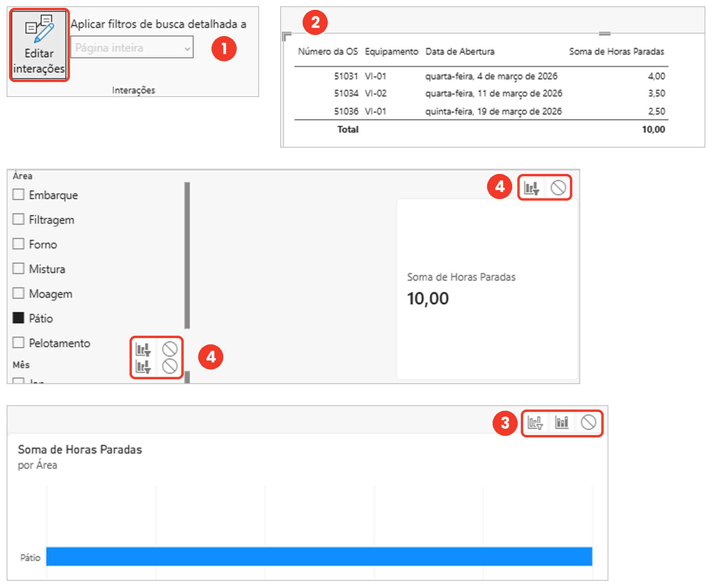
*Guia Visual 15 (Figura 3.20 da Apostila): Controles no canto superior do visual (Filtrar, Realçar e Nenhum).*

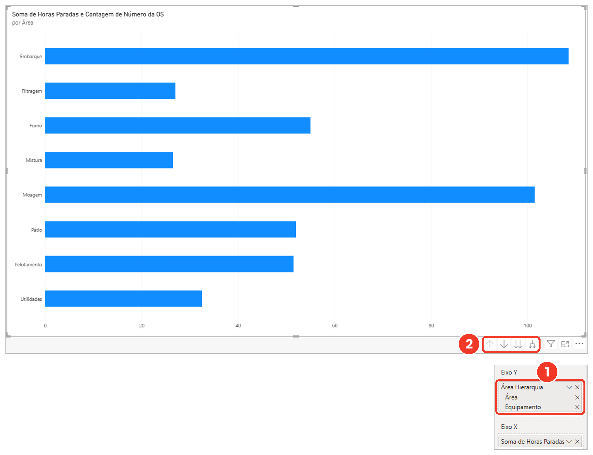
*Guia Visual 16 (Figura 3.23 da Apostila): Funcionamento de cada seta de navegação de hierarquia (Drill up e Drill down).*

---

### 4.5. Publicação no Serviço do Power BI e Gateways (Seção 3.8)
- **Por que não mandar o arquivo `.pbix` por e-mail ou WhatsApp?**
  1. Pesado e inseguro (qualquer um pode apagar uma etapa ou mudar um número).
  2. Nasce velho: amanhã entram novas OS e o arquivo enviado ontem está desatualizado.
- **A Arquitetura na Nuvem (Power BI Service):**
  - Ao clicar em **Publicar**, o Desktop envia duas coisas para o **Espaço de Trabalho (Workspace)** na nuvem: o **Modelo Semântico** (dados + relacionamentos) e o **Relatório** (páginas visuais).
  - **Diferença entre Relatório e Dashboard (Painel):**
    - *Relatório:* Tem várias páginas, filtros, drill-down, criado no Desktop.
    - *Dashboard:* Uma tela única criada só na nuvem, onde o gerente "pina" (fixa) o cartão de disponibilidade de um relatório e o gráfico de custo de outro relatório para acompanhar no celular.

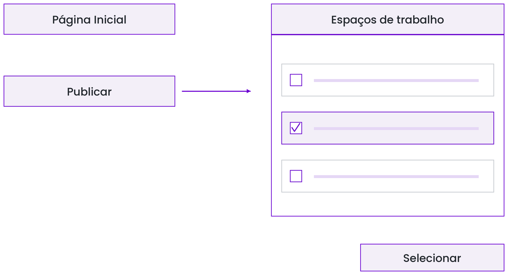
*Guia Visual 17 (Figura 3.26 da Apostila): Publicando do Power BI Desktop para um Espaço de Trabalho na nuvem.*

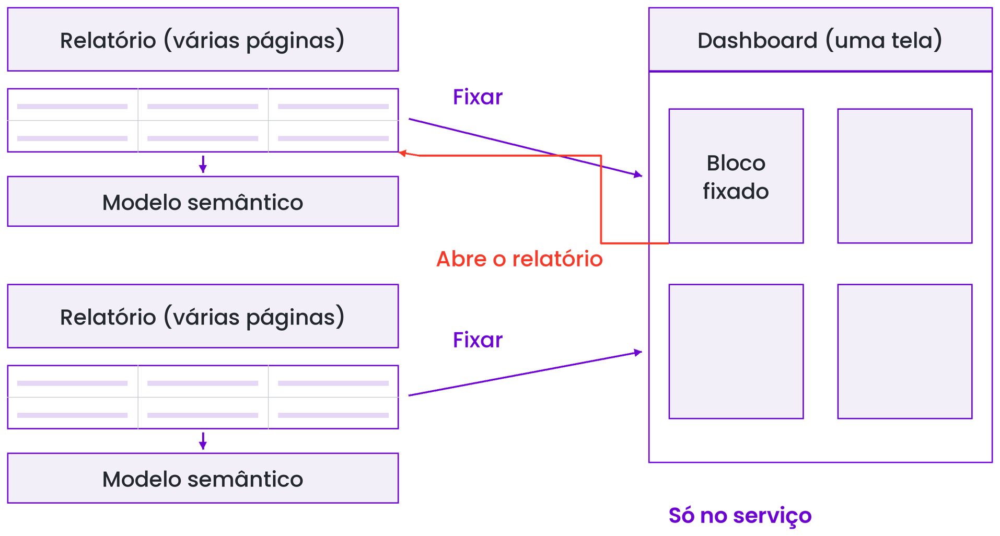
*Guia Visual 18 (Figura 3.27 da Apostila): O modelo semântico abastece o relatório (multipáginas), que cede blocos ao dashboard (tela única).*

- **O Papel do Gateway (Como a nuvem lê a rede interna da Samarco?):**
  - A nuvem da Microsoft está fora da empresa; a pasta com a exportação do SIGMA está dentro do servidor da Samarco.
  - O **Gateway de Dados** é a ponte segura que busca o dado atualizado todo dia no horário agendado.
  - **Gateway Pessoal vs Padrão (Empresarial):**

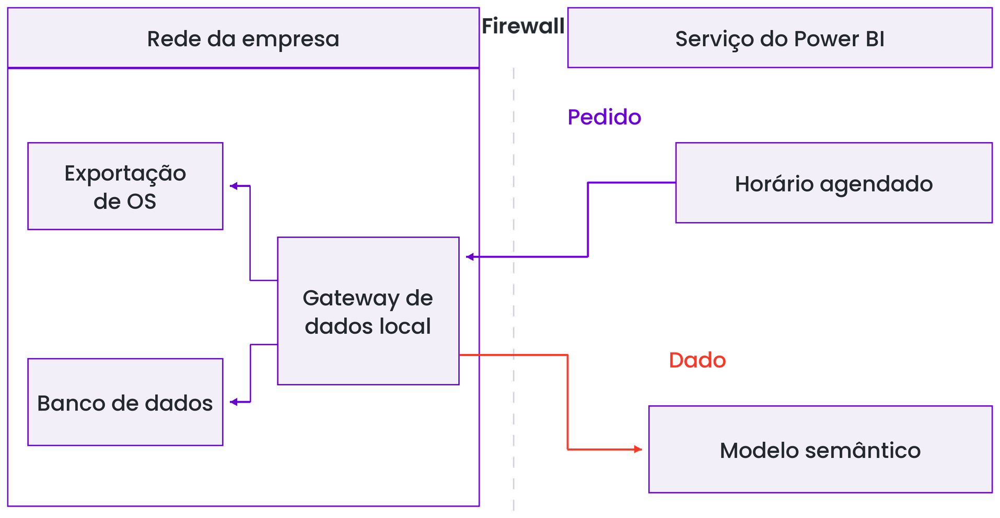
*Guia Visual 19 (Figura 3.29 da Apostila): Fluxo de atualização agendada através do gateway corporativo.*

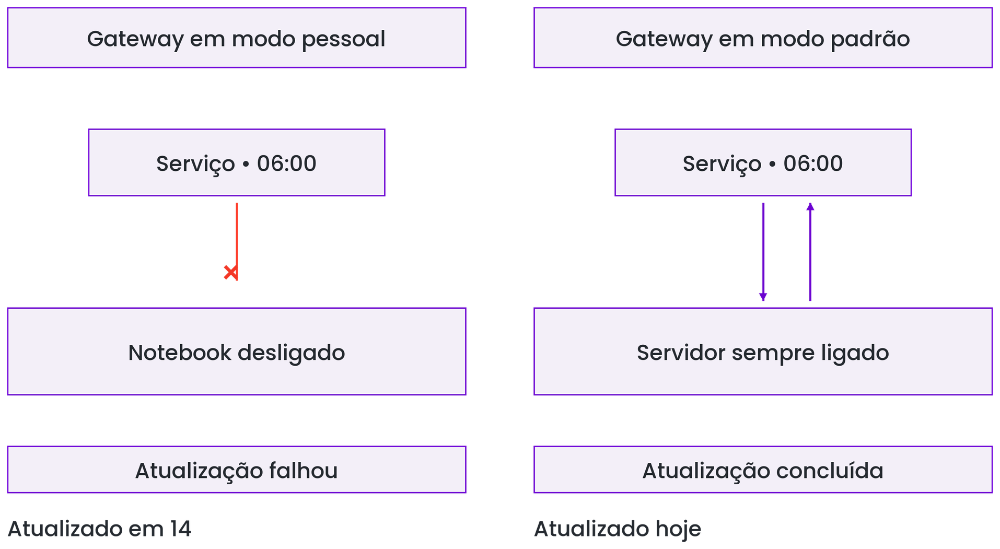
*Guia Visual 20 (Figura 3.31 da Apostila): O gateway pessoal falha se o notebook do analista estiver desligado; o padrão roda no servidor 24/7.*

---

### 4.6. Casos Integrados de Fechamento (Seção 3.9)
Para fechar a explicação com chave de ouro, conte os dois casos reais da apostila como histórias de investigação:

#### Caso 1: O Mistério das "Horas em Dobro" (Granularidade Quebrada)
- **A História:**
  - Em março, o relatório oficial tinha **48 OS** somando **92,0 horas paradas**.
  - O supervisor pediu para ver o nome do técnico no painel. O analista tinha uma planilha de alocação (`Número da OS | Técnico | Turno`).
  - Ele usou **Mesclar Consultas** no Power Query para puxar o `Técnico` para dentro da tabela `OS`.
  - Quando carregou o painel, o cartão de Horas Paradas saltou de **92,0 h** para **131,5 h**!
- **Pergunta para a Turma:** *"De onde brotaram essas 39,5 horas fantasmas?"*
- **A Descoberta:**
  - 15 daquelas 48 OS foram executadas por **dupla de técnicos** (2 linhas para a mesma OS na planilha de alocação).
  - Ao expandir a coluna `Técnico` dentro da tabela `OS`, cada uma dessas 15 OS duplicou de linha! As 48 linhas viraram **63 linhas**, repetindo as horas paradas da OS para cada técnico!
- **A Solução Correta:**
  - Nunca misturar granularidades diferentes numa mesma tabela fato! A tabela `OS` deve continuar com 1 linha por OS (48 linhas), e a tabela de `Alocação` entra como uma tabela separada no modelo ligada pelo `Número da OS`.

#### Caso 2: O Painel que Parou no Dia 14 (Governança e Qualidade)
- **A História:**
  - Na reunião do dia 20, o gerente reclama que uma corretiva grande do dia 16 não aparece no painel. Além disso, no filtro de Área aparecem duas opções: `"Utilidades"` e `"Utilidades "` (com espaço).
- **Diagnóstico com a Turma:**
  1. *Por que parou no dia 14?* O analista configurou a atualização agendada num **Gateway Pessoal** instalado no próprio notebook e saiu de férias no dia 14 com o computador na mochila!
  2. *Por que a área duplicou?* Faltou aplicar o **Cortar (Trim)** no Power Query e faltou conferir a **Distribuição de Colunas (2.8)** antes de publicar.

---

## Resumo Rápido de Perguntas para Fixação em Sala (Debate Final)

1. **"Por que usamos 'Transformar outras colunas em linhas' em vez de 'Transformar colunas selecionadas' na planilha mensal?"**  
   *Gabarito:* Para que os novos meses (Maio, Junho...) entrem automaticamente na atualização sem precisar editar a consulta.
2. **"Qual o sintoma imediato no gráfico quando fazemos um visual usando campos de duas tabelas que não têm relacionamento?"**  
   *Gabarito:* Todas as barras ficam da mesma altura, repetindo o total geral para todas as categorias.
3. **"Por que ocultamos a coluna `Equipamento` do lado da tabela Fato (`OS`)?"**  
   *Gabarito:* Para obrigar quem constrói o relatório a usar a coluna `Equipamento` da tabela Dimensão (`Equipamentos`), garantindo que o filtro flua corretamente no sentido `1 ➔ *`.
4. **"Qual a conferência obrigatória que todo analista deve fazer antes de publicar o painel?"**  
   *Gabarito:* Conferir a contagem de linhas da tabela Fato e a soma total do Cartão contra a exportação de origem para garantir que nenhuma mesclagem duplicou linhas.
