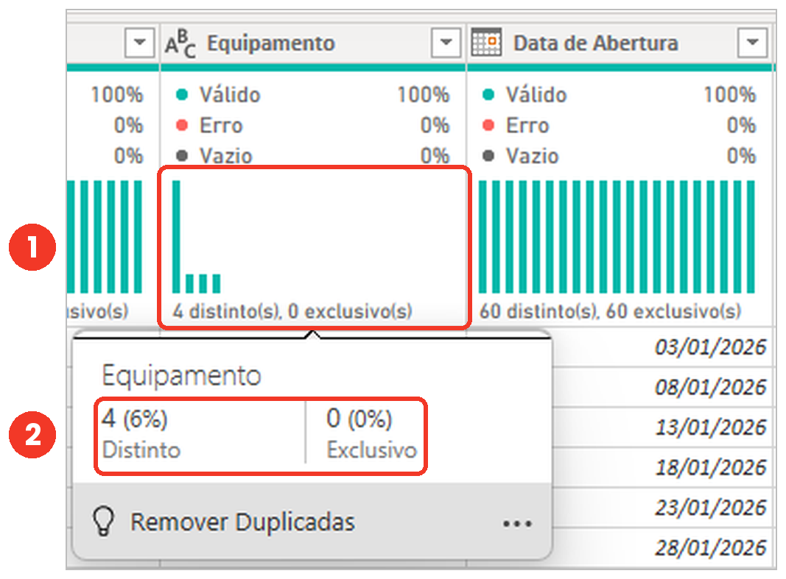
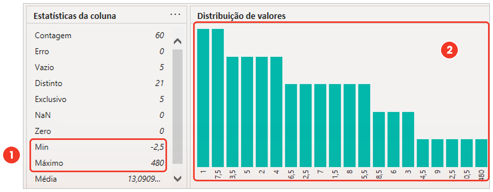
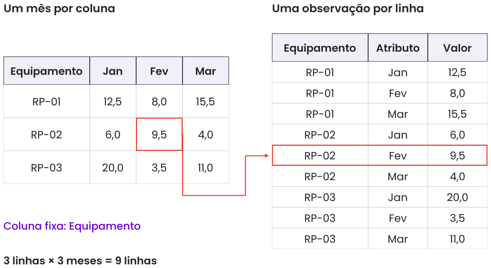
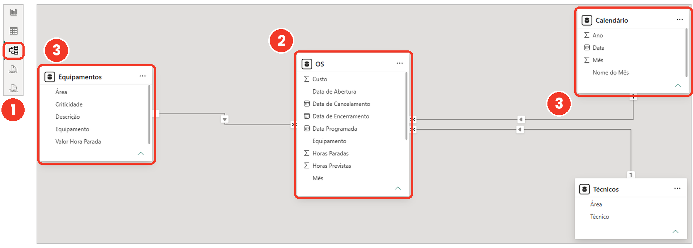
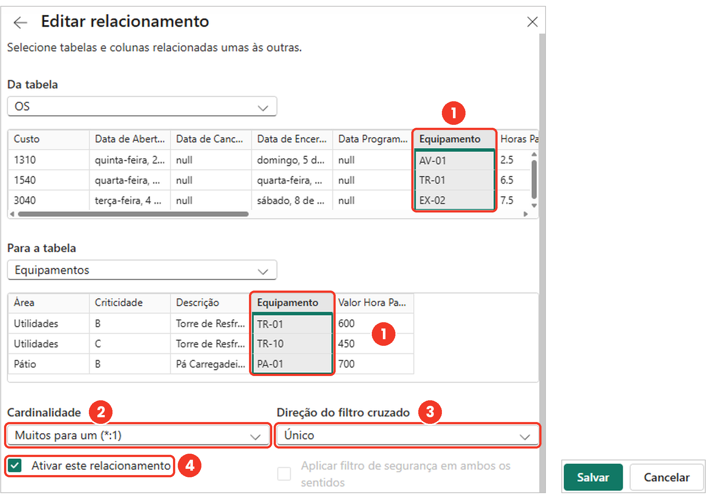
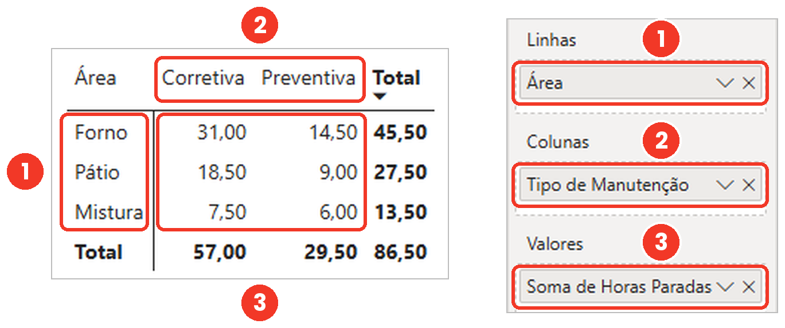
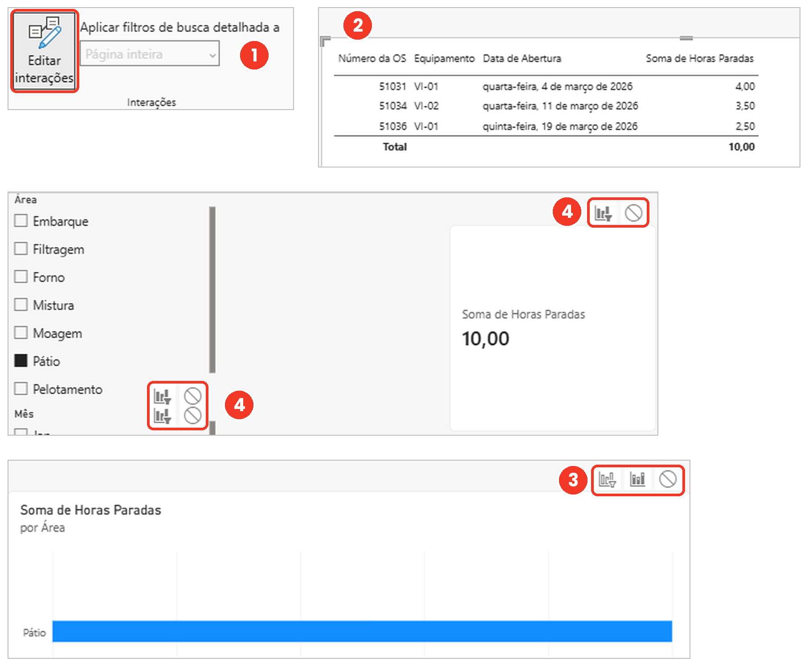

# Roteiro Prático: Interação com os Datasets da Aula 2 no Power BI Desktop
**Curso:** Power BI e DAX para Manutenção (CEDTEC Guarapari · Samarco)  
**Módulos de Referência:** Seções 2.3 a 2.8 (Tratamento e Perfil de Dados) e Capítulo 3 (Modelo e Visuais)  
**Arquivos de Dados:**
- [`Dataset/Aula 2/Exportacao_OS_Lote2.csv`](./Exportacao_OS_Lote2.csv) *(Exportação bruta com ruídos do SIGMA)*
- [`Dataset/Aula 2/complemento_2-7.csv`](./complemento_2-7.csv) *(Matriz horizontal com meses em colunas)*

---

## Visão Geral do Fluxo de Trabalho

```
   ┌────────────────────────────────┐         ┌────────────────────────────────┐
   │    Exportacao_OS_Lote2.csv     │         │       complemento_2-7.csv      │
   └───────────────┬────────────────┘         └───────────────┬────────────────┘
                   │                                          │
        [1. Limpar Cabeçalho SIGMA]                 [1. Remover Coluna Total]
        [2. Remover Rodapé Total]                             │
        [3. Excluir Duplicatas]                     [2. Despivotar Colunas]
        [4. Padronizar TAGs (TR-01)]                (Transformar outras em linhas)
        [5. Tratar texto '5,5 h']                             │
        [6. Validar no Perfil 2.8]                  [3. Renomear e Tipar]
                   │                                          │
                   ▼                                          ▼
   ┌────────────────────────────────┐         ┌────────────────────────────────┐
   │  Tabela OS Pronta e Confiável  │         │  Tabela Tabular Vertical (24L) │
   └───────────────┬────────────────┘         └───────────────┬────────────────┘
                   │                                          │
                   └────────────────────┬─────────────────────┘
                                        ▼
                          ┌───────────────────────────┐
                          │    MODELO E VISUAIS       │
                          │  - Esquema Estrela (3.1)  │
                          │  - Relacionamentos (3.2)  │
                          │  - Matriz & Gráficos(3.6) │
                          └───────────────────────────┘
```

---

# PARTE 1: Tratamento de `Exportacao_OS_Lote2.csv`
*(Limpeza de exportação suja, padronização de chaves e conferência no Perfil de Dados)*

### Cenário de Manutenção
A exportação do sistema SIGMA da usina contém problemas típicos gerados por relatórios corporativos:
- Metadados institucionais nas primeiras 4 linhas.
- Uma linha de rodapé com somatórios parciais (`Total Geral`).
- A OS `51878` cadastrada duas vezes (duplicada).
- TAGs de máquinas escritos de três formas distintas: `TR 01` (sem hífen), `TR-02 ` (com espaço no final) e `MO-02 - Moinho de bolas 2` (com a descrição concatenada).
- Apontamento incorreto na coluna `Horas Paradas`: `5,5 h` misturando texto e número.

---

### Passo 1: Importar o Arquivo no Power Query
1. Abra o **Power BI Desktop**.
2. Na guia **Página Inicial**, clique em **Obter Dados** ➔ **Texto/CSV**.
3. Selecione o arquivo `Exportacao_OS_Lote2.csv` na pasta `Dataset/Aula 2/`.
4. Na janela de diálogo de pré-visualização, **não** clique em Carregar. Clique em **Transformar Dados**.

---

### Passo 2: Eliminar o Cabeçalho de Relatório do SIGMA
1. Na guia **Página Inicial** do Editor do Power Query, localize o grupo *Reduzir Linhas*.
2. Clique em **Remover Linhas** ➔ **Remover Linhas Principais**.
3. No campo *Número de linhas*, digite: `4` e clique em **OK**.
4. Agora que os nomes das colunas estão na primeira linha, clique em:  
   👉 **Usar a Primeira Linha como Cabeçalho** (na guia *Página Inicial*).

---

### Passo 3: Eliminar o Rodapé (`Total Geral`)
1. No grupo *Reduzir Linhas*, clique em **Remover Linhas** ➔ **Remover Linhas Inferiores**.
2. No campo *Número de linhas*, digite: `1` e clique em **OK**.
   > [!TIP]
   > Alternativa recomendada: você também pode clicar na seta de filtro da coluna `Número da OS` e desmarcar a opção `"Total Geral"`. Isso garante a exclusão mesmo se o arquivo vier com mais linhas no rodapé.

---

### Passo 4: Eliminar Linhas Duplicadas (OS 51878)
1. Clique com o botão esquerdo no cabeçalho da coluna **Número da OS** para selecioná-la.
2. Clique com o botão direito sobre o cabeçalho ➔ selecione **Remover Duplicadas**.
   - *Conferência:* A OS `51878` do redutor de guincho `PR-02` agora aparece em apenas uma linha.

---

### Passo 5: Padronizar os Códigos de Equipamento (TAGs) — Seção 2.4
Com a coluna **Equipamento** selecionada, execute as 3 etapas de saneamento:

1. **Remover espaços extras invisíveis (`TR-02 `):**
   - Clique com o botão direito no cabeçalho de **Equipamento**.
   - Selecione **Transformar** ➔ **Cortar** (*Trim*).
2. **Substituir o espaço por hífen (`TR 01` ➔ `TR-01`):**
   - Na guia **Transformar**, clique em **Substituir Valores**.
   - *Valor a ser Localizado:* `TR 01`
   - *Substituir por:* `TR-01`
   - Clique em **OK**.
3. **Extrair apenas o código do TAG (`MO-02 - Moinho de bolas 2` ➔ `MO-02`):**
   - Na guia **Transformar**, clique em **Extrair** ➔ **Texto Antes do Delimitador**.
   - No campo *Delimitador*, digite: ` - ` *(espaço, hífen, espaço)*.
   - Clique em **OK**.

---

### Passo 6: Limpar e Tipar a Coluna `Horas Paradas`
A OS `51873` (`FO-01`) veio preenchida como `5,5 h`. Se for convertida direto para número decimal, gerará um erro.

1. Selecione a coluna **Horas Paradas**.
2. Na guia **Transformar**, clique em **Substituir Valores**:
   - *Valor a ser Localizado:* ` h` *(espaço seguido da letra h)*.
   - *Substituir por:* *(deixe totalmente vazio)*.
   - Clique em **OK**.
3. Se o sistema estiver configurado para ponto como separador decimal:
   - Clique em **Substituir Valores**: localize `,` e substitua por `.`.
4. Clique no ícone de tipo de dados no canto esquerdo do cabeçalho da coluna `Horas Paradas` e escolha **Número Decimal**.

---

### Passo 7: Inspecionar no Perfil de Qualidade da Coluna — Seção 2.8
1. Vá até a guia **Exibição** na faixa superior do Power Query.
2. Ative as caixas de seleção:
   - ☑ **Qualidade da coluna**
   - ☑ **Distribuição de colunas**
   - ☑ **Perfil da coluna**
3. **Ajuste essencial de escala:** Olhe na barra de status inferior esquerda. Se exibir *"Com base nas primeiras 1.000 linhas"*, clique nela e selecione:  
   👉 **Criação de perfil de coluna com base no conjunto de dados inteiro**.


*Figura 1: Barra de qualidade no Power Query exibindo percentual de dados válidos, erros e vazios.*

4. Selecione a coluna `Horas Paradas`:
   - A barra deve estar **100% verde (Válido)**, sem erros vermelhos.
   - O painel inferior exibe a distribuição e estatísticas descritivas (mínimo, máximo e média).


*Figura 2: Painel de estatísticas descritivas da coluna selecionada no Power Query.*

---

# PARTE 2: Despivotando `complemento_2-7.csv`
*(Conversão de Colunas em Linhas — Seção 2.7)*

### Cenário de Manutenção
Você recebeu a planilha de fechamento quadrimestral das horas paradas dos britadores, moinhos, fornos e prensas. Os meses estão distribuídos horizontalmente nas colunas (`Jan`, `Fev`, `Mar`, `Abr`), além de uma coluna `Total`.

---

### Passo 1: Importar a Planilha Matricial
1. No Editor do Power Query, vá na guia **Página Inicial** ➔ **Nova Fonte** ➔ **Texto/CSV**.
2. Selecione o arquivo `complemento_2-7.csv`.
3. Clique em **OK**.
4. No painel de consultas à esquerda, renomeie a consulta para: `Horas_Mensais_Equipamento`.

---

### Passo 2: Eliminar a Coluna `Total` (A Armadilha de Duplicidade)
> [!WARNING]
> A coluna `Total` contém a soma das horas dos quatro meses. Se você despivotar a tabela com o `Total` presente, o Power BI criará um "mês" chamado *Total*, duplicando o valor total de horas nos gráficos!

1. Clique com o botão esquerdo no cabeçalho da coluna **Total**.
2. Pressione a tecla `Delete` (ou clique com o botão direito ➔ **Remover**).

---

### Passo 3: Executar a Conversão (Transformar Outras Colunas em Linhas)
1. Segure a tecla `Ctrl` e clique nos cabeçalhos das colunas que devem permanecer fixas:
   - Marque **Equipamento**
   - Marque **Descrição**
2. Clique com o botão direito sobre qualquer um dos dois cabeçalhos selecionados.
3. Escolha a opção:  
   👉 **Transformar outras colunas em linhas** (*Unpivot Other Columns*).


*Figura 3: O comando "Transformar outras colunas em linhas" desdobra o cabeçalho horizontal em linhas verticais.*

---

### Passo 4: Renomear Colunas e Definir Tipos
1. Dê um duplo clique no cabeçalho `Atributo` e digite: **Mês**.
2. Dê um duplo clique no cabeçalho `Valor` e digite: **Horas Paradas**.
3. Clique no ícone de tipo de cada coluna:
   - `Mês` ➔ **Texto**.
   - `Horas Paradas` ➔ **Número Decimal**.

**Resultado Matemático:**  
A matriz original de 6 linhas e 5 colunas de meses foi desdobrada em **24 linhas verticais** perfeitamente estruturadas (6 equipamentos $\times$ 4 meses).

---

# PARTE 3: Estruturação no Modelo e Criação dos Visuais da Aula 3

Depois de tratar os dois datasets:
1. Na guia **Página Inicial**, clique em **Fechar e Aplicar**.

---

### Passo 1: Organizar o Modelo no Esquema Estrela (Seções 3.1 e 3.2)
1. Mude para a **Exibição de Modelo** (terceiro ícone na barra lateral esquerda).
2. Posicione a tabela fato de ordens de serviço no centro e as dimensões de cadastro (`Equipamentos`, `Calendario`) ao redor.


*Figura 4: Esquema Estrela com a tabela fato no centro e as tabelas dimensões ao redor.*

3. Verifique a linha de relacionamento entre `Equipamentos` e a tabela de ordens de serviço:
   - Cardinalidade: `1:*` (Um para Muitos).
   - Direção do filtro cruzado: `Único`.


*Figura 5: Propriedades do relacionamento entre a tabela dimensão e a tabela fato.*

---

### Passo 2: Ocultar Chaves Técnicas (Seção 3.3)
1. Na tabela fato, clique com o botão direito sobre a coluna `Equipamento` (chave estrangeira).
2. Selecione **Ocultar da visualização de relatório**.  
   *Isso evita que o usuário final utilize o campo de texto da Fato ao montar gráficos, forçando o uso da Dimensão padronizada.*


*Figura 6: Ocultando colunas técnicas da lista de campos do relatório.*

---

### Passo 3: Montar a Matriz com Formatação Condicional (Seção 3.6)
1. Mude para a **Exibição de Relatório**.
2. Adicione um visual de **Matriz**.
3. Configure os campos:
   - **Linhas:** `Equipamento`
   - **Colunas:** `Mês` (da tabela `Horas_Mensais_Equipamento`)
   - **Valores:** `Horas Paradas`
4. Na seta ao lado de `Horas Paradas` no painel Visualizações, selecione **Formatação condicional** ➔ **Barras de dados** (ou **Cor da tela de fundo**).


*Figura 7: Matriz de manutenção com barras de dados e formatação condicional aplicada.*

---

### Passo 4: Configurar a Interação entre Visuais (Seção 3.7)
1. Adicione um **Gráfico de Barras** (Horas por Equipamento) e um **Gráfico de Linhas** (Evolução mensal).
2. Selecione o Gráfico de Barras.
3. Vá na guia superior **Formato** ➔ clique em **Editar interações**.
4. No Gráfico de Linhas, clique no ícone de **Funil (Filtrar)** para que a linha mostre com nitidez o comportamento individual do equipamento selecionado.


*Figura 8: Ajuste das opções de interação entre visuais: Filtrar, Realçar ou Nenhum.*

---

## Resumo dos Comandos Utilizados

| Problema Identificado no Dado | Ferramenta / Menu no Power BI | Seção da Apostila |
| :--- | :--- | :--- |
| Cabeçalho com 4 linhas do SIGMA | `Página Inicial` > `Remover Linhas Principais (4)` | 2.3 |
| Nomes das colunas na linha 1 | `Página Inicial` > `Usar Primeira Linha como Cabeçalho` | 2.3 |
| Linha `Total Geral` no fim | `Página Inicial` > `Remover Linhas Inferiores (1)` | 2.3 |
| OS 51878 duplicada | Botão direito na coluna > `Remover Duplicadas` | 2.3 |
| Espaços no TAG (`TR-02 `) | Botão direito na coluna > `Transformar` > `Cortar` | 2.4 |
| Código sem hífen (`TR 01`) | `Transformar` > `Substituir Valores` | 2.4 |
| Descrição no TAG (`MO-02 - ...`) | `Transformar` > `Extrair` > `Texto Antes do Delimitador` | 2.4 |
| Texto na coluna numérica (`5,5 h`) | `Transformar` > `Substituir Valores` > tirar `" h"` | 2.2 / 2.8 |
| Meses em colunas (`Jan`, `Fev`...) | `Transformar outras colunas em linhas` | 2.7 |
| Coluna `Total` na matriz | Selecionar coluna > tecla `Delete` (Remover) | 2.7 |
| Linhas iguais em visuais | Exibição de Modelo > Criar relacionamento `1:*` Único | 3.2 |
| Destaque confuso no clique | Guia `Formato` > `Editar interações` > `Filtrar` | 3.7 |
