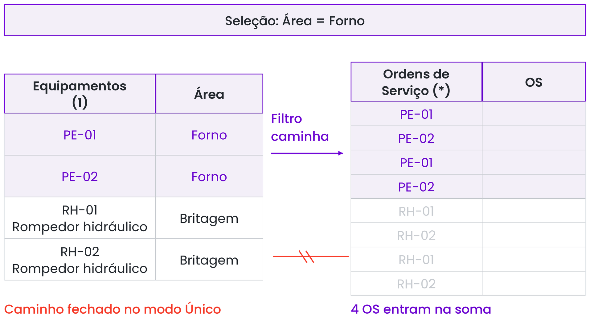

# Roteiro de Apoio para Explicação dos Temas — Aula 3 (Slide a Slide)
**Curso:** Power BI e DAX para Manutenção (CEDTEC Guarapari · Samarco)  
**Apresentação Oficial:** [`Slides/Power BI e DAX para Manutenção — Dia 3 · O painel que responde perguntas.pptx`](../../Slides/Power%20BI%20e%20DAX%20para%20Manuten%C3%A7%C3%A3o%20%E2%80%94%20Dia%203%20%C2%B7%20O%20painel%20que%20responde%20perguntas.pptx) *(26 Slides — Seções 3.2 a 3.9)*  
**Objetivo deste Guia:** Acompanhar exatamente a ordem dos **26 slides** da apresentação do Dia 3, fornecendo ao professor o discurso de sala, as analogias de manutenção, os exemplos de quadro branco e o gabarito das perguntas.

---

## Mapa dos 26 Slides da Aula 3

```
┌────────────────────────────────────────────────────────────────────────────┐
│ ABERTURA (Slides 1 a 3): Pergunta do RA-01, Objetivos e Cronograma         │
├────────────────────────────────────────────────────────────────────────────┤
│ BLOCO 3.2 (Slides 4 a 8): Relacionamentos, Direção Único e Conjuntos       │
│ • S05: Barras da mesma altura | S06: *:1 Único | S07: Ambas | S08: ∩ e ∪   │
├────────────────────────────────────────────────────────────────────────────┤
│ BLOCO 3.3 · 3.4 (Slides 9 a 12): Hierarquias e Escolha do Visual           │
│ • S10: Pátio › EM-01, EM-02, CN-01 | S11: 4 Famílias | S12: Teste Rápido   │
├────────────────────────────────────────────────────────────────────────────┤
│ BLOCO 3.5 · 3.6 (Slides 13 a 17): Gráficos, Cartões e Matriz com Semáforo  │
│ • S14: Empilhado × Clusterizado | S15: Soma Nº OS | S16-17: Forno 54% e Cor│
├────────────────────────────────────────────────────────────────────────────┤
│ BLOCO 3.7 · 3.8 (Slides 18 a 21): Filtros, Interações e Publicação         │
│ • S19: 4 Controles de Filtro | S20: Desktop × Serviço | S21: TI Samarco    │
├────────────────────────────────────────────────────────────────────────────┤
│ BLOCO 3.9 (Slides 22 a 26): Caso "Horas em Dobro" (131,5h vs 92,0h)        │
└────────────────────────────────────────────────────────────────────────────┘
```

---

# ABERTURA (Slides 1 a 3)

### Slide 1 — Capa e Pergunta do Dia
- **Texto do Slide:** *"Pergunta do dia: Quantas horas o RA-01 parou em março, e isso está subindo ou caindo?"*
- **Como Conduzir na Sala:**
  - Mostre que essa única frase do gerente esconde **duas perguntas** de naturezas diferentes:
    1. *"Quantas horas o RA-01 parou em março?"* ➔ Pede **um número exato** filtrado em um ativo e um mês (**Cartão**: `16,5 h`).
    2. *"Isso está subindo ou caindo?"* ➔ Pede **acompanhamento no tempo** de janeiro a março (**Gráfico de linhas**: `6,5 h ➔ 11,0 h ➔ 16,5 h`, mostrando que está subindo!).

### Slides 2 e 3 — Objetivos e Cronograma do Dia 3
- Destaque que a manhã cobre **Seções 3.2 a 3.6** (relacionamentos, hierarquias e construção dos visuais principais) e a tarde cobre **Seções 3.7 a 3.9** (segmentações, interações, publicação e o caso prático das horas em dobro).

---

# BLOCO 3.2: Relacionamentos e Direção do Filtro (Slides 4 a 8)

### Slide 4 e Slide 5 — Situação: "Por que todas as barras de horas por área têm a mesma altura?"
- **Como Explicar:**
  - Todo mundo que monta o primeiro painel sem configurar o modelo passa por isso: coloca `Área` (da tabela `Equipamentos`) no Eixo X e `Horas Paradas` (da tabela `OS`) no Eixo Y, e o gráfico desenha um "muro" onde todas as áreas mostram exatamente o mesmo valor!
  - **Causa:** As tabelas `OS` e `Equipamentos` entraram no modelo sem ligação. Quando o Power BI vai calcular a barra da *Britagem*, ele não sabe quais OS pertencem à Britagem e devolve o **total geral da tabela inteira** para cada barra!


*Guia Visual 1 (Figura 3.3): Sem a linha ligando Equipamentos à OS, o filtro de Área não chega nas horas paradas.*

---

### Slide 6 — Ideia Central: "O relacionamento leva o filtro da dimensão até a fato"
- **Como Criar (2 caminhos):**
  1. Na **Exibição de modelo**: arrastar `Equipamento` (do cadastro `Equipamentos`) e soltar em cima de `Equipamento` (da fato `OS`).
  2. Pelo menu superior: **Modelagem › Gerenciar relações › Novo**.
- **Como Ler os Símbolos da Linha:**
  - **Cardinalidade Muitos para um (`*:1`):** Existem **muitas (`*`)** ordens de serviço para **um (`1`)** único equipamento no cadastro.
  - **Direção `Único`:** A setinha no meio da linha aponta da Dimensão (`Equipamentos`) para a Fato (`OS`). Ou seja: **a área filtra as OS**.


*Guia Visual 2 (Figura 3.5): O filtro atravessa o relacionamento no sentido da seta (da Dimensão para a Fato).*


*Guia Visual 3 (Figura 3.4): Janela de propriedades do relacionamento (*:1 e Único).*

---

### Slide 7 — Pegadinha: "A direção Ambas faz as tabelas se comportarem como uma só"
- **Por que manter `Único` e fugir do `Ambas`?**
  - **Com `Único` (o padrão correto):** Se você filtrar o mês de março, a tabela `OS` é filtrada, mas a sua segmentação de `Equipamentos` continua listando todas as máquinas da usina (mesmo aquela que teve zero falhas em março!). Isso é ótimo na manutenção, porque ver que uma máquina teve `0 horas paradas` é uma informação importante!
  - **Com `Ambas`:** O filtro corre nos dois sentidos. Se houver mais tabelas no modelo (ex: Técnicos, Metas por Área), criam-se dois caminhos para o mesmo filtro (um anel fechado) e o resultado fica imprevisível ou o Desktop bloqueia com erro de ambiguidade. **Regra de bolso: Use `Único`.**

---

### Slide 8 — Ideia Central: "Duas segmentações juntas são uma interseção"
- **Conectando com a Teoria de Conjuntos do Dia 2:**
  - Desenhe dois círculos no quadro branco:
    - **Segmentações diferentes = `E` (Interseção $\cap$):**Quando o leitor clica em `Área = Pátio` numa segmentação **E** em `Mês = março` em outra segmentação, o Power BI entrega só as OS que pertencem **aos dois conjuntos ao mesmo tempo** ($\text{Pátio} \cap \text{março}$).
    - **Mesma segmentação = `OU` (União $\cup$):** Quando o leitor segura `Ctrl` e marca `Pátio` **OU** `Forno` dentro da mesma segmentação de Área, o Power BI soma os dois conjuntos ($\text{Pátio} \cup \text{Forno}$).

---

# BLOCO 3.3 · 3.4: Hierarquias e Escolha do Visual (Slides 9 a 12)

### Slide 9 e Slide 10 — Ideia Central: "Hierarquia: descer de nível com um clique"
- **Exemplo Exato do Slide 10 (`Área › Equipamento`):**
  - No painel **Dados**, clicamos com o botão direito em `Área` ➔ **Criar hierarquia**, e depois clicamos com o botão direito em `Equipamento` ➔ **Adicionar à hierarquia**.
  - Na prática: o gráfico mostra primeiro as barras das Áreas. Quando o supervisor clica na barra da área **Pátio** (com o Drill Down ligado), a barra do Pátio se abre imediatamente nas suas três máquinas: **`EM-01`** (Empilhadeira 1), **`EM-02`** (Empilhadeira 2) e **`CN-01`** (Carregador de navios 1)!
- **Hierarquia de Datas:**
  - Mostre que toda coluna do tipo Data já ganha automaticamente do Power BI a hierarquia `Ano › Trimestre › Mês › Dia`, controlada pelas mesmas setinhas no cabeçalho do visual.


*Guia Visual 4 (Figura 3.7): Hierarquia no painel Dados e hierarquia automática de Datas.*


*Guia Visual 5 (Figura 3.23): As setas no topo do gráfico para descer e subir níveis.*

---

### Slide 11 — Ideia Central: "Comece pela pergunta, depois escolha o visual"
Explique as **4 famílias fundamentais** do Slide 11:
1. **Comparar (*"Qual área tem mais?"*):** Pede **Barras ou colunas** (o olho humano compara comprimentos de barras com precisão imediata).
2. **Acompanhar no tempo (*"Está subindo ou caindo?"*):** Pede **Linhas**, com o mês ordenado no eixo horizontal (a inclinação da linha revela a tendência).
3. **Mostrar um número (*"Quanto foi no mês?"*):** Pede **Cartão** (destaque grande no topo da tela).
4. **Detalhar (*"Quais OS estão por trás?"*):** Pede **Tabela ou matriz**.


*Guia Visual 6 (Figura 3.11): Como os quatro tipos de visual se organizam na página do painel.*

---

### Slide 12 — Teste Rápido: "Qual visual responde cada pergunta?" (Gabarito para Sala)
Faça a dinâmica oral com a turma para as 4 perguntas do **Slide 12**:
- **1. Total de horas paradas de março**  
  ➔ **Gabarito:** **Cartão** *(Família: Mostrar um número — é um único valor consolidado).*
- **2. Qual equipamento da Moagem parou mais**  
  ➔ **Gabarito:** **Gráfico de barras ou de colunas** *(Família: Comparar — ordenando do maior para o menor equipamento da Moagem).*
- **3. As corretivas estão aumentando desde janeiro?**  
  ➔ **Gabarito:** **Gráfico de linhas** com o mês no eixo X *(Família: Acompanhar no tempo — mostra a trajetória de subida ou queda).*
- **4. Lista das OS abertas do silo `SL-02`**  
  ➔ **Gabarito:** **Tabela** *(Família: Detalhar — lista o número de cada OS, data e descrição do serviço pendente no silo).*

---

# BLOCO 3.5 · 3.6: Gráficos, Cartões e Matriz (Slides 13 a 17)

### Slide 13 e Slide 14 — Ideia Central: "Empilhado mostra o total; clusterizado compara os tipos"
- **Como contrastar os dois no projetor:**
  - **Colunas empilhadas:** Cada coluna inteira é o **total da área**; as cores dentro dela mostram quanto veio de Corretiva, Preventiva e Preditiva. Responde direto: *"Quanto a área parou no total?"*
  - **Colunas clusterizadas (agrupadas):** Coloca as barras de Corretiva, Preventiva e Preditiva **lado a lado** na mesma linha de base zero dentro de cada área. Responde direto: *"Qual tipo de manutenção pesa mais em cada área?"*


*Guia Visual 7 (Figura 3.12): Colunas empilhadas com Área no eixo, Horas no valor e Tipo na legenda.*

---

### Slide 15 — Pegadinha: "Número da OS é número, mas somá-lo não significa nada"
- **A Cena Clássica no Laboratório:**
  - O aluno quer mostrar *"Quantidade de OS"* num Cartão. Ele arrasta a coluna `Número da OS` (`51020`, `51021`...) para o cartão.
  - Como o tipo de dado é Número Inteiro, o Power BI faz uma **Soma** dos números das OS e mostra `43,89 Milhões` no cartão!
  - **Lição:** Nem toda coluna numérica é aditiva! Código de OS e matrícula de técnico são identificadores: devemos clicar na setinha do campo e trocar o resumo de *Soma* para **Contagem**.


*Guia Visual 8 (Figura 3.15): Trocando Soma por Contagem ou Média no resumo do campo.*

---

### Slide 16 e Slide 17 — Situação e Como Fazer: "O Forno concentra mais da metade das horas de corretiva" e "Matriz com semáforo"
- **Explicando o Slide 16:**
  - Num mês com `57,0 h` totais de manutenção corretiva, só a área do **Forno** respondeu por **`31,0 h`** — ou seja, **54%** de toda a parada corretiva!
  - Enquanto o **Cartão** mostra um número isolado (`57,0 h`), a **Matriz** cruza `Área` (nas linhas) $\times$ `Tipo de Manutenção` (nas colunas), e a **formatação condicional** pinta a célula de vermelho, revelando essa concentração antes de qualquer conta!
- **Explicando os 3 Passos do Slide 17 (Como fazer: matriz com semáforo):**
  1. `Visualizações › Matriz`: `Área` nas linhas, `Tipo` nas colunas, `Horas Paradas` nos valores.
  2. `Botão direito em Horas Paradas › Formatação condicional › Cor da tela de fundo`.
  3. `Regras`:
     - Até `15 h` ➔ **Verde**
     - De `15 a 30 h` ➔ **Amarelo**
     - Acima de `30 h` ➔ **Vermelho** *(o Forno com `31,0 h` acende em vermelho na hora!).*


*Guia Visual 9 (Figura 3.19): A cor na matriz direciona o olho imediatamente para a célula crítica.*

---

# BLOCO 3.7 · 3.8: Filtros e Publicação (Slides 18 a 21)

### Slide 18 e Slide 19 — Ideia Central: "Quem filtra o quê na página"
Explique os **4 mecanismos de controle** resumidos no **Slide 19**:
1. **Segmentação:** É o filtro visível na tela feito para o leitor clicar (em formato de lista, mosaico/botões, suspensa ou intervalo de data).
2. **Interação:** O comportamento automático de clicar numa barra de um gráfico e ver todos os outros visuais da página reagirem (filtrando ou realçando).
3. **Editar interações (`Guia Formato`):** Onde o autor do painel escolhe o que o clique em cada visual faz em cada um dos outros (trocando o *Realçar* pelo *Filtrar* de funil, ou desligando em *Nenhum*).
4. **Painel Filtros:** A gaveta lateral com **três níveis de alcance** (*neste visual*, *nesta página* e *em todas as páginas do relatório*), onde o autor pode ocultar ou trancar filtros com o cadeado.


*Guia Visual 10 (Figura 3.20): Controles de Editar Interações no canto superior direito do visual.*


*Guia Visual 11 (Figura 3.21): Os três níveis de escopo do painel Filtros.*

---

### Slide 20 e Slide 21 — Publicação no Serviço e Governança na Samarco
- **O Conceito do Slide 20 ("Publicar cria uma segunda cópia, no serviço"):**
  - **No Desktop:** Você vai em `Página Inicial › Publicar` e escolhe o espaço de trabalho. A partir desse instante existem duas cópias: o arquivo `.pbix` no seu computador (que continua sendo a sua oficina de edição) e a versão publicada na nuvem.
  - **No Serviço (nuvem):**
    - **Espaço de trabalho (Workspace):** A pasta compartilhada da equipe.
    - **As 4 Funções:** *Administrador*, *Membro*, *Colaborador* (que publicam/editam) e *Visualizador* (que apenas consulta o painel com segurança).
    - **Aplicativo (App):** A versão oficial "empacotada" e distribuída para a leitura da gerência e operação.


*Guia Visual 12 (Figura 3.26): O botão Publicar e a escolha do Espaço de Trabalho.*

- **A Pegadinha do Slide 21 ("Na Samarco, conta, licença e espaço de trabalho vêm da TI"):**
  - Deixe muito claro para a turma: construir no Power BI Desktop é gratuito, mas publicar num espaço compartilhado exige licença corporativa (**Pro** ou **PPU**) ou capacidade contratada pela empresa.
  - Por isso, aqui no laboratório do CEDTEC a publicação é demonstrada pelo professor; lá na Samarco, antes de publicar um painel oficial da área, o alinhamento de conta, gateway e espaço de trabalho é feito junto à TI da empresa.

---

# BLOCO 3.9: Caso Integrado — "Horas em Dobro" (Slides 22 a 26)

### Slide 22, Slide 23 e Slide 24 — O Mistério das `131,5 h` contra `92,0 h`
- **A Situação (Slide 23):**
  - Na exportação oficial do mês de março ([`OS_Marco_Auditoria.csv`](./OS_Marco_Auditoria.csv)), a soma conferida no Excel dá exatamente **`92,0 h`** (em 48 OS).
  - Porém, ao abrir o painel montado pelo colega, o cartão mostra **`131,5 h`**!
  - O que ele fez antes de carregar? Ele usou **Mesclar Consultas** no Power Query para juntar a planilha de alocação ([`Alocacao_Tecnicos_OS.csv`](./Alocacao_Tecnicos_OS.csv), que tem **uma linha por técnico em cada OS**) dentro da tabela de OS!
- **A Ideia Central / Causa Raiz (Slide 24):**
  - *"A mescla mudou a granularidade e repetiu as horas."*
  - Das 48 OS do mês, **15 OS tiveram dois técnicos** trabalhando juntos. Quando a coluna `Técnico` foi expandida dentro da tabela de OS, cada uma dessas 15 OS virou **duas linhas** na tabela fato (`48 + 15 = 63 linhas`), e as horas paradas daquelas 15 OS (`39,5 h`) foram somadas duas vezes (`92,0 + 39,5 = 131,5 h`)!
- **A Correção Definitiva (Slide 24):**
  1. Manter a tabela `OS` com **uma única linha por OS** (48 linhas).
  2. Deixar a planilha de `Alocação` numa **tabela separada** no modelo, ligada pelo `Número da OS`.
  3. **Regra de ouro:** *Confira sempre o total do painel com a exportação de origem antes de confiar!*

---

### Slide 25 e Slide 26 — Resumo e Fechamento do Dia 3
- **Três Pilares do Resumo (Slide 25):**
  1. **Relacionamento:** O filtro vai da dimensão para a fato (`1 ➔ *`, direção `Único`).
  2. **Visual:** Primeiro a pergunta da manutenção, depois o gráfico.
  3. **Conferência:** O total do painel bate com a origem?
- **Checkpoint do Dia 3 (Slide 26):**
  - Cada aluno salva o seu `.pbix` com **duas páginas funcionando**:
    - Página 1: **Visão Geral**
    - Página 2: **Por Equipamento**
    - Com as segmentações de **Área** e **Mês** funcionando nas duas páginas.
- **Gancho para o Dia 4 (Slide 26):**
  - *"Hoje respondemos às perguntas usando somas e contagens automáticas das colunas. Mas e quando o gerente pedir o **Custo por Hora Parada**, o **MTBF**, o **MTTR** ou o **% de Preventivas sobre o Total Geral**? Amanhã no Dia 4 entramos na linguagem **DAX**: primeiras medidas, contexto de filtro e `CALCULATE`!"*
