# Roteiro de Apoio para Explicação dos Temas — Aula 3 (Guia do Professor)
**Curso:** Power BI e DAX para Manutenção (CEDTEC Guarapari · Samarco)  
**Escopo:** Capítulo 3 Completo (Seções 3.1 a 3.9 — *O painel que responde perguntas*)  
**Arquivos de Dados de Referência (`Dataset/Aula 3/`):**
- [`Dataset_PowerBI_Manutencao.xlsx`](./Dataset_PowerBI_Manutencao.xlsx) *(Modelo Estrela Principal)*
- [`OS_Marco_Auditoria.csv`](./OS_Marco_Auditoria.csv) *(48 OS de março = 92,0 horas)*
- [`Alocacao_Tecnicos_OS.csv`](./Alocacao_Tecnicos_OS.csv) *(63 registros de alocação de técnicos — Caso 3.9)*

---

## Estrutura de Condução da Aula 3 em Sala

```
┌────────────────────────────────────────────────────────────────────────────┐
│ PARTE 1 (MANHÃ — 2h): DO MODELO AOS VISUAIS (Seções 3.1 a 3.6)             │
│ • 3.1 e 3.2: Fato × Dimensão, Esquema Estrela e a Válvula do Filtro Único │
│ • 3.3: Hierarquias (Área > Equipamento) e ocultação de chaves técnicas     │
│ • 3.4: Jogo "Pergunta da Manutenção ➔ Visual Ideal" e leitura em "Z"       │
│ • 3.5 e 3.6: Barras, Linhas, Cartão e Matriz com Semáforo Condicional      │
└────────────────────────────────────┬───────────────────────────────────────┘
                                     ▼
┌────────────────────────────────────────────────────────────────────────────┐
│ PARTE 2 (TARDE — 1h20): INTERATIVIDADE, NUVEM E AUDITORIA (Seções 3.7-3.9) │
│ • 3.7: Segmentação, Painel Filtros (3 níveis) e Filtrar × Realçar          │
│ • 3.8: Publicação, Espaço de Trabalho, Relatório × Dashboard e Gateways    │
│ • 3.9: Caso 1 ("Horas em Dobro": 92h ➔ 131,5h) e Caso 2 (Parou no dia 14) │
└────────────────────────────────────────────────────────────────────────────┘
```

---

# PARTE 1: Explicando Relacionamentos, Hierarquias e Visuais (Seções 3.1 a 3.6)

### 1.1. Retomada de Conjuntos no Modelo: Fato, Dimensão e Cardinalidade (3.1 e 3.2)
- **Pergunta de Abertura do Dia 3:**
  > *"Quantas horas o resfriador RA-01 parou em março, e essa indisponibilidade está subindo ou caindo?"*
- **Como Conectar o Dia 2 ao Dia 3 na Lousa:**
  - Ontem limpamos as tabelas e separamos quem registra **eventos** (**Tabela Fato `OS`**) de quem descreve **cadastros** (**Tabela Dimensão `Equipamentos` e `Calendario`**).
  - Mas duas tabelas soltas dentro do Power BI são como dois conjuntos desconectados: se você colocar `Área` (da tabela `Equipamentos`) e `Horas Paradas` (da tabela `OS`) num gráfico sem ligar as duas, o que aparece na tela?
  - **Mostre o sintoma das "Barras da Mesma Altura":** Todas as áreas mostram o mesmo valor (total geral repetido), porque o filtro de Área não tem ponte para chegar nas OS!

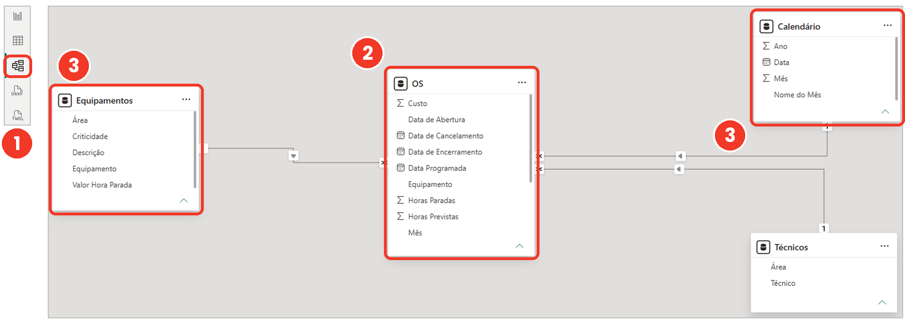
*Guia Visual 1 (Figura 3.3): O Esquema Estrela — a Fato `OS` no centro ligada às Dimensões pela chave.*

- **Como Explicar os 3 Elementos da Linha do Relacionamento:**
  1. **O `1` e o `*` (Cardinalidade Muitos para Um):**
     - Na tabela `Equipamentos`, cada TAG (`BR-01`, `MO-01`) aparece **1 única vez**.
     - Na tabela `OS`, o mesmo TAG aparece **muitas vezes (`*`)**, uma para cada falha no ano.
  2. **A Seta no Meio da Linha (Direção do Filtro Cruzado `Único`):**
     - **Analogia da Válvula de Retenção (*Check Valve*):** O filtro sai da Dimensão (`1`) e desce para filtrar a Fato (`*`). Quando você escolhe a área `"Britagem"`, o filtro passa pela seta e deixa na soma apenas as OS daquelas máquinas. O caminho inverso fica bloqueado.
     - *Por que não usar "Ambas"?* Se você ligar uma terceira tabela (ex: Técnicos ligados à Área e às OS) com filtro nas duas direções, fecha-se um anel (dois caminhos diferentes para o mesmo filtro) e o Power BI trava ou calcula errado.
  3. **Linha Contínua vs Linha Tracejada (Relacionamento Ativo vs Inativo):**
     - Entre `Calendario` e `OS` existem três datas possíveis (`Data de Abertura`, `Data de Encerramento` e `Data Programada`).
     - Só **uma** relação pode ficar ativa por padrão (linha contínua: `Data de Abertura`). As outras ficam tracejadas (inativas) esperando uma função DAX (`USERELATIONSHIP`, que veremos no Dia 5) para serem acionadas.


*Guia Visual 2 (Figura 3.5): O caminho do filtro único — da Dimensão para a Fato.*

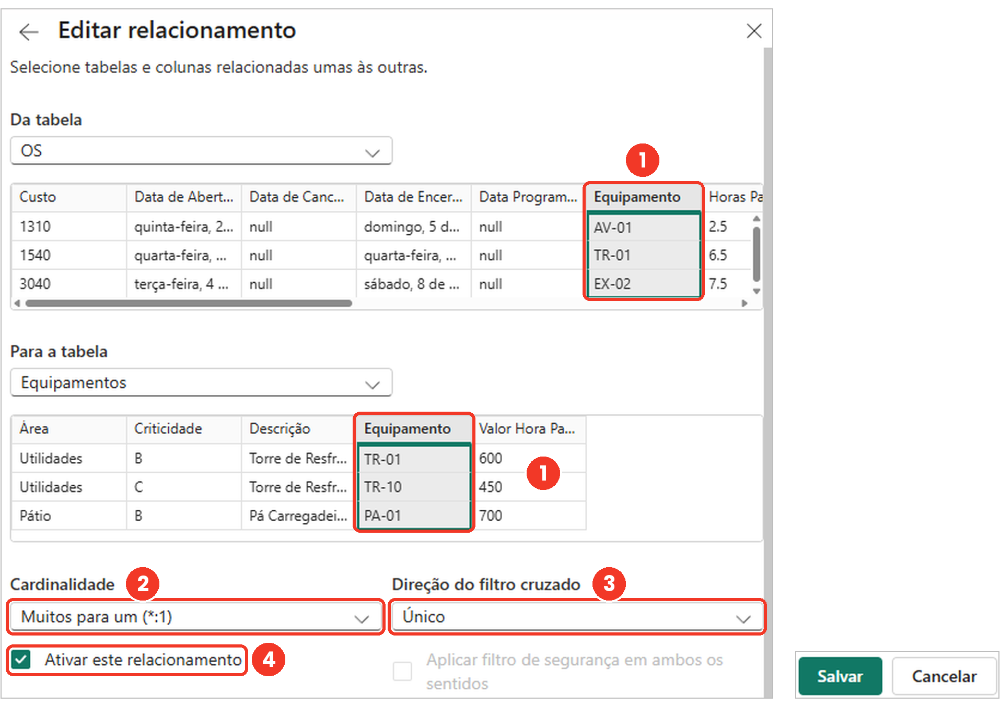
*Guia Visual 3 (Figura 3.4): A janela Editar Relacionamento mostrando as colunas que se correspondem.*

---

### 1.2. Hierarquias e Organização do Painel Dados (Seção 3.3)
- **A Lógica da Escada Gerencial (`Área > Equipamento`):**
  - Pergunte à turma: *"O diretor de operações da Samarco quer ver um gráfico com 200 equipamentos de uma vez ou quer ver primeiro as 5 grandes Áreas e só abrir a área que estiver no vermelho?"*
  - Isso é uma **Hierarquia**! Empacotamos `Área` (nível 1) e `Equipamento` (nível 2) num único item. No mesmo espaço de tela, o gráfico responde ao diretor (por Área) e, com um clique de **Drill Down**, responde ao supervisor (por Equipamento).

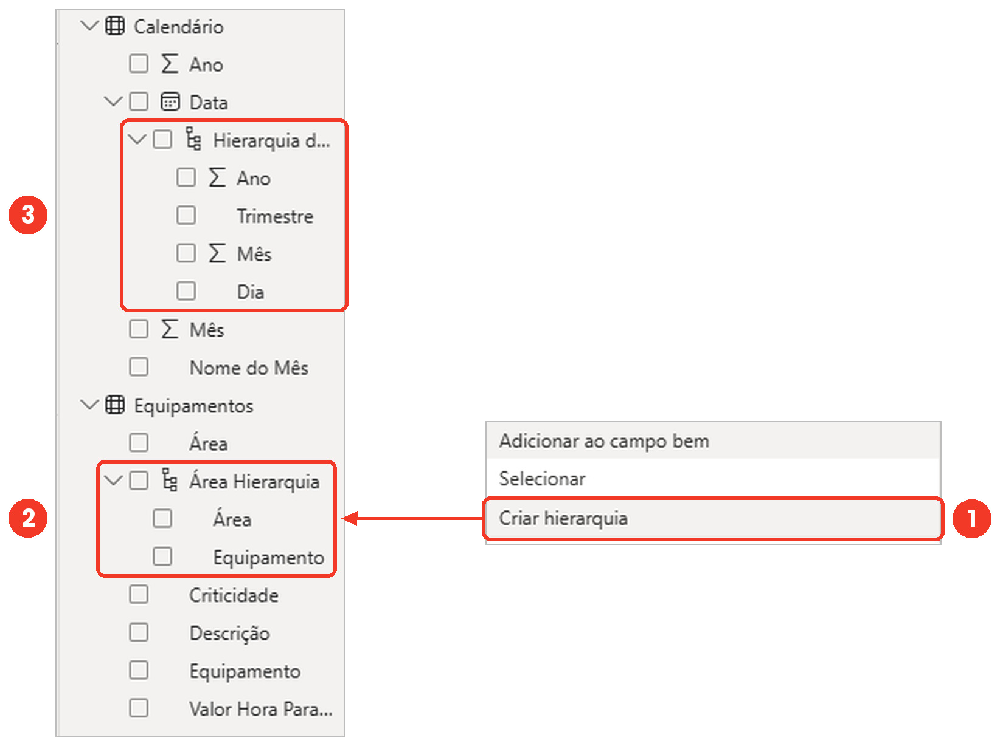
*Guia Visual 4 (Figura 3.7): Hierarquia criada no painel Dados e a Hierarquia de Data automática.*

- **A Regra de Higiene do Modelo (Ocultar e Renomear):**
  - **Ocultar a chave da Fato (`OS[Equipamento]`):** Se o aluno deixar a coluna `Equipamento` visível nas duas tabelas, na pressa ele vai arrastar a da tabela `OS` para uma segmentação de dados. Por isso ocultamos a chave estrangeira da Fato (ícone de olho cortado).
  - **Renomear colunas:** Nomes vindos de banco de dados (`DT_ABERT_OS`, `VL_HR_PAR`) devem virar português claro de manutenção (`Data de Abertura`, `Horas Paradas`) antes de montar o primeiro gráfico, porque o título de cada visual nasce do nome da coluna!

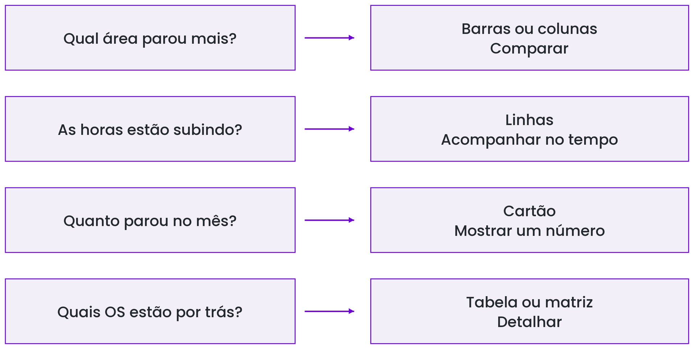
*Guia Visual 5 (Figura 3.8): Ocultar da visualização de relatório mantém o relacionamento funcionando sem poluir a lista.*

---

### 1.3. Escolha do Visual pela Pergunta da Manutenção (Seção 3.4)
- **O Princípio Fundamental:**
  > *"Quem abre o Power BI e clica num gráfico antes de saber qual pergunta quer responder acaba com um painel bonito que não serve para tomar decisão nenhuma."*

- **Dinâmica em Sala — Jogo "Pergunta ➔ Visual" (10 minutos):**
  Divida ou provoque a turma com 6 perguntas reais de reunião matinal e peça que digam na hora qual é a família e o visual:

| # | Pergunta da Manutenção na Samarco | Família | Visual Certo | Por que NÃO usar outro? |
| :-: | :--- | :--- | :--- | :--- |
| **1** | *"Quantas horas perdemos com corretivas no mês fechado?"* | Mostrar 1 número | **Cartão** | Gráfico de barra para 1 número só desperdiça espaço. |
| **2** | *"Qual das 6 áreas da planta teve mais horas paradas?"* | Comparar categorias | **Barras ou Colunas** | Pizza com 6 fatias parecidas impede comparar tamanhos. |
| **3** | *"A indisponibilidade do britador BR-01 está aumentando ou caindo desde janeiro?"* | Acompanhar no tempo | **Gráfico de Linhas** | A inclinação da linha contínua mostra tendência na hora. |
| **4** | *"Em cada área, quanto foi Corretiva, Preventiva e Preditiva?"* | Comparar + Compor | **Colunas Empilhadas ou Clusterizadas** | Mostra o total da área e a divisão interna por tipo. |
| **5** | *"Onde está a maior concentração de horas cruzando Área × Tipo de Manutenção?"* | Cruzar 2 categorias | **Matriz com Cor (Mapa de Calor)** | Cruza linhas e colunas como uma tabela dinâmica visual. |
| **6** | *"Quais foram as OS abertas ontem, com número, descrição e custo?"* | Detalhar linhas | **Tabela** | Só a tabela lista textos longos e códigos individuais. |

- **A Ordem de Leitura da Página (Desenho na Lousa):**
  Mostre que um painel profissional segue o movimento natural dos olhos:
  - **Topo:** Cartões (o resumo executivo).
  - **Esquerda:** Segmentações (os botões de filtro).
  - **Centro:** Gráficos de comparação (Barras) e tempo (Linhas).
  - **Rodapé / Página 2:** Matriz e Tabela de detalhes.

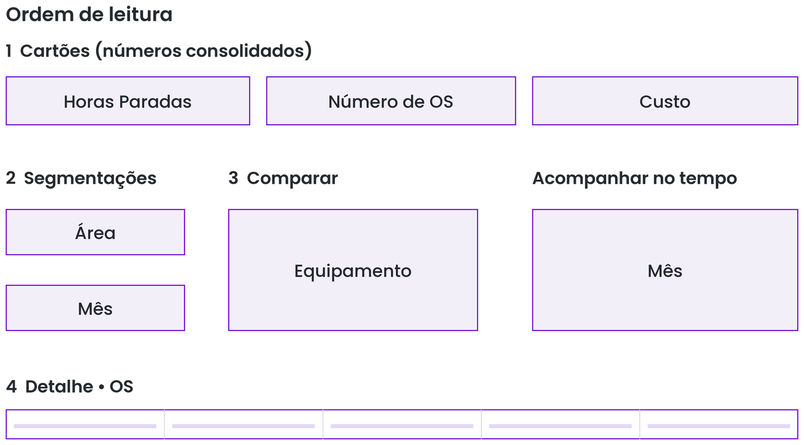
*Guia Visual 6 (Figura 3.11): Distribuição clássica de uma página de Visão Geral.*

---

### 1.4. Gráficos de Barras/Colunas, Linhas, Cartão e Matriz (Seções 3.5 e 3.6)
- **Empilhado × Clusterizado (Agrupado):**
  - Faça um desenho rápido de duas barras no quadro:
    - Na **Empilhada**, a preventiva fica em cima da corretiva. A altura total mostra o **total da Área**.
    - Na **Clusterizada**, a barra da corretiva fica ao lado da preventiva. Elas têm a mesma linha de base zero, permitindo comparar se uma área fez mais preventiva do que corretiva!

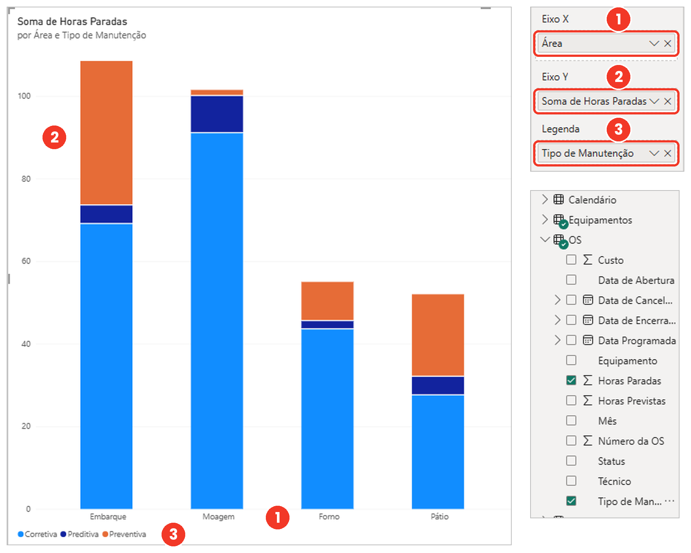
*Guia Visual 7 (Figura 3.12): Eixo X, Eixo Y e Legenda no gráfico de colunas empilhadas.*

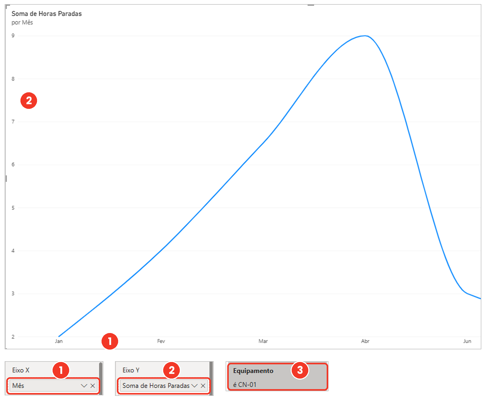
*Guia Visual 8 (Figura 3.13): No gráfico de linhas, o eixo de meses precisa estar ordenado cronologicamente (e não por ordem alfabética!).*

- **A Pegadinha da Agregação Implícita (Soma, Média, Contagem):**
  - Pergunte: *"Se o dosador `DO-03` teve 5 ordens de serviço no mês com `1,5`, `4,0`, `2,5`, `6,0` e `1,0` horas paradas (soma = 15,0 h), o que aparece no Cartão se eu trocar o resumo de Soma para Média? E para Contagem?"*
  - **Resposta no quadro:**
    - `Soma` = **15,0 horas** (indisponibilidade total).
    - `Média` = **3,0 horas** ($15,0 \div 5$ = tempo médio de parada por OS, próximo ao MTTR!).
    - `Contagem` = **5** (quantidade de intervenções!).

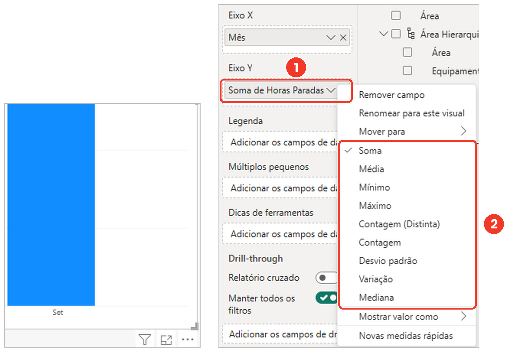
*Guia Visual 9 (Figura 3.15): O menu de agregação do campo numérico no painel Visualizações.*

- **As 4 Formas de Formatação Condicional na Matriz (Seção 3.6):**
  1. **Cor da tela de fundo:** Pinta a célula inteira (mapa de calor para achar o maior valor).
  2. **Cor da fonte:** Discreta, muda só a cor do número.
  3. **Barras de dados:** Desenha um mini gráfico de barras dentro da coluna numérica.
  4. **Ícones:** Coloca bolinhas de semáforo (🟢 🟡 🔴) ou setas conforme regras da meta.

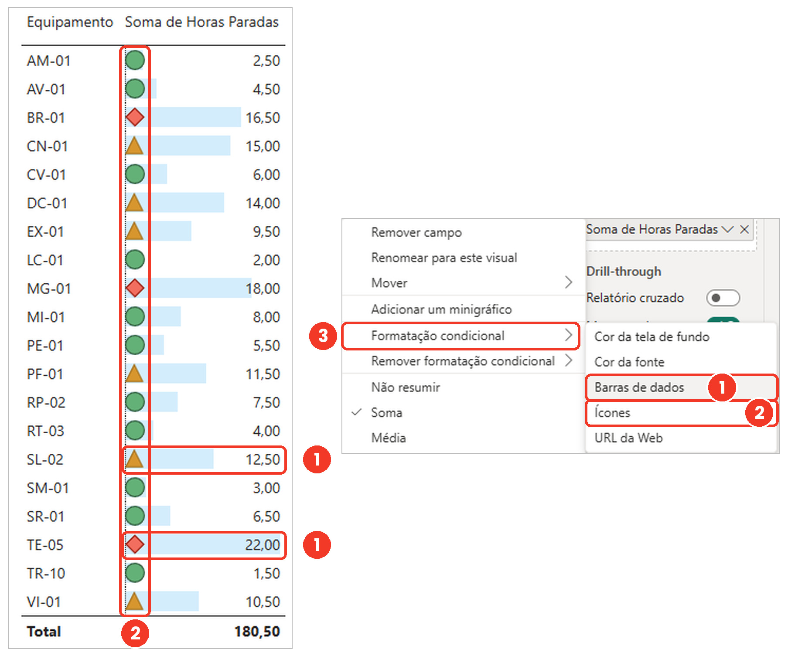
*Guia Visual 10 (Figura 3.19): Barras de dados e ícones destacando os desvios dentro da matriz.*

---

# PARTE 2: Interatividade, Publicação e Casos Reais (Seções 3.7 a 3.9)

### 2.1. Segmentação de Dados, Painel Filtros e Interações (Seção 3.7)
- **Quem usa a Segmentação vs Quem usa o Painel Filtros:**
  - **Segmentação de dados:** É feita para o **leitor** do painel (supervisor, gerente). Fica visível na tela como botões ou lista suspensa.
  - **Painel Filtros:** É onde o **autor** do relatório trava regras estruturais em 3 alcances:
    - *Neste visual:* Ex: mostrar só o Top 5 equipamentos num gráfico específico.
    - *Nesta página:* Ex: uma página dedicada só ao ano atual.
    - *Em todas as páginas:* Ex: ocultar OS com status `Cancelada` no relatório inteiro e passar o cadeado!

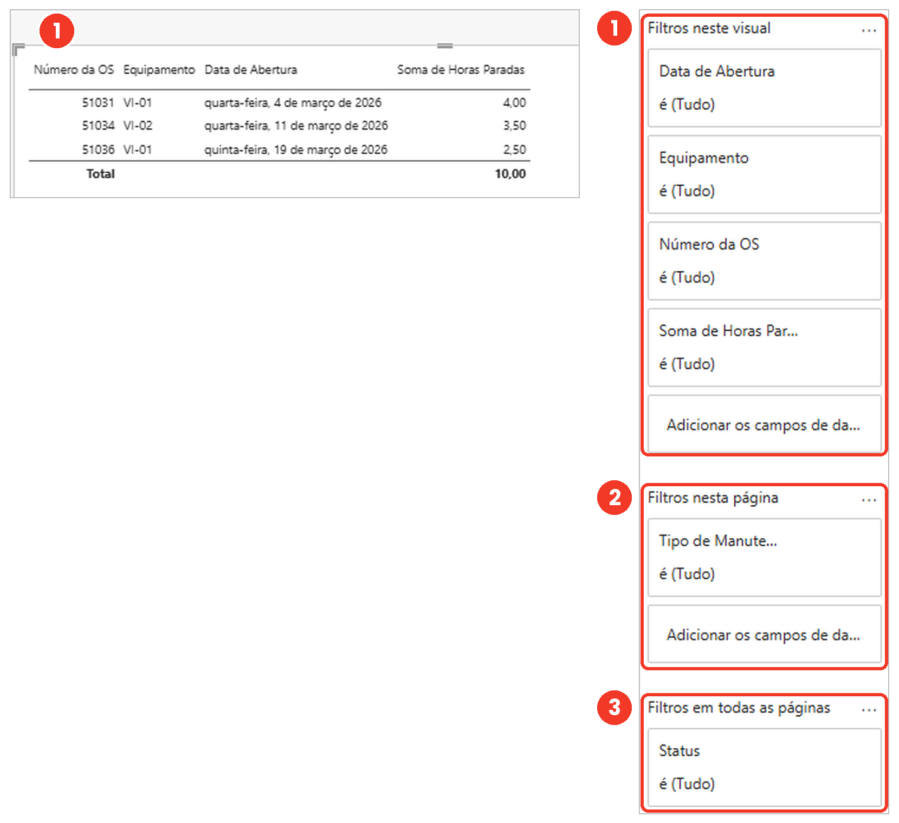
*Guia Visual 11 (Figura 3.21): Os três níveis de alcance do painel Filtros.*

- **Por que desligar o "Realçar" e ligar o "Filtrar" em Editar Interações?**
  - Mostre que, por padrão, clicar numa barra faz um **Realce (Highlight)** nos outros gráficos (pinta um pedacinho da barra e deixa o resto transparente).
  - Num gráfico de linhas ou numa barra pequena, o realce fica quase invisível! Trocando para **Filtrar (funil)** em `Formato > Editar Interações`, o gráfico recalcula sua escala mostrando 100% de foco na máquina clicada.

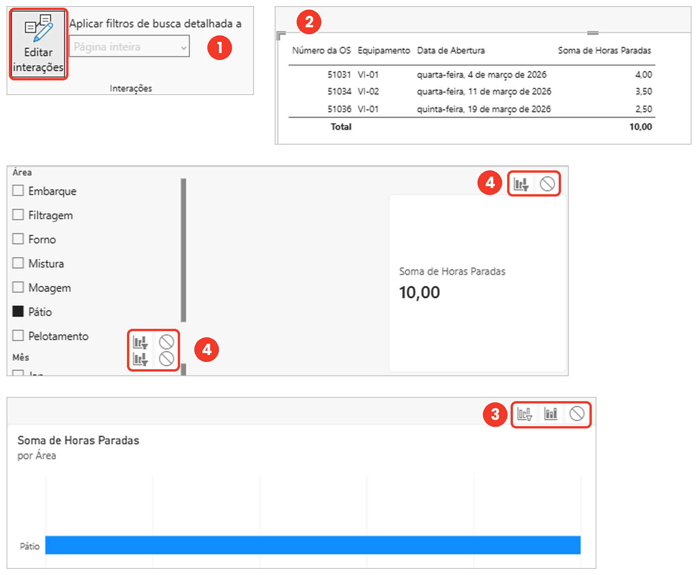
*Guia Visual 12 (Figura 3.20): Os três modos de interação — Filtrar (funil), Realçar e Nenhum.*

- **Navegação Avançada: Sincronizar Segmentações e Drill-through:**
  - **Sincronizar segmentações:** Quando o gerente escolhe a área `"Pelotização"` na Página 1 (Visão Geral) e muda para a Página 2 (Detalhe), ele espera que a Página 2 já esteja na Pelotização! É a sincronização que mantém a memória do filtro entre as abas.
  - **Drill-through:** Clicar com o botão direito na barra do britador `BR-01` e pular direto para uma página de dossiê daquela máquina específica.

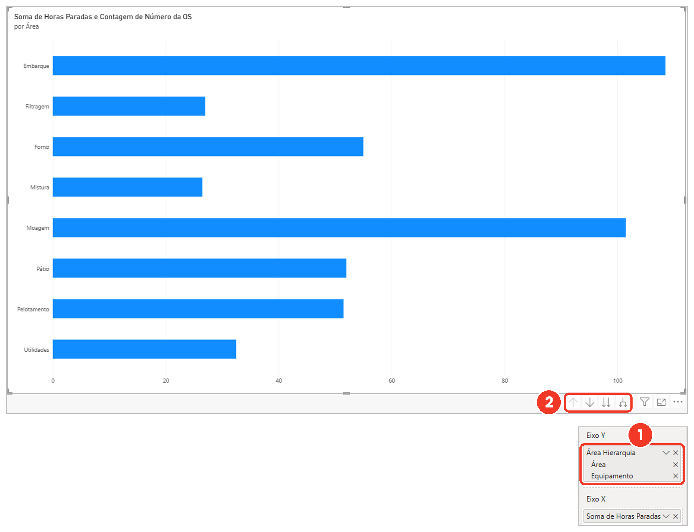
*Guia Visual 13 (Figura 3.23): Os 4 ícones do cabeçalho de hierarquia — Subir, Ativar clique de descida, Próximo nível e Expandir tudo.*

---

### 2.2. Publicação no Serviço do Power BI e Gateways (Seção 3.8)
- **A Oficina (Desktop) × A Vitrine (Serviço na Nuvem):**
  - No computador (`.pbix`), construímos o painel. Na nuvem (**Serviço do Power BI**), a equipe consome pelo navegador ou celular sem instalar nada.
  - **As 4 Funções do Espaço de Trabalho (Workspace):**
    - *Administrador* e *Membro:* Gerenciam permissões e publicam.
    - *Colaborador:* Publica e edita relatórios.
    - *Visualizador:* **Só lê e filtra**, sem risco de apagar um gráfico sem querer! (Papel ideal para quem só consulta o painel na área).

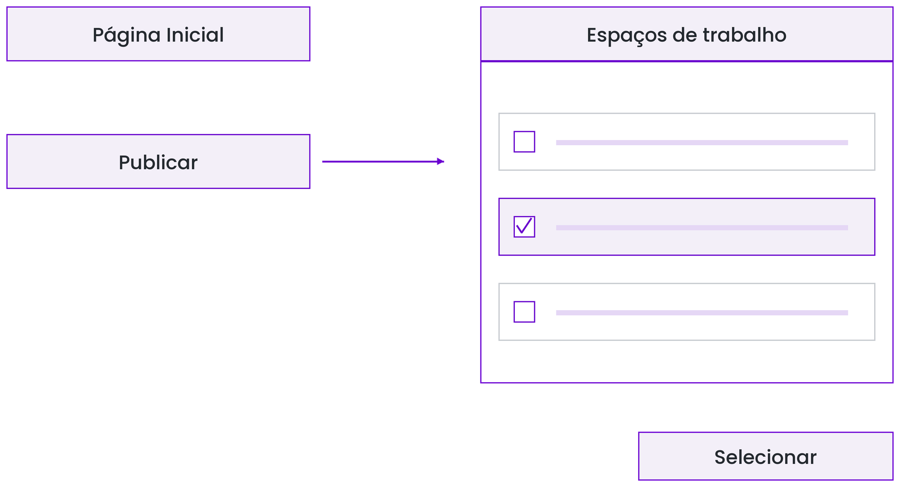
*Guia Visual 14 (Figura 3.26): O botão Publicar envia o arquivo .pbix para o Espaço de Trabalho.*

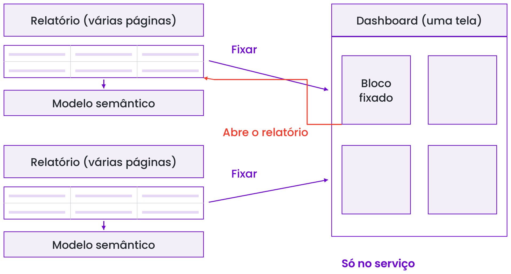
*Guia Visual 15 (Figura 3.27): Diferença arquitetural entre Modelo Semântico, Relatório e Dashboard.*

- **O Gateway de Dados: Como a Nuvem Conversa com o Servidor da Samarco?**
  - Desenhe na lousa: `[Rede Interna Samarco (Excel/SAP)] ➔ [Gateway] ➔ [Nuvem Power BI]`.
  - Explique a diferença crítica entre os dois modos de Gateway:
    - **Modo Pessoal:** Instalado no notebook do analista. Se o analista fechar a tampa do notebook ou sair de férias, o painel para de atualizar!
    - **Modo Padrão (Corporativo):** Instalado num servidor da TI da empresa que fica ligado 24 horas por dia. É o único caminho profissional para painéis de área.

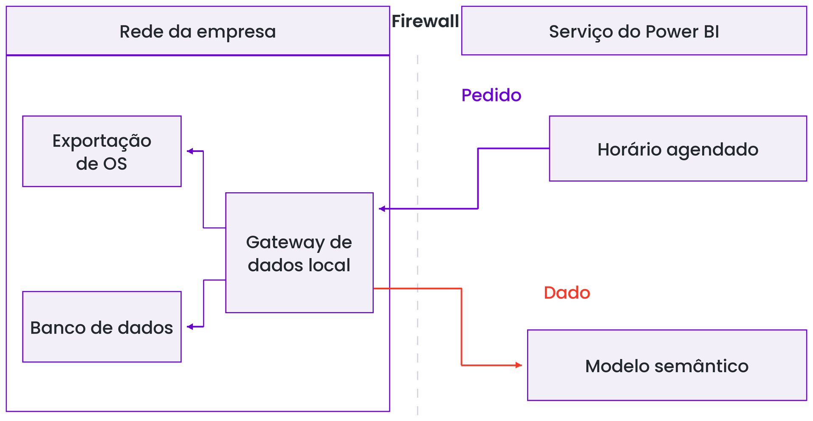
*Guia Visual 16 (Figura 3.29): O serviço aciona o gateway no horário agendado para buscar os dados na rede local.*

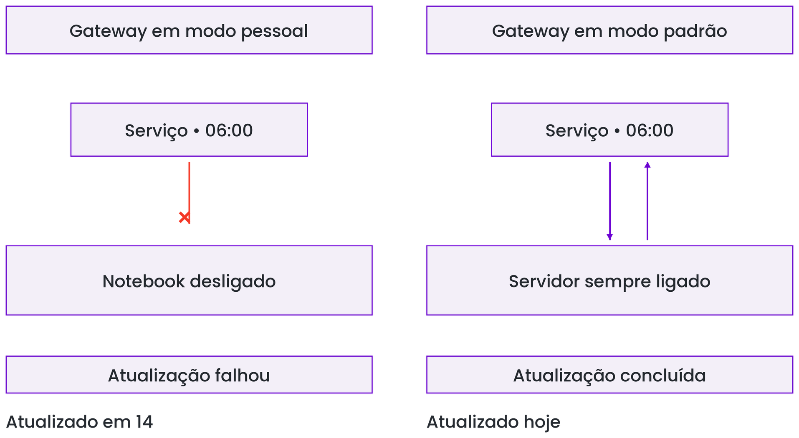
*Guia Visual 17 (Figura 3.31): Por que o gateway pessoal trava a atualização quando o notebook é desligado.*

---

### 2.3. Condução dos Dois Casos Integrados (Seção 3.9)

#### Caso 1: O Caso das "Horas em Dobro" (`OS_Marco_Auditoria.csv` + `Alocacao_Tecnicos_OS.csv`)
Conduza este caso como um **desafio de detetive** antes de os alunos fazerem no laboratório:
1. **Apresente os fatos na lousa:**
   - Exportação de março (`OS_Marco_Auditoria.csv`): **48 OS** | **92,0 horas paradas** | Empilhadeiras `EM-01` e `EM-02` = **23,0 horas**.
   - Planilha do supervisor (`Alocacao_Tecnicos_OS.csv`): tem o número da OS, o nome do técnico e o turno.
   - O analista usou **Mesclar Consultas** no Power Query para trazer a coluna `Técnico` para dentro da tabela de OS.
   - Resultado no Cartão: **131,5 horas paradas!** E as empilhadeiras subiram para **41,5 horas!**
2. **Lance as 3 perguntas da apostila (página 84) para a turma responder:**
   - **Pergunta A:** *"Que contagem de linhas, conferida no Power Query antes de carregar, teria denunciado o problema na hora?"*  
     ➔ **Resposta:** A barra de status do Power Query mostrou que a tabela de OS pulou de **48 linhas para 63 linhas** logo após expandir a coluna `Técnico`! (Porque 15 OS tiveram 2 técnicos trabalhando juntos).
   - **Pergunta B:** *"Se a planilha viesse com os dois técnicos na mesma célula (`Carlos Silva, Roberto Souza`), que problema sumiria e que pergunta ficaria difícil de responder?"*  
     ➔ **Resposta:** A duplicação das horas sumiria (continuariam 48 linhas), mas ficaria impossível filtrar ou contar quantas OS o `"Roberto Souza"` fez sozinho ou em dupla sem quebrar o texto!
   - **Pergunta C:** *"Qual é a solução correta no modelo do Power BI?"*  
     ➔ **Resposta:** Não mesclar no Power Query! Manter `OS` com 48 linhas e `Alocacao_Tecnicos_OS` como uma tabela separada de 63 linhas ligada pelo `Número da OS` (`1:*`). Assim cada OS soma suas horas uma única vez, e cada técnico recebe a contagem das OS em que participou!

---

#### Caso 2: O Painel que Parou no Dia 14
1. **Apresente o cenário (página 84):**
   - No dia 20, a gerência abre o painel de Utilidades e percebe que uma grande corretiva do dia 16 não está lá: a última OS do painel é do dia 14.
   - Além disso, na segmentação de Área aparecem duas caixas: `Utilidades` (88 horas) e `Utilidades` (19 horas).
2. **Discuta as 3 perguntas de revisão (página 85):**
   - **Pergunta A:** *"Se alguém abrir o Desktop, clicar em Atualizar e publicar de novo, a OS do dia 16 aparece. Mas por que isso não resolve a causa raiz?"*  
     ➔ Porque o problema está no **Gateway Pessoal** instalado no notebook de quem saiu de férias no dia 14. A solução definitiva é migrar para o **Gateway Padrão** no servidor da TI.
   - **Pergunta B:** *"Onde a duplicação de `'Utilidades'` e `'Utilidades '` (com espaço no final) poderia ter sido pega antes de publicar?"*  
     ➔ Na **Distribuição de Colunas (Seção 2.8)** dentro do Power Query (que mostraria 2 valores distintos onde deveria haver 1) ou aplicando **Transformar > Cortar (Trim)** por padrão em todas as colunas de texto.
   - **Pergunta C:** *"Se o painel usasse DirectQuery contra um banco de dados interno da empresa em vez de importar pasta, o gateway deixaria de ser necessário?"*  
     ➔ **Não!** O banco continua dentro da rede privada da empresa e o serviço continua na nuvem; o gateway continua obrigatório para intermediar as consultas em tempo real.
