# Roteiro Prático: Interação com os Datasets da Aula 3 no Power BI Desktop
**Curso:** Power BI e DAX para Manutenção (CEDTEC Guarapari · Samarco)  
**Módulo de Referência:** Capítulo 3 Completo (Seções 3.1 a 3.9 — *O painel que responde perguntas*)  
**Arquivos de Dados na Pasta `Dataset/Aula 3/`:**
- [`Dataset_PowerBI_Manutencao.xlsx`](./Dataset_PowerBI_Manutencao.xlsx) *(Base estruturada: Fato `OS`, Dimensões `Equipamentos` e `Calendario`, e `Metas por Area`)*
- [`OS_Marco_Auditoria.csv`](./OS_Marco_Auditoria.csv) *(48 OS de março somando 92,0 horas paradas — para o laboratório da Seção 3.9)*
- [`Alocacao_Tecnicos_OS.csv`](./Alocacao_Tecnicos_OS.csv) *(63 linhas de alocação com duplas de técnicos — para simular e corrigir o Caso das "Horas em Dobro" da Seção 3.9)*

---

## Visão Geral do Fluxo Prático da Aula 3

```
   ┌──────────────────────────────────────────────────────────────┐
   │        1. MODELAGEM E RELACIONAMENTOS (3.1, 3.2, 3.3)        │
   │  • Importar OS, Equipamentos e Calendario                    │
   │  • Ligar Equipamentos (1) ➔ (*) OS e Calendario (1) ➔ (*) OS │
   │  • Criar Hierarquia [Área > Equipamento] e ocultar chaves    │
   └──────────────────────────────┬───────────────────────────────┘
                                  ▼
   ┌──────────────────────────────────────────────────────────────┐
   │          2. PÁGINA 1: VISÃO GERAL EM 30 SEGUNDOS (3.4-3.6)   │
   │  • Topo: 3 Cartões (Horas Paradas, Total de OS, Custo R$)    │
   │  • Centro: Barras (Horas por Área/Equip.) + Linhas (Meses)   │
   │  • Base: Matriz (Área × Tipo de Manutenção) com Semáforo     │
   └──────────────────────────────┬───────────────────────────────┘
                                  ▼
   ┌──────────────────────────────────────────────────────────────┐
   │      3. INTERATIVIDADE, DRILL-THROUGH E PUBLICAÇÃO (3.7-3.8) │
   │  • Segmentações (Ano, Mês, Criticidade) + Sincronização      │
   │  • Editar Interações (trocar Realçar por Filtrar)            │
   │  • Página 2 de Detalhe + Publicação no Serviço               │
   └──────────────────────────────┬───────────────────────────────┘
                                  ▼
   ┌──────────────────────────────────────────────────────────────┐
   │       4. LABORATÓRIO DE AUDITORIA: HORAS EM DOBRO (3.9)      │
   │  • Importar OS_Marco_Auditoria.csv (48 OS = 92,0 h)          │
   │  • Simular o erro de mesclagem com Alocacao_Tecnicos_OS.csv  │
   │  • Ver o Cartão saltar para 131,5 h e corrigir no Modelo!    │
   └──────────────────────────────────────────────────────────────┘
```

---

# PARTE 1: Construindo o Modelo Estrela e Relacionamentos (Seções 3.1 a 3.3)

### Passo 1: Carregar as Tabelas do Modelo Principal
1. Abra o **Power BI Desktop**.
2. Na guia **Página Inicial**, clique em **Pasta de Trabalho do Excel**.
3. Selecione o arquivo [`Dataset_PowerBI_Manutencao.xlsx`](./Dataset_PowerBI_Manutencao.xlsx) na pasta `Dataset/Aula 3/`.
4. No Navegador, marque as caixas das tabelas:
   - ☑ `OS` *(Tabela Fato)*
   - ☑ `Equipamentos` *(Tabela Dimensão)*
   - ☑ `Calendario` *(Tabela Dimensão)*
5. Clique em **Carregar** (ou passe pelo **Transformar Dados** para conferir se os tipos estão corretos e clique em **Fechar e Aplicar**).

---

### Passo 2: O Teste das "Barras Iguais" (Antes de Relacionar)
*Objetivo: Ver na prática o que acontece quando falta relacionamento no modelo.*
1. Na **Exibição de Modelo** (3º ícone na barra esquerda), caso o Power BI tenha criado algum relacionamento automático entre `Equipamentos` e `OS`, clique com o botão direito sobre a linha e escolha **Excluir**.
2. Volte para a **Exibição de Relatório** (1º ícone à esquerda) e insira um **Gráfico de Colunas Clusterizadas**:
   - **Eixo X:** `Equipamentos[Área]`
   - **Eixo Y:** `OS[Horas Paradas]`
3. **Observe o sintoma clássico:** Todas as áreas (*Britagem, Moagem, Pelotização, Pátio, Utilidades*) aparecem exatamente com a mesma altura (repetindo o total geral de todas as OS)!

---

### Passo 3: Criar e Auditar os Relacionamentos no Esquema Estrela (Seção 3.2)
1. Volte para a **Exibição de Modelo**.
2. Posicione a tabela `OS` no centro da tela e as tabelas `Equipamentos` e `Calendario` acima dela.

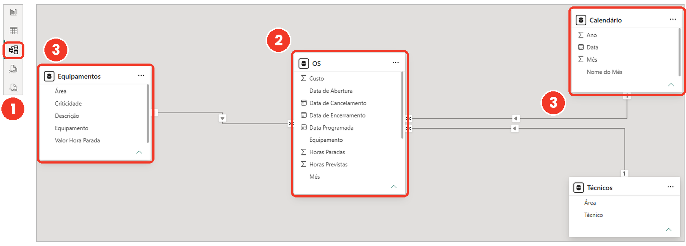
*Figura 1: Disposição em Esquema Estrela — Fato no centro e Dimensões ao redor.*

3. **Ligar Equipamentos à OS:**
   - Arraste a coluna `Equipamento` da tabela `Equipamentos` e solte exatamente em cima da coluna `Equipamento` da tabela `OS`.
   - Dê duplo clique na linha criada para abrir a janela **Editar relacionamento** e confira:
     - **Cardinalidade:** `Muitos para um (*:1)` (ou `1:*` de Equipamentos para OS).
     - **Direção do filtro cruzado:** `Único` (*Single*).
     - ☑ **Ativar este relacionamento**.

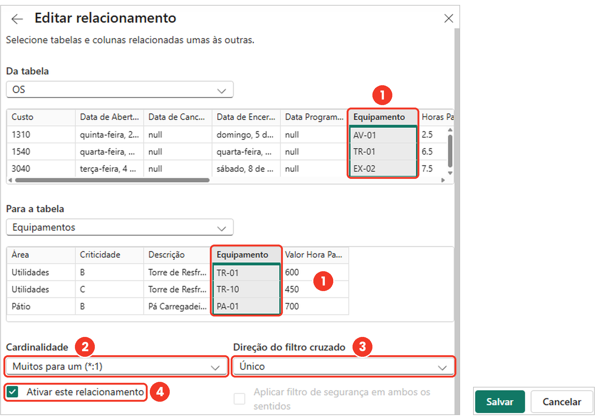
*Figura 2: Janela Editar Relacionamento confirmando cardinalidade *:1 e direção de filtro Único.*

4. **Ligar Calendário à OS:**
   - Arraste a coluna `Data` da tabela `Calendario` e solte sobre a coluna `Data de Abertura` da tabela `OS`.
   - Confirme a cardinalidade `1:*` e direção `Único`.
5. Volte para a **Exibição de Relatório** e olhe o gráfico que antes tinha barras iguais: agora cada área exibe exatamente as suas horas reais!

---

### Passo 4: Criar Hierarquia, Renomear e Ocultar Chaves Técnicas (Seção 3.3)
1. No painel **Dados** (à direita), expanda a tabela `Equipamentos`.
2. Clique com o botão direito sobre a coluna **Área** ➔ selecione **Criar hierarquia**.
3. Clique com o botão direito sobre a coluna **Equipamento** (ainda na tabela `Equipamentos`) ➔ **Adicionar à hierarquia** ➔ **Hierarquia Área**.

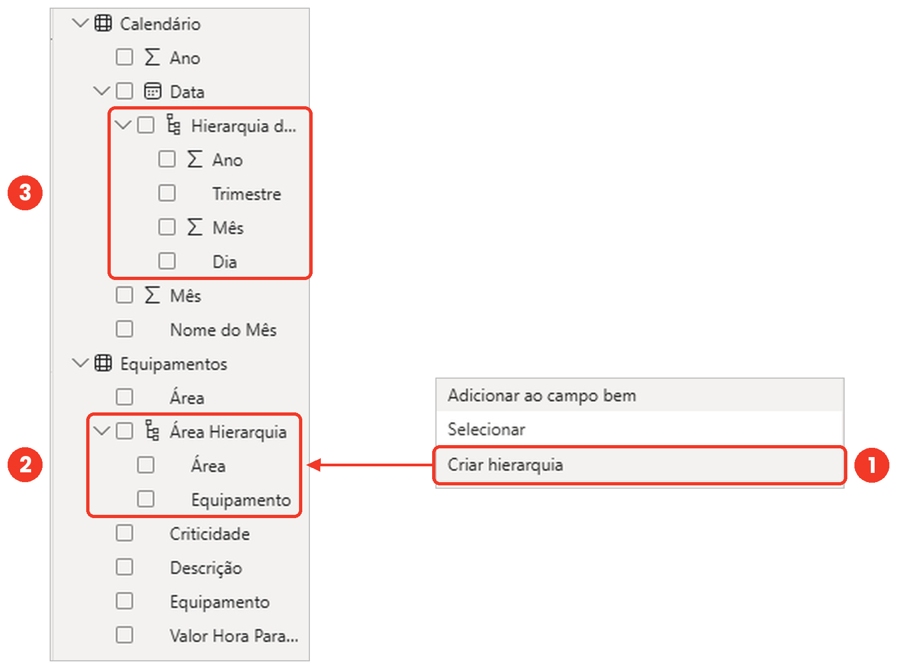
*Figura 3: Hierarquia criada no painel Dados pronta para navegação em níveis (Drill-down).*

4. Agora expanda a tabela fato `OS` no painel **Dados**.
5. Clique com o botão direito sobre a coluna `Equipamento` (da tabela `OS`) ➔ selecione **Ocultar da visualização de relatório**.
   - *Por quê?* Para garantir que ninguém arraste a coluna da Fato para os gráficos ou filtros, obrigando o uso da coluna da Dimensão `Equipamentos`.


*Figura 4: Ocultando chaves estrangeiras da tabela fato para limpar a lista de campos do relatório.*

---

# PARTE 2: Montando a Página 1 — "Visão Geral" (Seções 3.4, 3.5 e 3.6)

Renomeie a aba inferior `Página 1` para **Visão Geral**. Vamos seguir a arquitetura de leitura em "Z" da apostila:

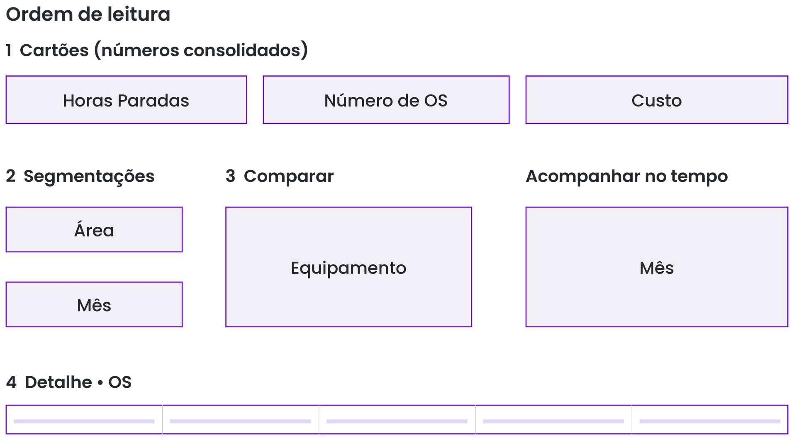
*Figura 5: Mapa de distribuição visual da página — Cartões no topo, Segmentações à esquerda, Comparação e Tempo no centro e Detalhe embaixo.*

---

### Passo 1: Os 3 Cartões de Resumo no Topo (Seções 3.4 e 3.6)
1. Clique em uma área em branco do relatório e selecione o visual **Cartão** no painel **Visualizações**.
2. **Cartão 1 — Total de Horas Paradas:**
   - Arraste `OS[Horas Paradas]` para o campo **Campos**.
   - A agregação padrão será `Soma de Horas Paradas`.
   - No pincel (**Formatar seu visual**) ➔ **Geral** ➔ **Título** (ou no rótulo): renomeie o campo dando duplo clique nele no painel Visualizações para `Horas Paradas`.
3. **Cartão 2 — Quantidade de OS:**
   - Adicione um novo **Cartão** ao lado.
   - Arraste `OS[Número da OS]` para **Campos**.
   - Clique na setinha ao lado do campo no painel Visualizações e troque de *Soma* para **Contagem (Distinta)** ou **Contagem**.
   - Renomeie no visual para `Total de OS`.

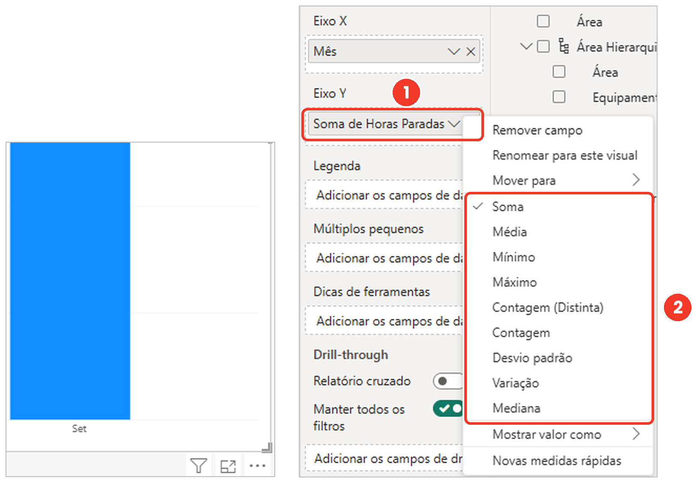
*Figura 6: Alterando a agregação implícita do campo diretamente no painel Visualizações.*

4. **Cartão 3 — Custo Total de Manutenção:**
   - Adicione o terceiro **Cartão** à direita.
   - Arraste `OS[Custo (R$)]` para **Campos** (agregação: *Soma*).

---

### Passo 2: Gráfico de Colunas/Barras com Hierarquia — Comparação (Seção 3.5)
*Pergunta respondida: "Qual área ou equipamento mais parou, e qual tipo de manutenção pesa mais?"*
1. Insira um **Gráfico de colunas empilhadas** (ou **Gráfico de barras clusterizadas**) no centro-esquerdo da página.
2. Configure as três caixas do visual:
   - **Eixo X:** Arraste a `Hierarquia Área` (`Área > Equipamento`) da tabela `Equipamentos`.
   - **Eixo Y:** Arraste `OS[Horas Paradas]`.
   - **Legenda:** Arraste `OS[Tipo de Manutenção]`.

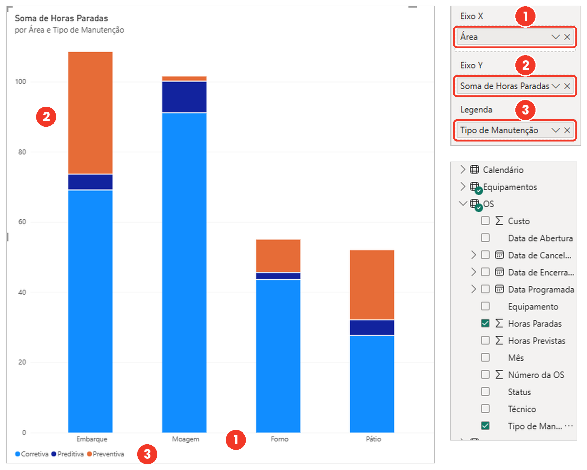
*Figura 7: Configuração de Eixo, Valor e Legenda no gráfico de colunas por área e tipo de manutenção.*

3. No pincel **Formatar seu visual**, ligue a chave **Rótulos de dados** (e **Rótulos totais**, se empilhado).
4. Teste os **Ícones de Drill Down** no canto superior direito do gráfico:
   - Clique na **seta única para baixo** (*Clique para ativar o Drill Down*) e depois clique sobre a barra da **Britagem**: o gráfico desce imediatamente para mostrar apenas os equipamentos da Britagem (`BR-01`, `BR-02`, `PN-01`)!
   - Clique na **seta para cima** (*Subir nível*) para voltar à visão por Área.

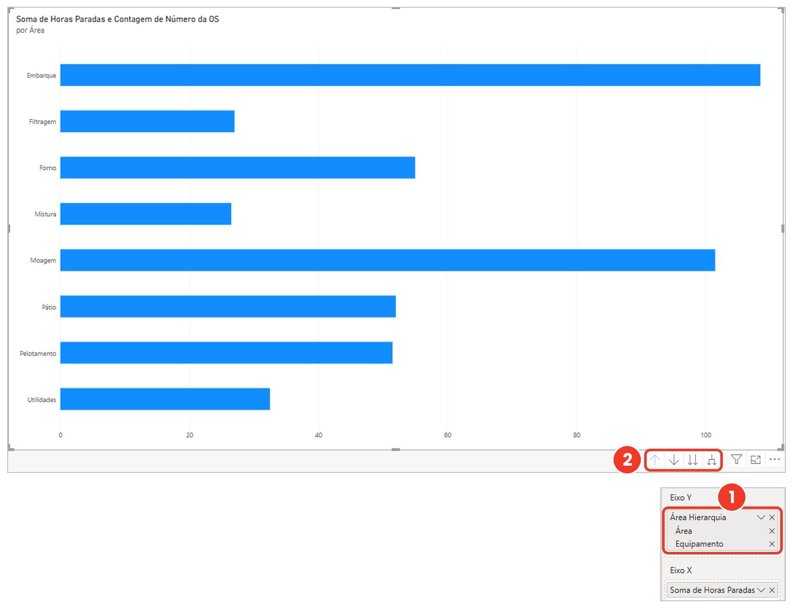
*Figura 8: Os botões de navegação de hierarquia no cabeçalho do gráfico.*

---

### Passo 3: Gráfico de Linhas — Acompanhamento no Tempo (Seção 3.5)
*Pergunta respondida: "As horas paradas estão subindo ou caindo mês a mês?"*
1. Insira um **Gráfico de linhas** no centro-direito da página.
2. Configure os campos:
   - **Eixo X:** Arraste `Calendario[Ano-Mês]` (ou a hierarquia de `Calendario[Data]` mantendo Ano e Mês).
   - **Eixo Y:** Arraste `OS[Horas Paradas]`.
3. **Ordenação Cronológica:** Clique nos três pontinhos (`...`) no canto superior do gráfico ➔ **Classificar eixo** ➔ selecione **Ano-Mês** e depois **Classificar em ordem crescente**.
4. Ative os **Marcadores** e os **Rótulos de dados** no painel de formatação (pincel).

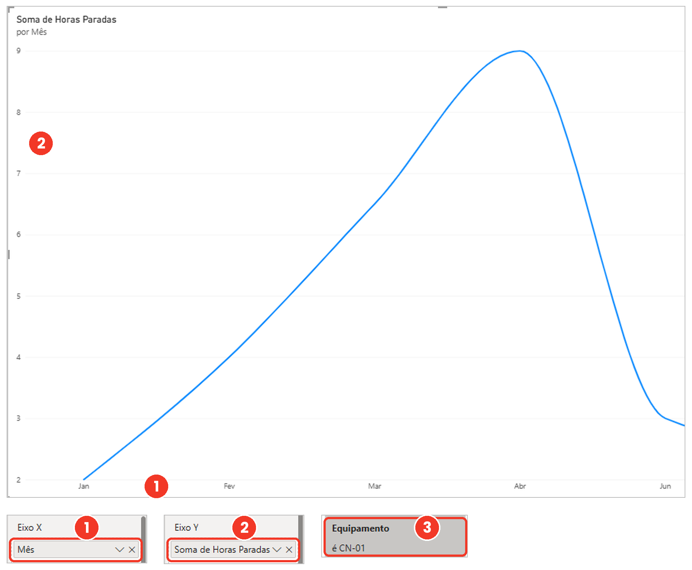
*Figura 9: Gráfico de linhas com eixo temporal ordenado revelando a inclinação de tendência.*

---

### Passo 4: Matriz com Formatação Condicional — Concentração (Seção 3.6)
*Pergunta respondida: "Onde está o gargalo no cruzamento entre Área e Tipo de Manutenção?"*
1. Na parte inferior da página, adicione o visual **Matriz**.
2. Preencha as três áreas da Matriz:
   - **Linhas:** `Equipamentos[Área]`
   - **Colunas:** `OS[Tipo de Manutenção]`
   - **Valores:** `OS[Horas Paradas]`
3. **Aplicar Formatação Condicional:**
   - No painel Visualizações, clique na setinha ao lado de `Horas Paradas` (dentro de *Valores*).
   - Passe o mouse em **Formatação condicional** e ative:
     - **Cor da tela de fundo** (gradiente do branco/verde suave para o vermelho nas maiores horas) **OU**
     - **Barras de dados** e **Ícones** (semáforo por faixa de horas).

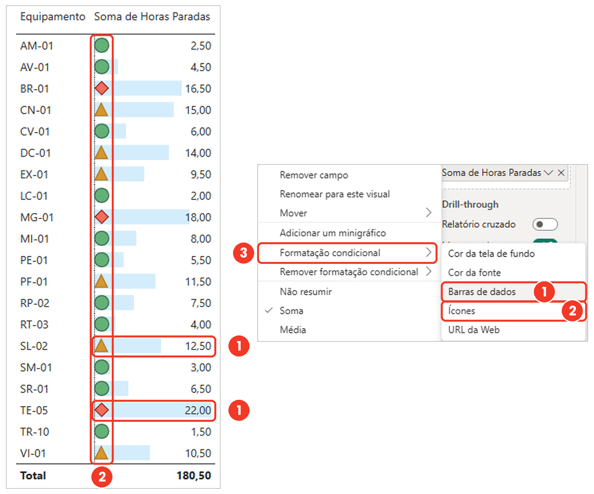
*Figura 10: Barras de dados e ícones aplicados na matriz para evidenciar a concentração antes da leitura numérica.*

---

# PARTE 3: Segmentações, Interações e Página de Detalhe (Seções 3.7 e 3.8)

### Passo 1: Criar Segmentações de Dados na Coluna Esquerda (Seção 3.7)
1. Adicione um visual de **Segmentação de dados** no canto esquerdo:
   - Arraste `Calendario[Ano]`.
   - Em **Formatar seu visual** ➔ **Configurações da segmentação** ➔ **Opções** ➔ Estilo: **Bloco** (ou Mosaico).
2. Adicione uma segunda **Segmentação de dados** logo abaixo:
   - Arraste `Equipamentos[Área]`.
   - Estilo: **Lista vertical**.
3. Adicione uma terceira **Segmentação de dados**:
   - Arraste `Equipamentos[Criticidade]`.
   - Estilo: **Suspenso** (*Dropdown*).

---

### Passo 2: Ajustar "Editar Interações" — Trocar Realçar por Filtrar (Seção 3.7)
1. Clique sobre o **Gráfico de Colunas por Área** para selecioná-lo.
2. Na faixa superior do Power BI Desktop, clique na guia **Formato** (ao lado de *Exibição*) e ative o botão **Editar interações**.
3. Observe os pequenos ícones que surgiram no canto superior direito dos demais visuais:
   - No **Gráfico de Linhas**, clique no ícone de **Filtrar (funil)**.
   - Na **Matriz**, confirme que está marcado **Filtrar (funil)**.
4. Desative o botão **Editar interações** na guia Formato.
5. **Teste prático:** Clique na barra da área **Britagem** (ou filtre o equipamento `RA-01`). Veja como a linha do tempo agora redesenha a curva exclusiva daquela seleção, respondendo em segundos se as paradas estão subindo ou caindo!

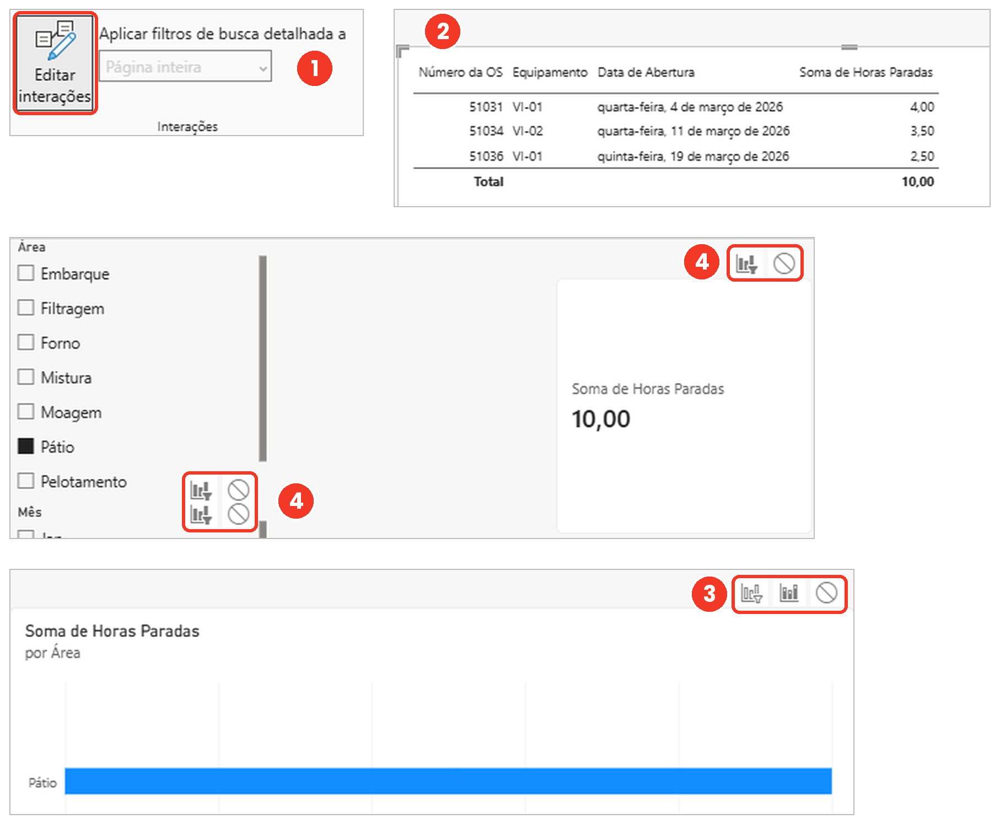
*Figura 11: Com o botão Editar Interações ativo, trocamos o realce parcial pelo filtro direto.*

---

### Passo 3: Configurar o Painel Filtros e Sincronizar Segmentações (Seção 3.7)
1. Abra o painel **Filtros** (à direita do relatório).
2. Arraste a coluna `OS[Status]` para a caixa **Filtros em todas as páginas**.
3. Marque `Encerrada` e `Aberta` (desmarcando `Cancelada`) e clique no **ícone de cadeado** (*Bloquear filtro*) para que as OS canceladas não distorçam nenhum indicador.

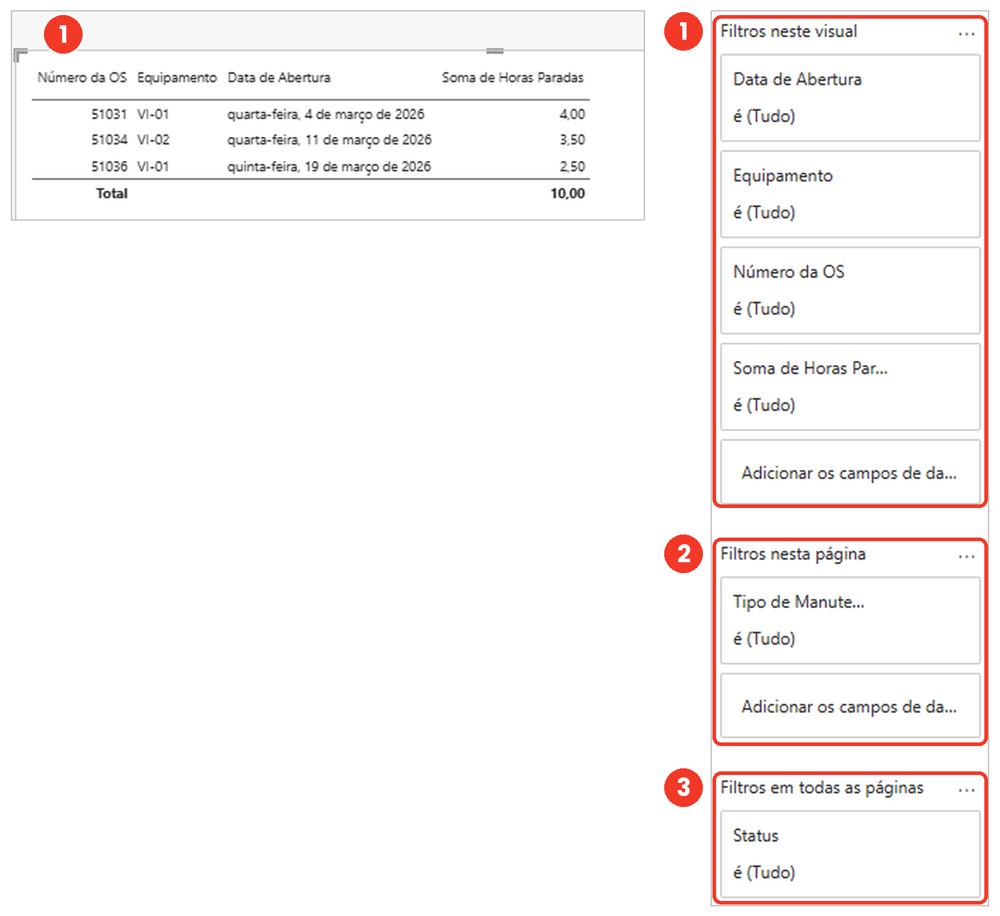
*Figura 12: Os três níveis do painel Filtros — neste visual, nesta página e em todas as páginas.*

4. Crie uma segunda página clicando no botão `+` no rodapé e renomeie para **Detalhe por Equipamento**.
5. Nela, insira uma **Tabela** com as colunas: `Número da OS`, `Data de Abertura`, `Equipamento`, `Tipo de Manutenção`, `Horas Paradas`, `Custo (R$)` e `Descrição da Falha/Serviço`.
6. Copie (`Ctrl+C`) as segmentações de `Ano` e `Área` da página **Visão Geral** e cole (`Ctrl+V`) na página **Detalhe por Equipamento**.
7. Quando o Power BI perguntar *"Sincronizar visuais?"*, clique em **Sincronizar**!

---

### Passo 4: Salvar e Publicar no Serviço (Seção 3.8)
1. Salve seu projeto (`Ctrl+B` ou `Arquivo > Salvar como`) com o nome `Painel de Manutencao.pbix`.
2. Na guia **Página Inicial**, clique no botão **Publicar** (para demonstração com conta corporativa/Microsoft).

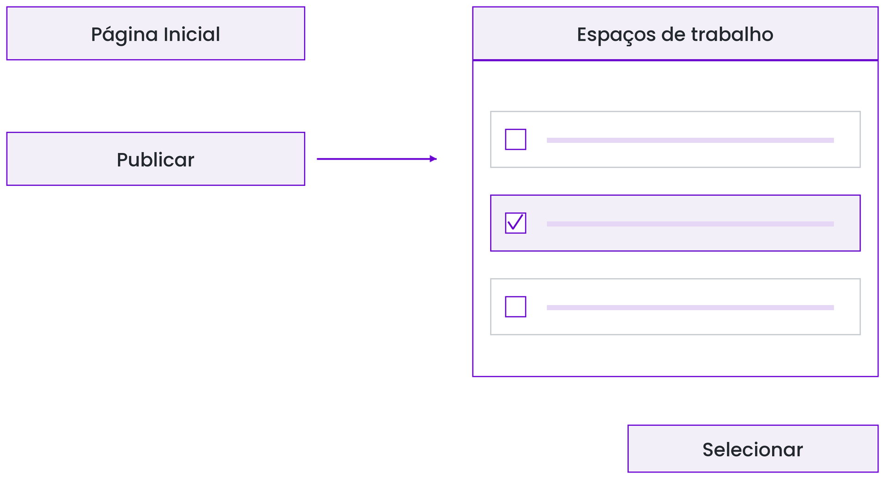
*Figura 13: O comando Publicar envia o modelo semântico e o relatório para o Espaço de Trabalho na nuvem.*

---

# PARTE 4: Laboratório Prático do Caso 1 — "As Horas em Dobro" (Seção 3.9)
*Simulando e corrigindo no Power BI o erro clássico da página 83 da Apostila com os arquivos CSV da pasta `Dataset/Aula 3/`.*

### O Cenário Real
Em março, a planta registrou **48 ordens de serviço** que somam exatamente **92,0 horas paradas** (sendo **23,0 horas** nas empilhadeiras `EM-01` e `EM-02`).  
O supervisor enviou uma planilha de alocação ([`Alocacao_Tecnicos_OS.csv`](./Alocacao_Tecnicos_OS.csv)) com os técnicos que trabalharam em cada OS. Vamos ver o que acontece quando mesclamos essa planilha na tabela de OS e como consertar!

---

### Passo 1: Importar os Dois Arquivos CSV da Auditoria
1. Na guia **Página Inicial**, clique em **Texto/CSV** e carregue [`OS_Marco_Auditoria.csv`](./OS_Marco_Auditoria.csv).
2. Clique em **Texto/CSV** novamente e carregue [`Alocacao_Tecnicos_OS.csv`](./Alocacao_Tecnicos_OS.csv).
3. Crie uma nova página no relatório chamada **Caso 3.9 - Horas em Dobro**.
4. Coloque na tela:
   - Um **Cartão** com `OS_Marco_Auditoria[Horas Paradas]` ➔ **Conferência: mostra `92,0`!**
   - Um **Cartão** com `Contagem de Número da OS` ➔ **Conferência: mostra `48`!**
   - Um **Gráfico de Barras** com `Equipamento` no Eixo Y e `Horas Paradas` no Eixo X ➔ **Conferência: `EM-01` (12,0 h) + `EM-02` (11,0 h) somam `23,0 h`!**

---

### Passo 2: Provocar o Erro das "Horas em Dobro" no Power Query
1. Clique em **Transformar dados** (guia *Página Inicial*) para abrir o Power Query.
2. Selecione a consulta `OS_Marco_Auditoria`.
3. Na guia **Página Inicial**, clique em **Mesclar Consultas**.
4. Na janela *Mesclar*:
   - Tabela de cima: `OS_Marco_Auditoria` (clique na coluna `Número da OS`).
   - Tabela de baixo: `Alocacao_Tecnicos_OS` (clique na coluna `Número da OS`).
   - Clique em **OK**.
5. Clique no botão de **Expandir** (duas setinhas) no cabeçalho da coluna `Alocacao_Tecnicos_OS`:
   - Marque apenas `Técnico` e `Turno` e clique em **OK**.
6. **Olhe a barra de status inferior do Power Query:**  
   ⚠️ **As 48 linhas viraram 63 linhas!** (Porque 15 OS tiveram 2 técnicos alocados!).
7. Clique em **Fechar e Aplicar** e olhe o que aconteceu na página do relatório:
   - O Cartão de Horas Paradas saltou de **92,0 h** para **131,5 h**!
   - As empilhadeiras `EM-01` e `EM-02` saltaram de **23,0 h** para **41,5 h**!

---

### Passo 3: Aplicar a Correção Definitiva no Modelo
1. Volte ao **Power Query** (`Transformar dados`), selecione a consulta `OS_Marco_Auditoria` e, no painel **Etapas Aplicadas** à direita, **exclua (`X`)** as etapas `Alocacao_Tecnicos_OS Expandido` e `Consultas Mescladas`.
   - *A tabela `OS_Marco_Auditoria` volta a ter exatamente 48 linhas (1 linha por OS)!*
2. Clique em **Fechar e Aplicar**.
3. Vá para a **Exibição de Modelo** e crie um **Relacionamento** arrastando `OS_Marco_Auditoria[Número da OS]` (`1`) até `Alocacao_Tecnicos_OS[Número da OS]` (`*`).
4. Volte ao relatório:
   - O Cartão voltou para **92,0 horas**!
   - As empilhadeiras voltaram para **23,0 horas**!
   - E você pode adicionar uma tabela ou gráfico por `Técnico` usando a coluna da tabela `Alocacao_Tecnicos_OS` sem inflar o total geral da usina!

---

## Checklist de Validação da Aula 3 (Gabarito Rápido)

| Item Conferido no Power BI | Valor Esperado | Onde Conferir |
| :--- | :--- | :--- |
| Relacionamento `Equipamentos` ➔ `OS` | `1:*` (Filtro Único) | Exibição de Modelo |
| Relacionamento `Calendario` ➔ `OS` | `1:*` (Filtro Único) | Exibição de Modelo |
| Coluna `OS[Equipamento]` | Oculta (olho cortado) | Painel Dados |
| `OS_Marco_Auditoria` (Total de OS) | **48 OS** | Cartão (Caso 3.9) |
| `OS_Marco_Auditoria` (Horas Reais) | **92,0 horas** | Cartão (Caso 3.9) |
| Horas `EM-01` + `EM-02` (Reais) | **23,0 horas** (`12,0` + `11,0`) | Gráfico de Barras (Caso 3.9) |
| Horas após mesclagem errada (Erro) | **131,5 horas** (`63 linhas`) | Simulação do erro no Power Query |
