# Roteiro de Apoio para Explicação dos Temas — Aula 4 (Slide a Slide)
**Curso:** Power BI e DAX para Manutenção (CEDTEC Guarapari · Samarco)  
**Apresentação Oficial:** [`Aulas/Power BI e DAX para Manutenção — Dia 4 · Falando DAX.pptx`](../../Aulas/Power%20BI%20e%20DAX%20para%20Manuten%C3%A7%C3%A3o%20%E2%80%94%20Dia%204%20%C2%B7%20Falando%20DAX.pptx) *(25 Slides — Seções 4.1 a 5.2)*  
**Objetivo deste Guia:** Acompanhar exatamente a sequência dos **25 slides** da apresentação do Dia 4 (*Falando DAX*), fornecendo ao professor o discurso didático, as contas de quadro branco, as pegadinhas e a dinâmica *"Adivinhe o número"*.

---

## Mapa dos 25 Slides da Aula 4

```
┌────────────────────────────────────────────────────────────────────────────┐
│ ABERTURA (Slides 1 a 3): Pergunta da PF-01, Objetivos e Cronograma         │
├────────────────────────────────────────────────────────────────────────────┤
│ BLOCO 4.1 · 4.2 (Slides 4 a 7): Medidas × Colunas Calculadas               │
│ • S05: Excel × DAX | S06: PF-01 (1.266,67 vs 1.360) | S07: Medida × Coluna │
├────────────────────────────────────────────────────────────────────────────┤
│ BLOCO 4.3 a 4.5 (Slides 8 a 13): Sintaxe, DIVIDE, SWITCH e VAR             │
│ • S09: Anatomia | S10: COUNT × COUNTROWS | S11: DIVIDE | S12: SWITCH | S13: VAR
├────────────────────────────────────────────────────────────────────────────┤
│ BLOCO 4.6 · 4.7 (Slides 14 a 18): Contexto de Filtro, Linha e SUMX         │
│ • S15-16: EX-01, EX-02, PC-01 | S17: SUM na Coluna | S18: SUMX + RELATED   │
├────────────────────────────────────────────────────────────────────────────┤
│ BLOCO 5.1 · 5.2 (Slides 19 a 25): CALCULATE, REMOVEFILTERS e Checkpoint    │
│ • S20: CALCULATE Corretiva | S21-22: % da Área | S23: Adivinhe o Número    │
└────────────────────────────────────────────────────────────────────────────┘
```

---

# ABERTURA (Slides 1 a 3)

### Slide 1 — Capa e Pergunta do Dia
- **Texto do Slide:** *"Pergunta do dia: Quanto custa, em reais, cada hora parada da perfuratriz PF-01?"*
- **Como Provocar a Turma na Abertura:**
  - Até ontem (Dia 3), arrastávamos uma coluna numérica para o visual e o Power BI somava ou contava sozinho.
  - Mas hoje a pergunta cruza **duas grandezas**: `Custo (R$)` dividido por `Horas Paradas`. Se você tentar resolver isso criando uma coluna de divisão na tabela e tirando a média no gráfico, **a conta dá errada**! É por isso que o DAX existe.

### Slides 2 e 3 — Objetivos e Cronograma do Dia 4
- **Manhã (Seções 4.1 a 4.5):** Diferenciar medida de coluna calculada, sintaxe DAX, agregações conferidas à mão, `DIVIDE`, `SWITCH` e variáveis `VAR`.
- **Tarde (Seções 4.6 a 5.2):** Contexto de filtro vs contexto de linha, `SUMX` com `RELATED`, `CALCULATE` e percentual do total com `REMOVEFILTERS`.

---

# BLOCO 4.1 · 4.2: Medidas e Colunas Calculadas (Slides 4 a 7)

### Slide 4 e Slide 5 — Ideia Central: "No DAX, a fórmula aponta para colunas, não para células"
- **O Choque Cultural de Quem Vem do Excel:**
  - **No Excel (`=SOMA(D2:D40)`):** Você trabalha num "papel quadriculado". A fórmula mora dentro da célula `D41` e aponta para um intervalo de coordenadas fixas. Se entrarem 10 linhas novas na linha 41, a soma antiga fica para trás.
  - **No DAX (`Total de Horas Paradas = SUM(OS[Horas Paradas])`):** Não existe célula `D2`! A fórmula tem um **nome próprio**, mora no modelo de dados e aponta para a **coluna inteira** `OS[Horas Paradas]`. Quem decide quais linhas entram na soma são os **filtros** do relatório!

---

### Slide 6 — Situação: "Quanto custa cada hora parada da PF-01?" (Conta no Quadro Branco!)
Copie a tabela do **Slide 6** no quadro e faça a conta junto com a turma:

| OS da `PF-01` | Custo (R$) | Horas | `R$/hora` (Custo ÷ Horas da linha) |
| :---: | :---: | :---: | :---: |
| **1ª** | `9.000` | `6,0` | `1.500` |
| **2ª** | `2.000` | `2,5` | `800` |
| **3ª** | `6.000` | `4,0` | `1.500` |
| **Total** | **`17.000`** | **`12,5`** | **`?`** |

- **Pergunte para a sala:** *"Qual é o custo por hora parada da PF-01 no mês?"*
  - **Caminho A (Coluna Calculada + Média):** Se criarmos a 4ª coluna (`1.500`, `800`, `1.500`) e pedirmos a **média** dela:
    $$\frac{1.500 + 800 + 1.500}{3} = \mathbf{1.266,67\text{ R\$/h}}$$
  - **Caminho B (Medida — Razão dos Totais):** Se somarmos primeiro todo o dinheiro gasto (`R$ 17.000`) e dividirmos pelo total de horas que a máquina ficou parada (`12,5 h`):
    $$\frac{17.000}{12,5} = \mathbf{1.360,00\text{ R\$/h}}$$
- **Qual número representa a realidade física e financeira da `PF-01`?**
  - **`R$ 1.360,00`!** (Porque $12,5\text{ h} \times 1.360 = \text{R\$ } 17.000$ gastos!).
  - *Por que `1.266,67` está errado?* Porque a média simples de uma coluna dá o mesmo peso (1/3) para uma parada rápida de `2,5 h` e para uma parada longa de `6,0 h`. **Média de médias (ou razão de colunas) não se tira em coluna calculada!**

---

### Slide 7 — Ideia Central: "A medida calcula na hora; a coluna calculada guarda o valor"
Resuma os dois lados do **Slide 7**:
- **Medida:**
  - Calculada **quando o visual pede o número** (em tempo de execução).
  - Respeita o filtro de cada célula (soma todo o numerador filtrado e divide por todo o denominador filtrado).
  - Não ocupa espaço na memória da tabela.
- **Coluna calculada:**
  - Calculada **linha a linha na carga** de dados.
  - Fica guardada fisicamente no arquivo `.pbix`.
  - **Boa para:** classificar cada OS (ex: faixa de custo `"Baixo / Médio / Alto"` para colocar num filtro ou eixo).
  - **Ruim para:** razões de totais (`R$/hora`, `MTTR`, `MTBF`, `%`).

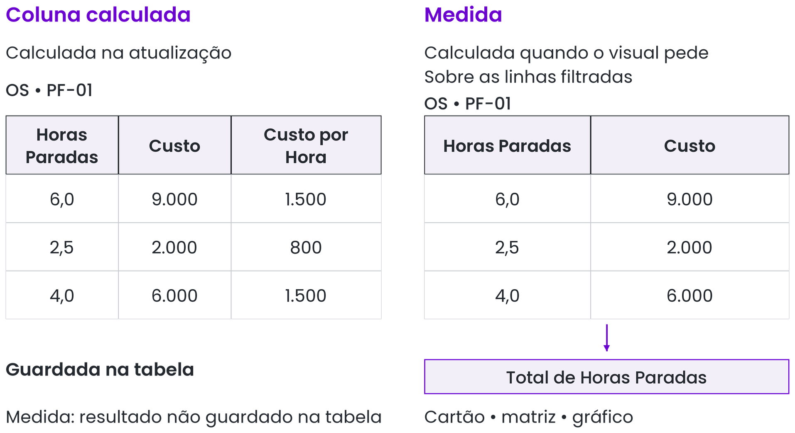
*Guia Visual 1 (Figura 4.3): A coluna calculada preenche a tabela na carga; a medida responde dinamicamente ao visual.*

---

# BLOCO 4.3 · 4.4 · 4.5: Sintaxe, Divisão Segura e Variáveis (Slides 8 a 13)

### Slide 8 e Slide 9 — Como Fazer: "Anatomia de uma medida"
Escreva no quadro as duas fórmulas do **Slide 9** e aponte cada peça:
```dax
Total de Horas Paradas = SUM( OS[Horas Paradas] )
Quantidade de OS = COUNTROWS( OS )
```
- **As 3 Regras de Ouro de Sintaxe do Slide 9:**
  1. **Antes do `=`:** Nome claro da medida (com espaços e acentos normais, porque vai aparecer no título do gráfico).
  2. **Referência a Coluna:** Sempre `Tabela[Coluna]` (`OS[Horas Paradas]`). Nunca escreva uma coluna sozinha sem o nome da tabela antes!
  3. **Referência a Medida já existente:** Sempre só o nome entre colchetes (`[Total de Horas Paradas]`), **sem** o nome da tabela antes! (É assim que um analista bate o olho numa fórmula e sabe o que é coluna e o que é medida!).

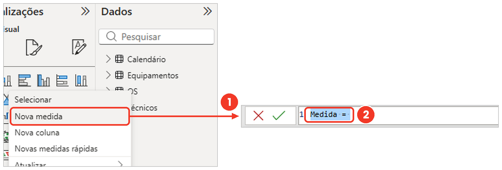
*Guia Visual 2 (Figura 4.4): Criando uma nova medida pelo clique direito na tabela.*

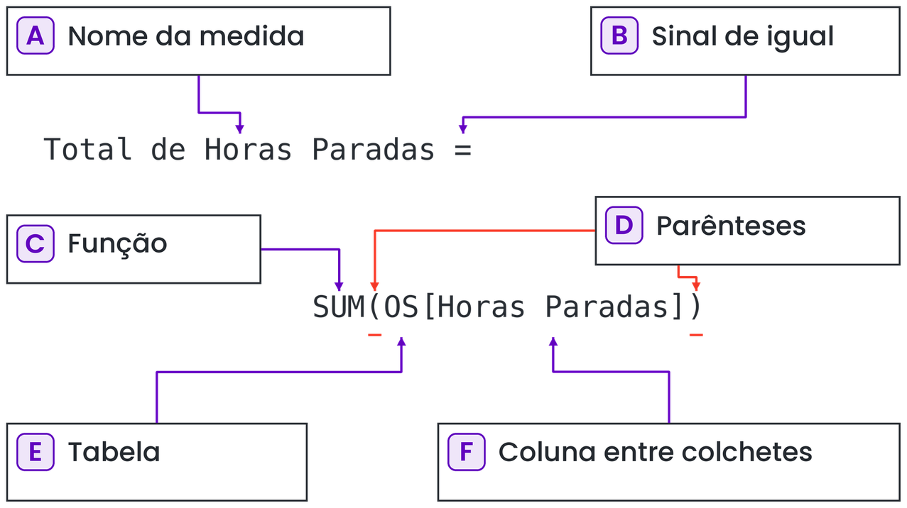
*Guia Visual 3 (Figura 4.5): Os 6 elementos que formam uma medida.*

---

### Slide 10 — Situação: "`COUNT` e `COUNTROWS` dão números diferentes"
- **Explique o exemplo dos 2 alimentadores vibratórios (`Slide 10`):**
  - Foram abertas **6 ordens de serviço** para 2 máquinas (`AV-01` e `AV-02`).
  - As 5 primeiras OS têm horas apontadas que somam `15,0 h` (`4,0 + 2,0 + 3,0 + 5,0 + 1,0`).
  - A **6ª OS ainda está aberta** e a célula de `Horas Paradas` está **em branco (`BLANK`)**.
- **Conferência das 5 funções no quadro:**
  - `SUM (horas)` = **`15,0`**
  - `AVERAGE (horas)` = **`3,0`** ($15,0 \div 5$ — o vazio não entra no divisor! Mas atenção: se fosse `0` em vez de vazio, dividiria por 6 dando `2,5`!).
  - `COUNT (horas)` = **`5`** (conta só as células preenchidas da coluna!).
  - `COUNTROWS (OS)` = **`6`** (conta as linhas da tabela, mesmo com campos em branco!).
  - `DISTINCTCOUNT (Equipamento)` = **`2`** (quantas máquinas diferentes tiveram OS).
- **Conclusão do Slide 10:** *Para contar quantas OS existem, use sempre **`COUNTROWS(OS)`**!*

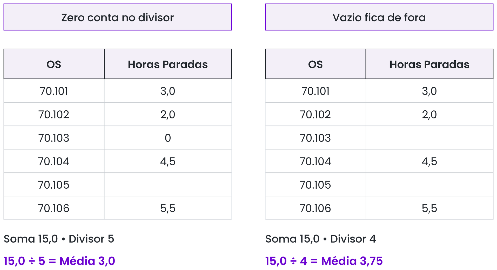
*Guia Visual 4 (Figura 4.7): Diferença entre zero e vazio (BLANK) no cálculo da média.*

---

### Slide 11 — Como Fazer: "`DIVIDE` evita a divisão por zero"
- **O Caso das Retificadoras `RT-01`, `RT-02` e `RT-03` (Slide 11):**
  ```dax
  Custo por Hora = DIVIDE( [Custo Total], [Total de Horas Paradas] )
  ```
  - **`RT-01`:** `R$ 8.400 ÷ 7,0 h = R$ 1.200/h`.
  - **`RT-03`:** `R$ 9.600 ÷ 12,0 h = R$ 800/h`.
  - **`RT-02`:** Teve uma inspeção preditiva em marcha: gastou `R$ 1.500`, mas teve **`0 horas paradas`**!
  - Se você dividisse com a barra `/`, `1.500 / 0` daria `Infinity`, poluindo a matriz inteira. Com **`DIVIDE`**, `1.500 ÷ 0` devolve **`BLANK` (vazio)** silenciosamente!

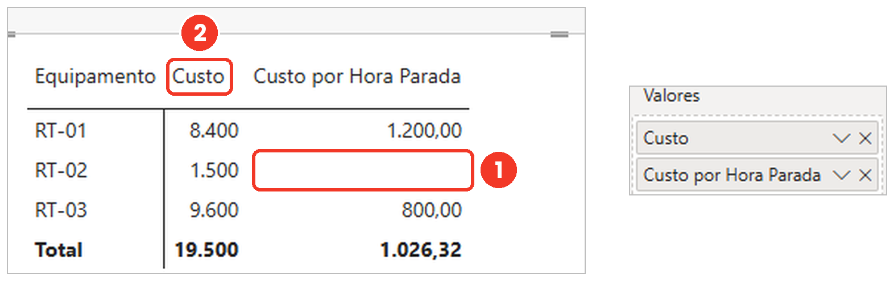
*Guia Visual 5 (Figura 4.8): A linha da RT-02 fica limpa quando protegida por DIVIDE.*

---

### Slide 12 — Como Fazer: "`SWITCH` classifica sem aninhar vários `IF`"
- **Explicando a Coluna Calculada do Slide 12:**
  ```dax
  Faixa de Custo = SWITCH( TRUE(),
      OS[Custo] <= 1000, "Baixo",
      OS[Custo] <= 5000, "Médio",
      "Alto" )
  ```
- **A Pegadinha da Ordem (Slide 12):**
  - `SWITCH(TRUE(), ...)` testa as condições de cima para baixo e **para na primeira que der verdadeiro**.
  - Se o aluno colocar `OS[Custo] <= 5000, "Médio"` na primeira linha e `OS[Custo] <= 1000, "Baixo"` na segunda, uma OS de `R$ 400` passa no primeiro teste (`400 <= 5000` é verdade!) e sai errada como `"Médio"`. Nenhuma OS sairia como `"Baixo"`!

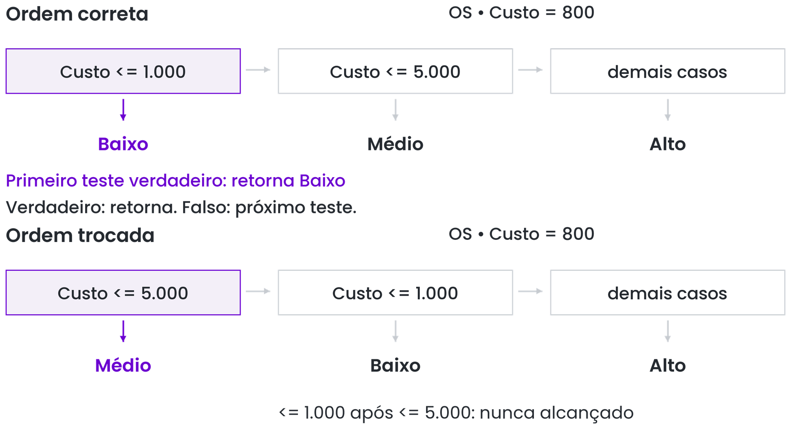
*Guia Visual 6 (Figura 4.9): Fluxo de avaliação de cima para baixo no SWITCH(TRUE()).*

---

### Slide 13 — Como Fazer: "`VAR` dá nome às partes da conta"
- **Explicando a Medida do Queimador `QM-01` (Slide 13):**
  ```dax
  Horas Médias por OS =
  VAR Horas = SUM( OS[Horas Paradas] )
  VAR Quantidade = COUNTROWS( OS )
  RETURN DIVIDE( Horas, Quantidade )
  ```
- **Por que ensinar `VAR / RETURN` desde o primeiro dia de DAX?**
  1. **Legibilidade:** Qualquer engenheiro ou técnico que abrir a fórmula lê os nomes das partes (`Horas`, `Quantidade`) e entende a regra na hora.
  2. **Desempenho:** Cada variável é calculada **uma única vez** e guardada na memória daquela execução.
  3. **Dica prática de sintaxe:** Dê nomes de variáveis curtos, **sem acento e sem espaço** (`Horas`, `Quantidade`), e feche sempre com a palavra `RETURN` antes da conta final.

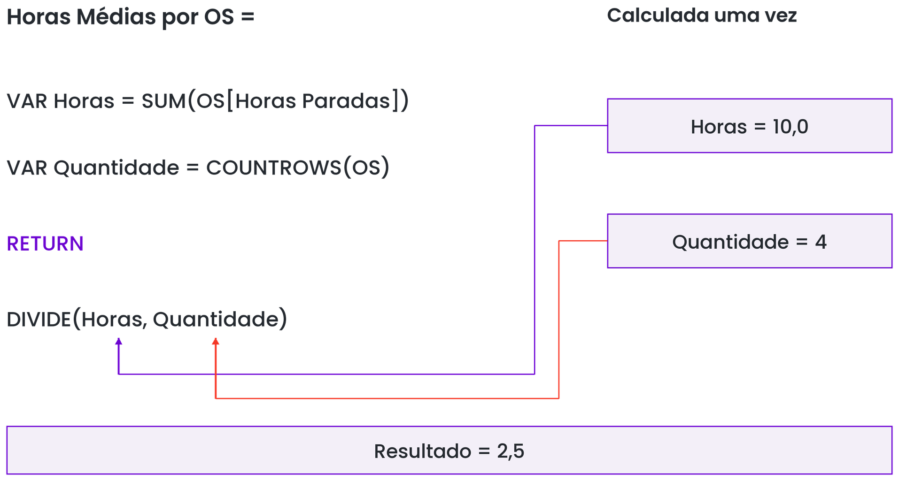
*Guia Visual 7 (Figura 4.10): Estrutura de variáveis VAR e bloco de saída RETURN.*

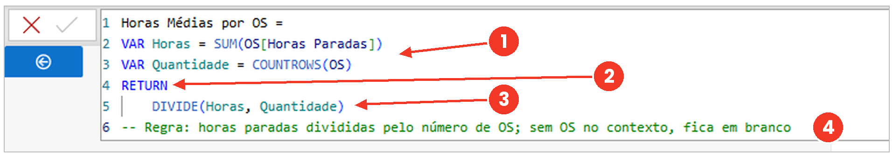
*Guia Visual 8 (Figura 4.11): Uso de Shift+Enter e comentários (//) para documentar a medida.*

---

# BLOCO 4.6 · 4.7: Contexto e Iteradores (Slides 14 a 18)

### Slide 14, Slide 15 e Slide 16 — Contexto de Filtro: "A mesma fórmula dá quatro números diferentes"
- **Mostre a Matriz do Slide 15 (`EX-01 = 14,0`, `EX-02 = 9,5`, `PC-01 = 6,0`, `Total = 29,5`):**
  - Pergunte: *"Nós escrevemos 4 medidas diferentes para ter esses 4 números ou escrevemos uma fórmula só (`SUM(OS[Horas Paradas])`)?"*
  - **Uma fórmula só!**
  - *"Então o que muda de uma célula para outra?"* ➔ **O Contexto de Filtro!**
- **Explique o Diagrama do Slide 16:**
  - **Contexto de filtro** é o subconjunto de linhas da tabela `OS` que aquela célula específica enxerga depois que todos os filtros ao redor dela são aplicados:
    - O cabeçalho da linha da matriz filtra `Equipamento = EX-01`.
    - A coluna da matriz (ou segmentação) filtra `Tipo = Corretiva`.
    - A célula só enxerga e soma a **interseção** desses filtros!
    - E na linha de **Total** lá embaixo? Não há filtro de um equipamento específico, então entram as três máquinas (`14,0 + 9,5 + 6,0 = 29,5`)!

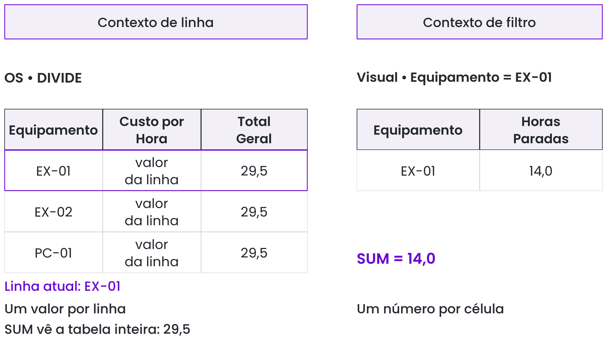
*Guia Visual 9 (Figura 4.12): Como cada célula da matriz monta o seu próprio recorte de linhas antes de rodar a medida.*

---

### Slide 17 — Pegadinha: "`SUM` numa coluna calculada devolve o total geral em todas as linhas"
- **Compare no Quadro os Dois Contextos do Slide 17:**
  - Quando você cria uma **Coluna Calculada** na tabela `OS`, o DAX tem um **Contexto de Linha** (ele sabe em qual linha está parado, por isso consegue fazer `OS[Custo] / OS[Horas]` daquela linha).
  - Mas se você escrever `Total Geral = SUM(OS[Horas Paradas])` dentro de uma **Coluna Calculada**, a função `SUM` não olha para o contexto de linha — ela olha para o **contexto de filtro**! Como na tabela de dados não há filtro nenhum ativo, `SUM` soma a tabela inteira e carimba **`29,5` em todas as linhas**!
  - Já como **Medida** na matriz, cada célula entrega um contexto de filtro diferente (`14,0`, `9,5`, `6,0`).

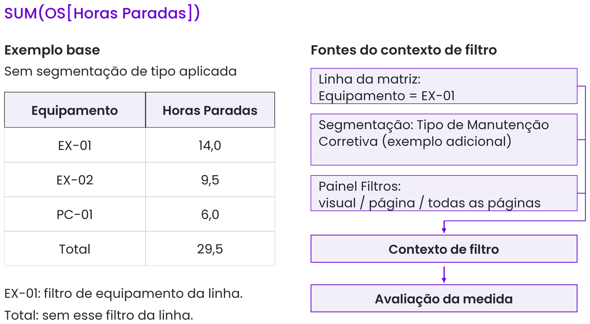
*Guia Visual 10 (Figura 4.13): Por que SUM(OS[Horas Paradas]) repete 29,5 numa coluna calculada e separa por máquina numa medida.*

---

### Slide 18 — Como Fazer: "`SUMX` soma o produto linha a linha"
- **O Problema Real dos Guindastes (Slide 18):**
  - Queremos calcular o **Custo de Parada Indireto** (horas paradas $\times$ quanto custa a hora parada daquela máquina no cadastro `Equipamentos`).
  - Na tabela `OS` estão as `Horas Paradas`. Na tabela `Equipamentos` está o `Valor Hora Parada`.
  - **Por que não podemos fazer `SUM(Horas) * AVERAGE(Valor Hora)`?**
    - Veja os números do **Slide 18**:
      - Guindaste 1 (`R$ 1.000/h`) parou `13,5 h` $\to 13,5 \times 1.000 = \text{R\$ } 13.500$.
      - Guindaste 2 (`R$ 1.200/h`) parou `7,5 h` $\to 7,5 \times 1.200 = \text{R\$ } 9.000$.
      - **Conta certa, linha a linha:** $13.500 + 9.000 =$ **`R$ 22.500`**.
      - **Atalho errado** ($\text{Total de horas } 21,0 \times \text{Média do valor da hora } 1.100$): dá **`R$ 23.100`**!
- **Como o `SUMX` e o `RELATED` resolvem isso numa única medida (Slide 18):**
  ```dax
  Custo de Parada = SUMX( OS,
      OS[Horas Paradas] * RELATED( Equipamentos[Valor Hora Parada] ) )
  ```
  1. O **`X`** no final de `SUMX` significa **iterador**: ele abre um contexto de linha temporário, caminhando de OS em OS.
  2. Em cada OS, o **`RELATED`** atravessa o relacionamento até a tabela `Equipamentos` e busca o `Valor Hora Parada` daquele guindaste específico.
  3. Multiplica um pelo outro na linha e, no final, soma todos os resultados!

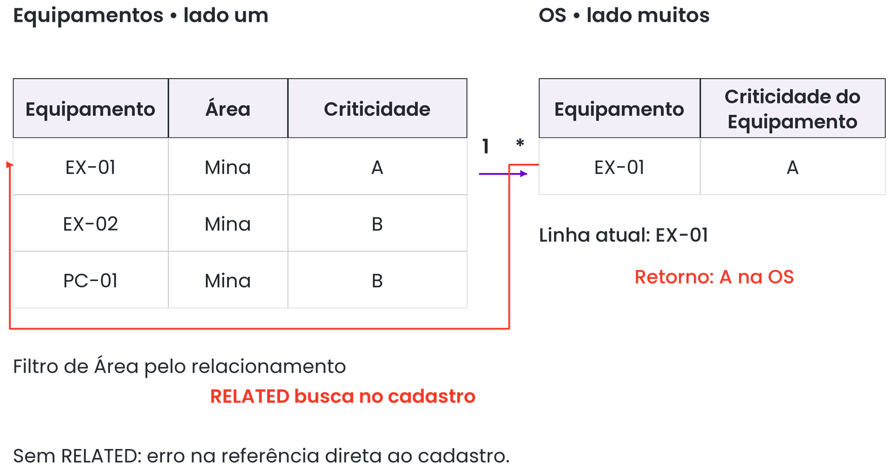
*Guia Visual 11 (Figura 4.14): O filtro desce da Dimensão para a Fato; o RELATED busca um valor subindo da Fato (muitos) para a Dimensão (um).*

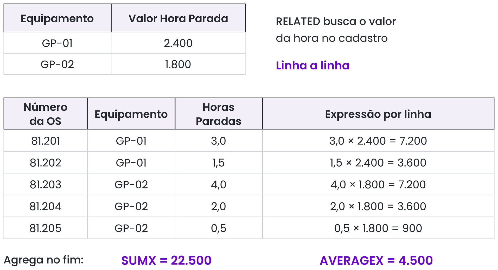
*Guia Visual 12 (Figura 4.15): Funcionamento passo a passo do iterador SUMX com RELATED.*

---

# BLOCO 5.1 · 5.2: `CALCULATE` e Percentual do Total (Slides 19 a 25)

### Slide 19 e Slide 20 — Como Fazer: "`CALCULATE` troca o filtro antes de calcular"
- **Apresente a função mais importante do DAX (Slide 20):**
  ```dax
  Horas Corretivas = CALCULATE( [Total de Horas Paradas],
      OS[Tipo de Manutenção] = "Corretiva" )
  ```
- **Como explicar o superpoder do `CALCULATE` em 2 frases:**
  1. **O que ele faz com os outros filtros (Equipamento, Área, Mês)?** Ele **respeita e mantém** todos eles!
  2. **O que ele faz com a coluna que ele menciona (`OS[Tipo de Manutenção]`)?** Ele **substitui (sobrescreve)** qualquer filtro externo daquela coluna pelo filtro `"Corretiva"` antes de calcular `[Total de Horas Paradas]`!

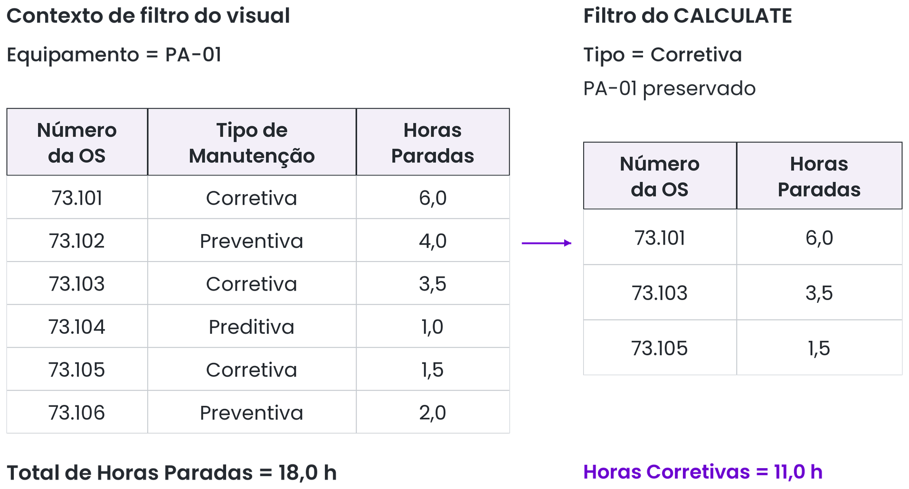
*Guia Visual 13 (Figura 5.1): CALCULATE restringindo as OS da máquina PA-01 apenas às corretivas.*

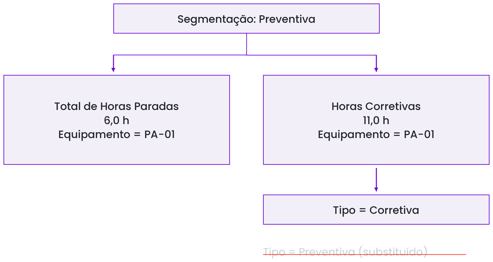
*Guia Visual 14 (Figura 5.3): Mesmo quando o usuário clica em Preventiva na segmentação, Horas Corretivas ignora a escolha e mantém as horas de Corretiva.*

---

### Slide 21 — Como Fazer: "Percentual do total: tirar o filtro só do denominador"
- **A Lógica da Fração no Quadro Branco (Slide 21):**
  - Queremos saber quantos `%` as horas da **Moagem** (`120,0 h`) representam sobre o total das 4 áreas da usina (`240,0 h`).
  - Na linha da **Moagem** dentro da matriz:
    - Quanto vale `[Total de Horas Paradas]` (nosso **numerador**)? Vale **`120,0`**, porque está filtrado na linha da Moagem.
    - Se dividíssemos `[Total de Horas Paradas]` por `[Total de Horas Paradas]`, daria $120,0 \div 120,0 = 100\%$ em todas as linhas!
    - Precisamos que, **apenas no denominador**, o filtro da coluna `Equipamentos[Área]` seja removido para enxergar as **`240,0`** horas da usina inteira!
  - É exatamente isso que `CALCULATE` com `REMOVEFILTERS` faz:
    ```dax
    % Horas da Área = DIVIDE( [Total de Horas Paradas],
        CALCULATE( [Total de Horas Paradas],
            REMOVEFILTERS( Equipamentos[Área] ) ) )
    ```
  - Na linha da Moagem: $120,0 \div 240,0 =$ **`50%`**. E a soma das quatro áreas fecha em **`100%`**!
  - *(Nota do Slide 21: `ALL(Equipamentos[Área])` faz exatamente o mesmo papel quando usado como filtro dentro de `CALCULATE`).*

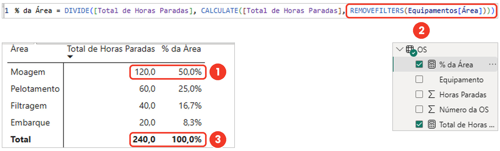
*Guia Visual 15 (Figura 5.4): A medida % da Área na matriz.*

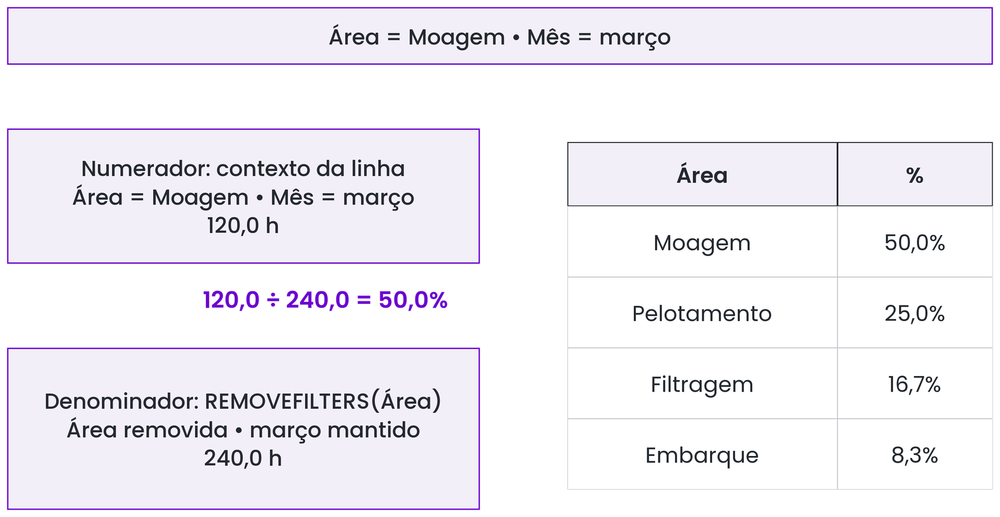
*Guia Visual 16 (Figura 5.5): O numerador respeita a área da linha; o denominador remove o filtro de área mantendo o filtro de mês.*

---

### Slide 22 — Pegadinha: "Se toda linha der 100%, a coluna removida é a errada"
- **O Erro nº 1 dos Alunos ao Calcular Percentual:**
  - O aluno escreve a fórmula certinha, formata como `%`, joga na matriz e **todas as áreas aparecem com `100,0%`**!
  - **Onde está o erro?**
    - `REMOVEFILTERS` só limpa o filtro da coluna exata que você escreveu dentro dos parênteses dele.
    - Se na Matriz o aluno arrastou `OS[Área]` (ou `Equipamentos[Equipamento]`), mas dentro do `REMOVEFILTERS` escreveu `Equipamentos[Área]`, o filtro da matriz continua ativo no denominador, deixando denominador = numerador = `100%`!

---

### Slide 23 — Teste Rápido / Dinâmica: "Adivinhe o número antes de rodar a medida"
- **Pergunta do Slide 23:**
  > *"Temos uma Matriz com um equipamento por linha (`BR-01`, `MO-01`, `RA-01`...). Colocamos nela a medida:*
  > `Horas Corretivas = CALCULATE([Total de Horas Paradas], OS[Tipo de Manutenção] = "Corretiva")`
  > *O filtro de equipamento da linha continua valendo?"*
- **Gabarito Comentado para a Turma:**
  - **SIM! Continua valendo 100%!**
  - **Por quê?** Porque `CALCULATE` só substitui o filtro das colunas que são mencionadas nos argumentos de filtro dele (neste caso, apenas `OS[Tipo de Manutenção]`). O filtro vindo da linha da matriz (`Equipamentos[Equipamento]`) não foi mexido: na linha do `BR-01`, a medida mostra as horas corretivas **apenas do `BR-01`**!

---

### Slide 24 e Slide 25 — Resumo e Fechamento do Dia 4
- **Três Pilares do Dia 4 (Slide 24):**
  1. **Medida:** Calcula na hora, dentro do contexto de filtro de cada célula.
  2. **`DIVIDE` e `VAR`:** Garantem divisão segura contra zero e fórmulas legíveis em etapas.
  3. **`CALCULATE`:** Muda o filtro primeiro e calcula a medida depois.
- **Checkpoint do Dia 4 (Slide 25):**
  - Tabela de medidas organizada contendo: `Total de Horas Paradas`, `Quantidade de OS`, `Custo por Hora`, `Horas Corretivas` e `% Horas da Área`.
- **Prévia do Dia 5 (Sexta-feira — Encerramento):**
  - Tabela de datas com inteligência de tempo (`TOTALYTD`, `SAMEPERIODLASTYEAR`), relacionamento inativo com `USERELATIONSHIP` (para OS encerradas), **MTBF**, **MTTR**, **Disponibilidade**, **Backlog**, **Pareto com `RANKX`** e a **Prova Final**!
