# Roteiro Prático: Interação com os Datasets da Aula 4 no Power BI Desktop
**Curso:** Power BI e DAX para Manutenção (CEDTEC Guarapari · Samarco)  
**Apresentação de Referência:** [`Aulas/Power BI e DAX para Manutenção — Dia 4 · Falando DAX.pptx`](../../Aulas/Power%20BI%20e%20DAX%20para%20Manuten%C3%A7%C3%A3o%20%E2%80%94%20Dia%204%20%C2%B7%20Falando%20DAX.pptx) *(Slides 1 a 25 — Seções 4.1 a 5.2)*  
**Arquivos de Dados na Pasta `Dataset/Aula 4/`:**
- [`Dataset_PowerBI_Manutencao.xlsx`](./Dataset_PowerBI_Manutencao.xlsx) *(Modelo completo do curso para o painel principal)*
- [`Casos_DAX_Slide_a_Slide.xlsx`](./Casos_DAX_Slide_a_Slide.xlsx) *(Planilha com as mini-tabelas exatas dos Slides 6, 10, 11, 15, 18 e 21 para conferência à mão e no Power BI)*
- [`COLA_DE_DAX_DIA4.md`](./COLA_DE_DAX_DIA4.md) *(Folha de consulta rápida de sintaxe DAX em 1 página)*

---

## Mapa Prático Alinhado aos 25 Slides da Aula 4

| Bloco dos Slides | Seções | O que fazer no Power BI Desktop |
| :--- | :---: | :--- |
| **Slides 4 a 7** | **4.1 · 4.2** | Comparar na prática **Coluna Calculada (`R$/hora` = `1.266,67`)** vs **Medida (`1.360,00`)** no caso da perfuratriz **`PF-01`**. |
| **Slides 8 a 13** | **4.3 a 4.5** | Criar a tabela de medidas, testar `SUM`, `AVERAGE`, `COUNT` vs `COUNTROWS`, `DIVIDE` (caso `RT-02`), coluna `SWITCH` e medida com `VAR / RETURN` (`QM-01`). |
| **Slides 14 a 18** | **4.6 · 4.7** | Ver o **Contexto de Filtro** na matriz (`EX-01`, `EX-02`, `PC-01`), testar a pegadinha do `SUM` em coluna calculada e escrever `SUMX` com `RELATED` (`22.500` vs `23.100`). |
| **Slides 19 a 25** | **5.1 · 5.2** | Escrever `Horas Corretivas` com **`CALCULATE`**, calcular `% Horas da Área` com **`REMOVEFILTERS`** e fechar o **Checkpoint** da Tabela de Medidas. |

---

# BLOCO 1: Medida × Coluna Calculada — O Caso da `PF-01` (Slides 4 a 7 · Seções 4.1 e 4.2)

### Passo 1.1: Importar a Tabela do Slide 6 (`Slide06_PF01`)
1. No **Power BI Desktop**, clique em **Página Inicial** ➔ **Pasta de Trabalho do Excel** e selecione [`Casos_DAX_Slide_a_Slide.xlsx`](./Casos_DAX_Slide_a_Slide.xlsx).
2. Marque todas as abas (`Slide06_PF01`, `Slide10_Alimentadores`, `Slide11_Retificadores`, `Slide15_Contexto`, `Slide18_OS_Guindastes`, `Slide18_Equip_Guindastes` e `Slide21_Quatro_Areas`) e clique em **Carregar**.
3. Na **Exibição de Modelo**, ligue `Slide18_Equip_Guindastes[Equipamento]` (`1`) até `Slide18_OS_Guindastes[Equipamento]` (`*`).

---

### Passo 1.2: Reproduzir o Conflito do Slide 6 (`1.266,67` vs `1.360,00`)
*Pergunta do Dia (Slide 1 e Slide 6): "Quanto custa, em reais, cada hora parada da perfuratriz PF-01?"*

1. Vá para a **Exibição de Tabela** (2º ícone à esquerda) e selecione `Slide06_PF01`.
2. **Teste 1 — Criando como Coluna Calculada (o jeito que dá erro no total):**
   - Na faixa superior, clique em **Nova coluna** e digite:
     ```dax
     R$/hora (Coluna) = Slide06_PF01[Custo (R$)] / Slide06_PF01[Horas Paradas]
     ```
   - Pressione `Enter`. Veja os valores guardados linha a linha (conforme a tabela do **Slide 6**):
     - 1ª OS: `9.000 ÷ 6,0 = 1.500`
     - 2ª OS: `2.000 ÷ 2,5 = 800`
     - 3ª OS: `6.000 ÷ 4,0 = 1.500`
3. Volte para a **Exibição de Relatório**, coloque uma **Tabela** com `Número da OS`, `Custo (R$)`, `Horas Paradas` e a coluna `R$/hora (Coluna)` trocando o resumo dela para **Média**:
   - Na linha de Total, a média simples das 3 razões dá **`1.266,67`**! *(Errado, porque dá o mesmo peso para uma parada curta de 2,5 h e uma longa de 6,0 h!).*

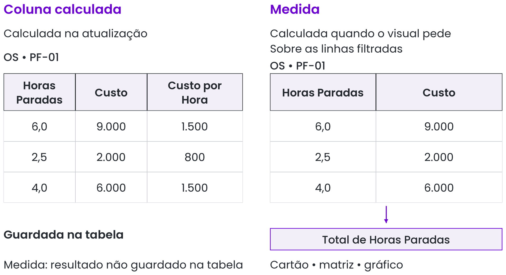
*Figura 1 (Figura 4.3): A coluna calculada guarda um valor por linha; a medida calcula na hora sobre as linhas filtradas.*

4. **Teste 2 — Criando como Medida (o jeito certo no DAX — Slide 7):**
   - Clique com o botão direito na tabela `Slide06_PF01` no painel **Dados** ➔ **Nova medida**.
   - Digite na barra de fórmulas:
     ```dax
     R$/hora (Medida Certa) = 
     DIVIDE(
         SUM( Slide06_PF01[Custo (R$)] ),
         SUM( Slide06_PF01[Horas Paradas] )
     )
     ```
   - Arraste a medida para a mesma tabela:
     - Nas linhas individuais: `1.500`, `800` e `1.500`.
     - Na linha de **Total**: divide o custo total (`17.000`) pelas horas totais (`12,5`) = **`R$ 1.360,00`**!
   - **Conclusão do Slide 7:** *Para razões de totais (R$/hora, MTTR, MTBF, % de preventiva), use sempre **Medida**, nunca coluna calculada!*

---

# BLOCO 2: Sintaxe, Divisão Segura e Variáveis (Slides 8 a 13 · Seções 4.3 a 4.5)

### Passo 2.1: Anatomia da Medida no Modelo Principal (Slide 9)
1. Importe (ou abra) o seu arquivo do painel principal com [`Dataset_PowerBI_Manutencao.xlsx`](./Dataset_PowerBI_Manutencao.xlsx).
2. Clique com o botão direito sobre a tabela `OS` no painel **Dados** ➔ **Nova medida**.

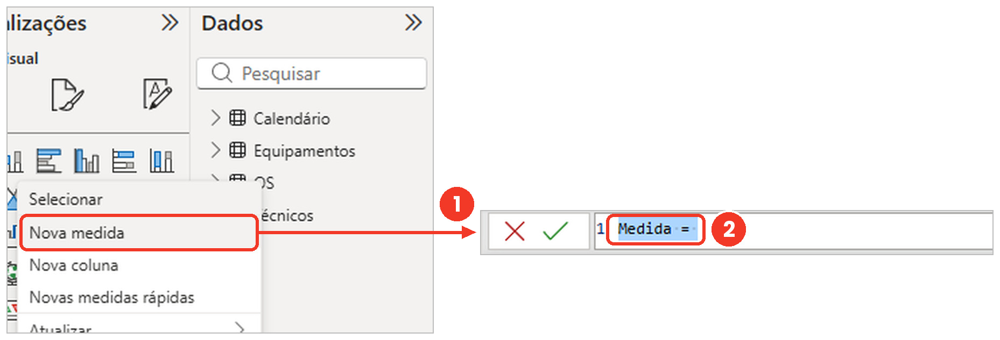
*Figura 2 (Figura 4.4): Botão direito na tabela › Nova medida abre a barra de fórmulas no topo.*

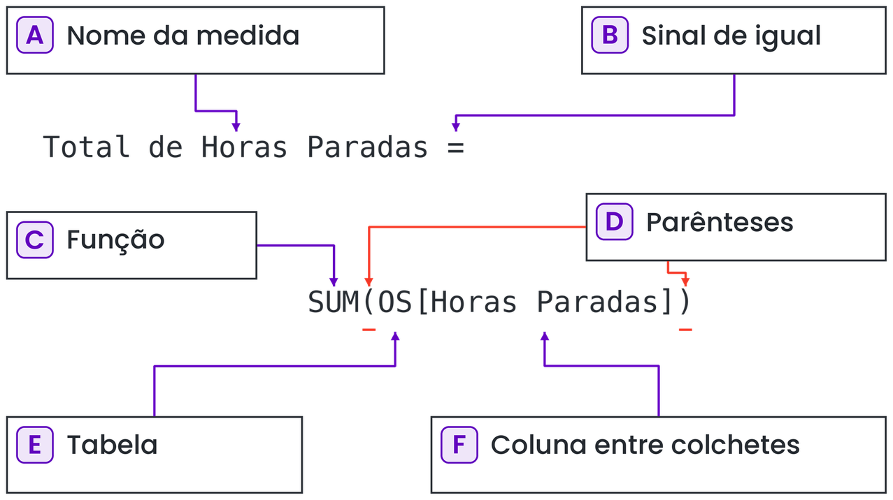
*Figura 3 (Figura 4.5): As seis partes de uma medida DAX.*

3. Crie as 3 medidas de base do **Slide 9 e Slide 11**:
   ```dax
   Total de Horas Paradas = SUM( OS[Horas Paradas] )
   ```
   ```dax
   Custo Total = SUM( OS[Custo (R$)] )
   ```
   ```dax
   Quantidade de OS = COUNTROWS( OS )
   ```
   > [!TIP]
   > Repare na regra do **Slide 9**:
   > - `SUM` pede **Tabela[Coluna]**: `SUM( OS[Horas Paradas] )`.
   > - `COUNTROWS` pede **só o nome da Tabela**: `COUNTROWS( OS )`.
   > - Quando chamar uma medida pronta dentro de outra, use **só o nome entre colchetes**: `[Total de Horas Paradas]`.

---

### Passo 2.2: Conferir a Diferença entre `COUNT` e `COUNTROWS` (Slide 10)
1. Crie uma página de rascunho e olhe a tabela `Slide10_Alimentadores` (6 OS dos alimentadores vibratórios `AV-01` e `AV-02`, onde a 6ª OS está com `Horas Paradas` em branco).
2. Crie e coloque em cartões as 5 funções da tabela do **Slide 10**:
   - `SUM(Slide10_Alimentadores[Horas Paradas])` ➔ **`15,0`**
   - `AVERAGE(Slide10_Alimentadores[Horas Paradas])` ➔ **`3,0`** *(divide `15,0` apenas pelas `5` linhas preenchidas!)*
   - `COUNT(Slide10_Alimentadores[Horas Paradas])` ➔ **`5`** *(pula a OS que está sem horas apontadas!)*
   - `COUNTROWS(Slide10_Alimentadores)` ➔ **`6`** *(conta todas as linhas da tabela!)*
   - `DISTINCTCOUNT(Slide10_Alimentadores[Equipamento])` ➔ **`2`** *(dois equipamentos distintos: `AV-01` e `AV-02`)*.

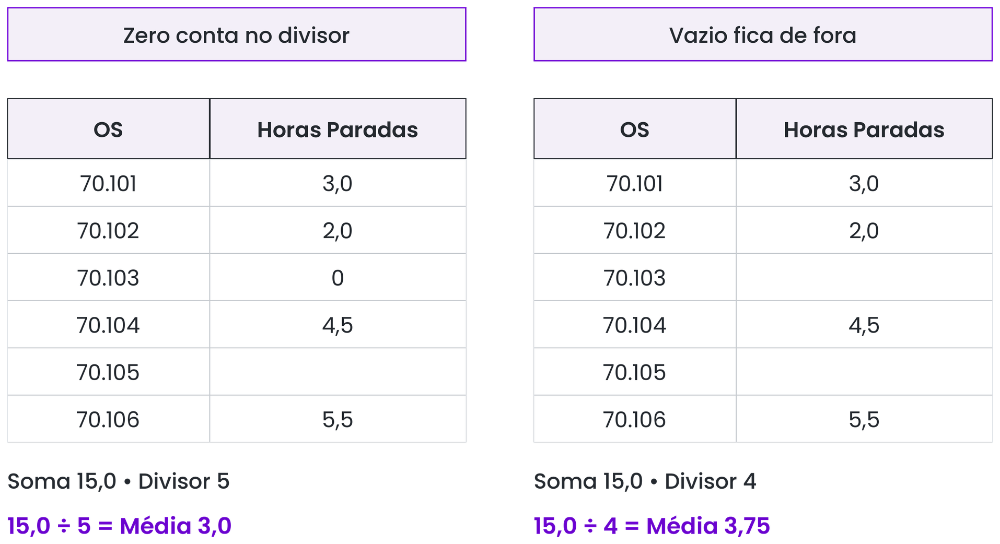
*Figura 4 (Figura 4.7): O zero entra na conta da média; o vazio (BLANK) fica fora do divisor e do COUNT.*

---

### Passo 2.3: Divisão Segura com `DIVIDE` — O Caso da `RT-02` (Slide 11)
1. Na tabela `Slide11_Retificadores` (ou na tabela principal `OS`), clique com o botão direito ➔ **Nova medida**.
2. Escreva a medida do **Slide 11**:
   ```dax
   Custo por Hora = 
   DIVIDE( [Custo Total], [Total de Horas Paradas] )
   ```
3. Monte uma **Matriz** com `Equipamento` nas linhas (`RT-01`, `RT-02`, `RT-03`):
   - **`RT-01`:** `8.400 ÷ 7,0 = 1.200`
   - **`RT-03`:** `9.600 ÷ 12,0 = 800`
   - **`RT-02`:** `1.500 ÷ 0` ➔ Com `DIVIDE`, devolve **vazio (`BLANK`)** limpamente, em vez de sujar o relatório com `Infinito` ou `NaN`!

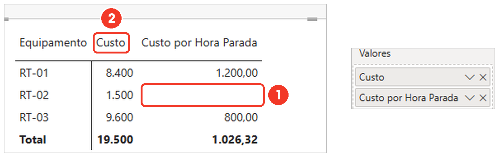
*Figura 5 (Figura 4.8): Na RT-02 com zero horas paradas, DIVIDE devolve BLANK sem travar a matriz.*

---

### Passo 2.4: Classificar com `SWITCH` em Coluna Calculada (Slide 12)
1. Vá para a **Exibição de Tabela** e selecione a tabela `OS`.
2. Clique em **Nova coluna** (pois queremos classificar cada linha para usar como filtro depois).
3. Digite a fórmula exata do **Slide 12** (usando `Shift + Enter` para quebrar linhas):
   ```dax
   Faixa de Custo = 
   SWITCH(
       TRUE(),
       OS[Custo (R$)] <= 1000, "Baixo",
       OS[Custo (R$)] <= 5000, "Médio",
       "Alto"
   )
   ```
4. **Pegadinha do Slide 12:** Como `SWITCH` testa de cima para baixo e para na primeira verdadeira, `<= 1000` **tem** que vir antes de `<= 5000`!

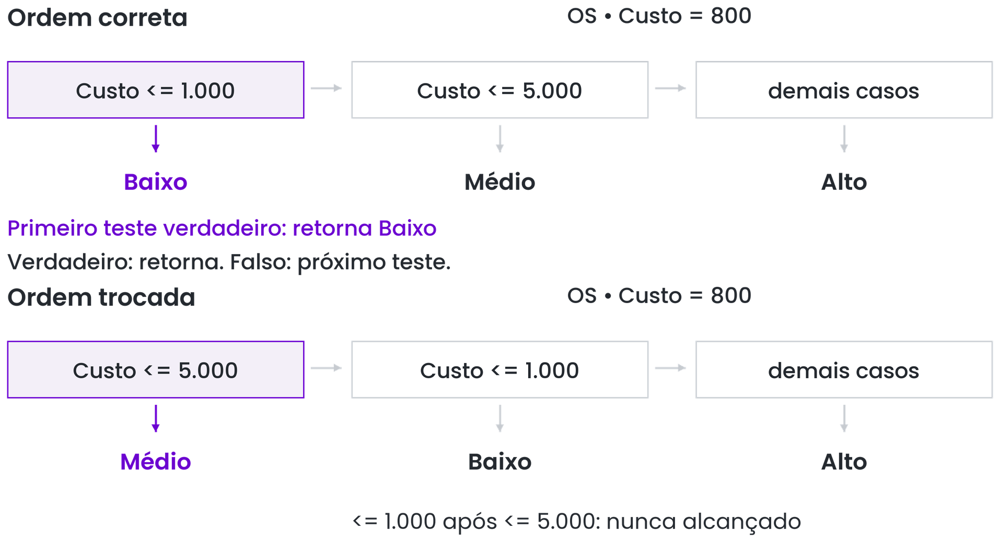
*Figura 6 (Figura 4.9): A avaliação de cima para baixo do SWITCH(TRUE()).*

---

### Passo 2.5: Organizar a Conta com `VAR` e `RETURN` (Slide 13)
1. Clique com o botão direito na tabela `OS` ➔ **Nova medida**.
2. Escreva a medida com variáveis do **Slide 13**:
   ```dax
   Horas Médias por OS = 
   VAR Horas = SUM( OS[Horas Paradas] )
   VAR Quantidade = COUNTROWS( OS )
   RETURN
       DIVIDE( Horas, Quantidade )
   ```
3. Formate para 1 casa decimal.

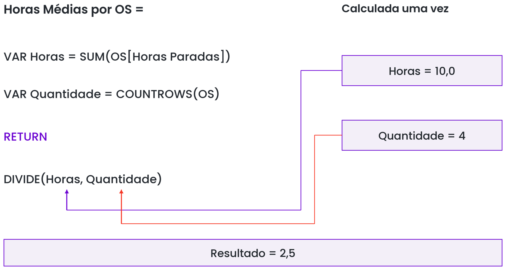
*Figura 7 (Figura 4.10): Cada variável VAR guarda um valor intermediário com nome simples (sem acento e sem espaço).*

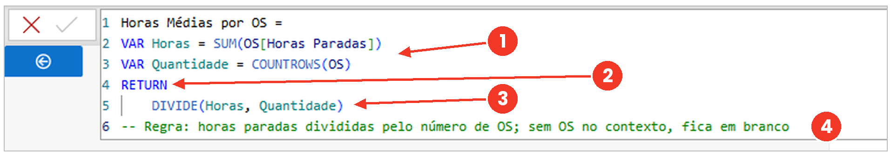
*Figura 8 (Figura 4.11): Fórmula bem indentada na barra expandida do Power BI Desktop.*

---

# BLOCO 3: Contexto de Filtro, Contexto de Linha e `SUMX` (Slides 14 a 18 · Seções 4.6 e 4.7)

### Passo 3.1: Ver o Contexto de Filtro e a Pegadinha do Slide 17 (`EX-01`, `EX-02`, `PC-01`)
1. Usando a tabela `Slide15_Contexto`:
   - Crie uma **Matriz** com `Equipamento` nas linhas e a **medida** `Soma Horas = SUM(Slide15_Contexto[Horas Paradas])` nos valores.
   - **Resultado do Slide 15:** A mesma fórmula entrega **4 números diferentes**: `EX-01 = 14,0`, `EX-02 = 9,5`, `PC-01 = 6,0` e `Total = 29,5`, porque cada célula da matriz aplica o seu próprio **Contexto de Filtro**!

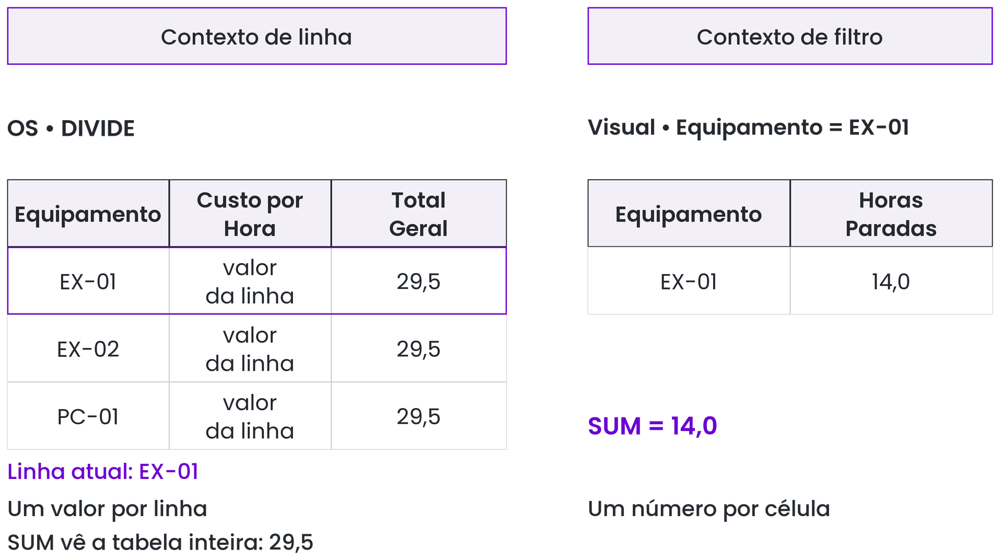
*Figura 9 (Figura 4.12): Cada célula da matriz enxerga apenas a interseção dos filtros da sua linha, coluna e segmentação.*

2. **Reproduzir a Pegadinha do Slide 17 (Por que `SUM` em Coluna Calculada dá o total geral):**
   - Vá na **Exibição de Tabela** da `Slide15_Contexto`, clique em **Nova coluna** e escreva a mesma fórmula:
     ```dax
     Total Geral (Coluna) = SUM( Slide15_Contexto[Horas Paradas] )
     ```
   - **Resultado do Slide 17:** Aparece **`29,5` em todas as linhas**! Porque na coluna calculada existe apenas *Contexto de Linha*, e `SUM` ignora a linha atual e soma a coluna inteira da tabela!

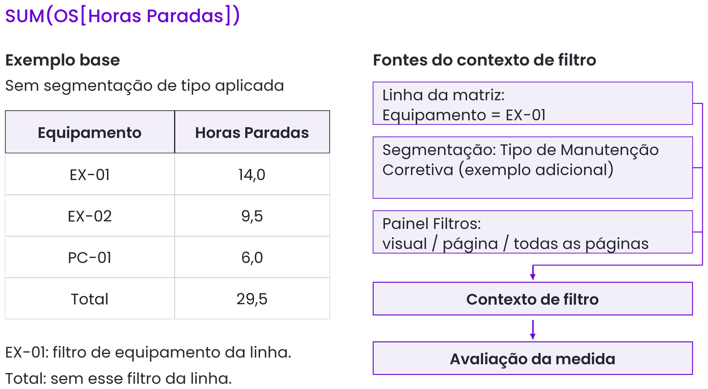
*Figura 10 (Figura 4.13): Na coluna calculada, SUM devolve 29,5 em todas as linhas; na medida, calcula o subconjunto filtrado.*

---

### Passo 3.2: Como Fazer — `SUMX` com `RELATED` (Slide 18)
*Situação: Na tabela `OS` temos as `Horas Paradas` de cada ordem. Na tabela `Equipamentos` temos o `Valor Hora Parada` de cada máquina. Queremos o Custo Indireto de Parada.*

1. Teste no caso dos guindastes (`Slide18_OS_Guindastes` ligada a `Slide18_Equip_Guindastes`) e também na tabela principal `OS` ligada a `Equipamentos`:
2. Clique com o botão direito em `OS` ➔ **Nova medida** e digite a fórmula do **Slide 18**:
   ```dax
   Custo de Parada = 
   SUMX(
       OS,
       OS[Horas Paradas] * RELATED( Equipamentos[Valor Hora Parada (R$)] )
   )
   ```
3. **Conferência no caso dos Guindastes (`Slide18_OS_Guindastes`):**
   - `GD-01`: `13,5 h × R$ 1.000 = R$ 13.500`
   - `GD-02`: `7,5 h × R$ 1.200 = R$ 9.000`
   - **Total certo linha a linha (`SUMX`):** **`R$ 22.500`**! *(Enquanto o atalho errado `21,0 h × média R$ 1.100` daria `R$ 23.100`!).*

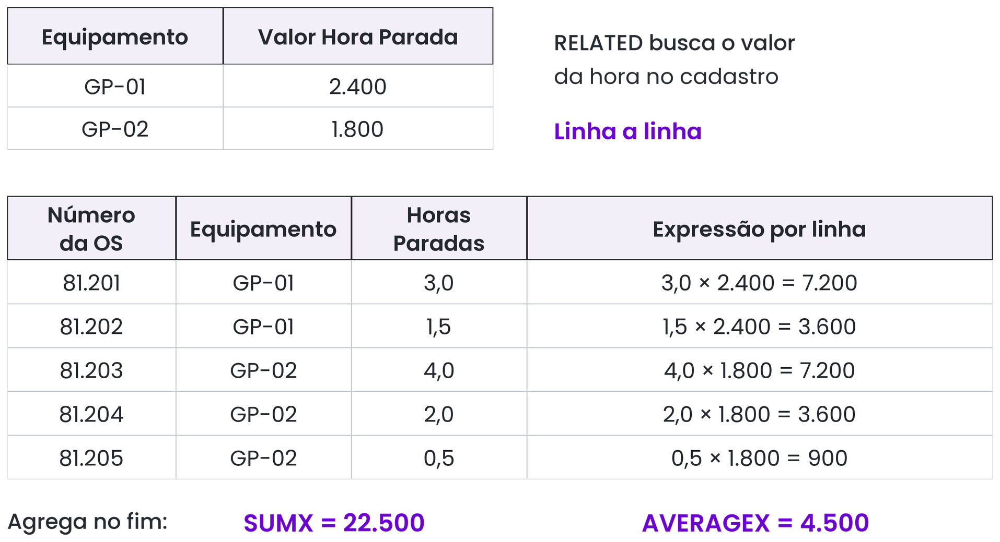
*Figura 11 (Figura 4.15): SUMX percorre a tabela OS linha a linha, busca o valor no cadastro via RELATED e soma os produtos no final.*

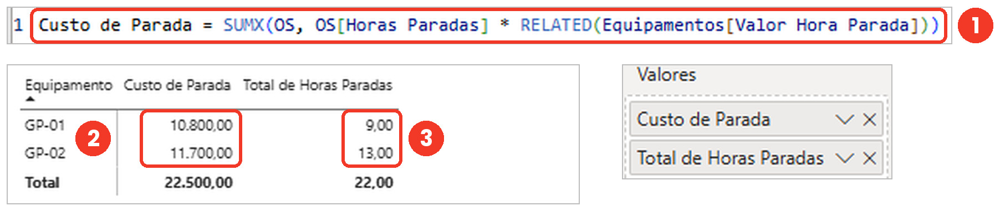
*Figura 12 (Figura 4.16): Medida com SUMX e RELATED aplicada na matriz por equipamento.*

---

# BLOCO 4: `CALCULATE` e Percentual do Total (Slides 19 a 25 · Seções 5.1 e 5.2)

### Passo 4.1: Como Fazer — `CALCULATE` Troca o Filtro Antes de Calcular (Slide 20)
1. Na tabela `OS`, clique com o botão direito ➔ **Nova medida**.
2. Digite a medida exata do **Slide 20**:
   ```dax
   Horas Corretivas = 
   CALCULATE(
       [Total de Horas Paradas],
       OS[Tipo de Manutenção] = "Corretiva"
   )
   ```
3. Coloque numa **Matriz** com `Equipamentos[Área]` (ou `Equipamento`) nas linhas:
   - Coluna 1: `[Total de Horas Paradas]`
   - Coluna 2: `[Horas Corretivas]`
4. **Teste de Ouro (Slide 20 e Slide 23):**
   - Na matriz com um equipamento por linha, o filtro de equipamento da linha **continua valendo**!
   - Mas se você clicar em `"Preventiva"` numa segmentação de `Tipo de Manutenção`, `[Total de Horas Paradas]` muda para mostrar só as preventivas, enquanto `[Horas Corretivas]` **continua mostrando as corretivas**, porque `CALCULATE` substitui o filtro da coluna que ele menciona!

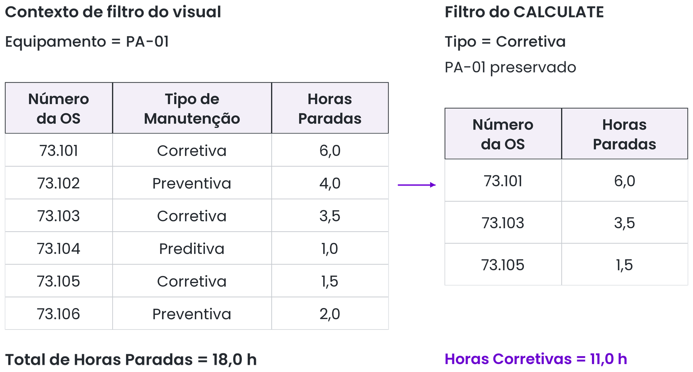
*Figura 13 (Figura 5.1): CALCULATE restringe o cálculo às OS corretivas mantendo o filtro do equipamento da linha.*

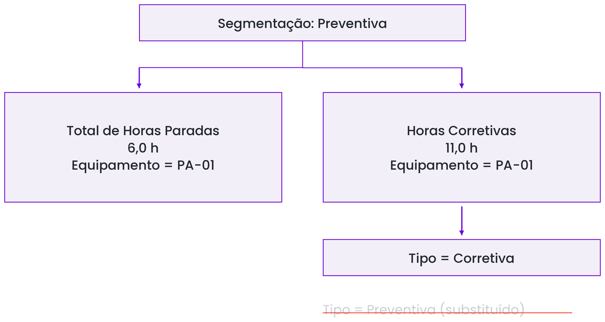
*Figura 14 (Figura 5.3): Mesmo com Preventiva marcada na segmentação, Horas Corretivas mantém seu valor porque CALCULATE sobrescreve o filtro de Tipo.*

---

### Passo 4.2: Como Fazer — Percentual do Total com `REMOVEFILTERS` (Slides 21 e 22)
1. Na tabela `OS`, clique com o botão direito ➔ **Nova medida**.
2. Digite a fórmula exata do **Slide 21**:
   ```dax
   % Horas da Área = 
   DIVIDE(
       [Total de Horas Paradas],
       CALCULATE(
           [Total de Horas Paradas],
           REMOVEFILTERS( Equipamentos[Área] )
       )
   )
   ```
3. Com a medida selecionada, vá na guia superior **Ferramentas de medição** e clique no ícone **`%`** (*Formatar como porcentagem*), definindo `1` casa decimal.
4. Coloque `[% Horas da Área]` na Matriz com `Equipamentos[Área]` nas linhas:
   - Cada área mostra a sua fatia percentual exata e a linha de **Total** soma **100,0%**!
   - > [!CAUTION]
     > **Pegadinha do Slide 22:** Se todas as linhas da matriz mostrarem **100,0%**, significa que você colocou nas linhas da matriz a coluna `Área` de uma tabela e dentro do `REMOVEFILTERS(...)` escreveu a coluna de outra tabela! A coluna dentro de `REMOVEFILTERS` tem que ser **exatamente a mesma** que está nas linhas do visual.

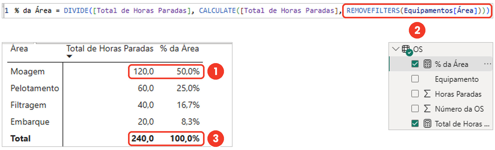
*Figura 15 (Figura 5.4): A medida % da Área na barra de fórmulas e o resultado somando 100% na matriz.*

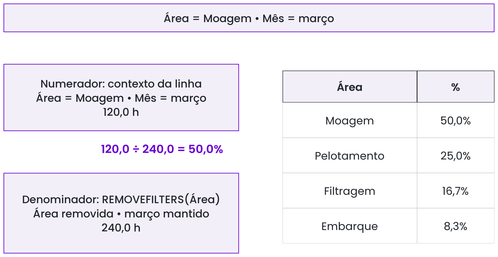
*Figura 16 (Figura 5.5): O numerador enxerga a área da linha; o denominador com REMOVEFILTERS enxerga a soma de todas as áreas.*

---

## Checkpoint do Dia 4 — A Tabela de Medidas Organizada (Slide 25)

Para encerrar o laboratório do Dia 4 com o projeto organizado para o Dia 5:
1. Na guia **Página Inicial**, clique em **Inserir dados** (ícone de tabela em branco).
2. Deixe a `Coluna1` vazia, dê o nome da tabela de **`_Medidas`** (o sublinhado faz ela subir para o topo do painel Dados!) e clique em **Carregar**.
3. Clique em cada uma das medidas criadas hoje (`[Total de Horas Paradas]`, `[Custo Total]`, `[Quantidade de OS]`, `[Custo por Hora]`, `[Horas Médias por OS]`, `[Custo de Parada]`, `[Horas Corretivas]` e `[% Horas da Área]`) e, na guia **Ferramentas de medição**, mude a **Tabela inicial** para `_Medidas`.
4. Por fim, clique com o botão direito na `Coluna1` vazia dentro de `_Medidas` e escolha **Excluir do modelo**.
   - **Efeito mágico:** O ícone da tabela `_Medidas` vira uma **calculadora** no topo do painel Dados, concentrando todas as suas fórmulas num único lugar!
5. Salve seu arquivo `.pbix`!
