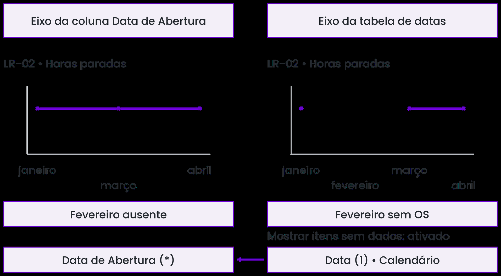
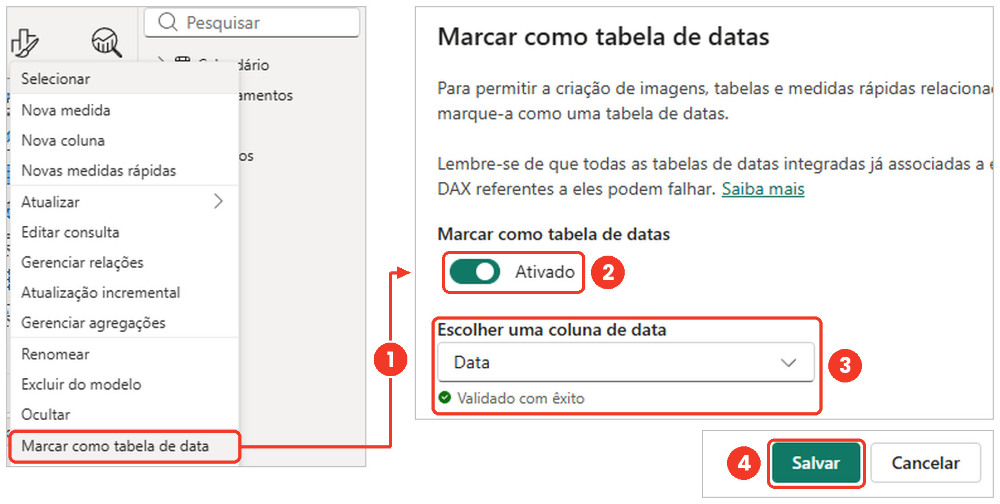
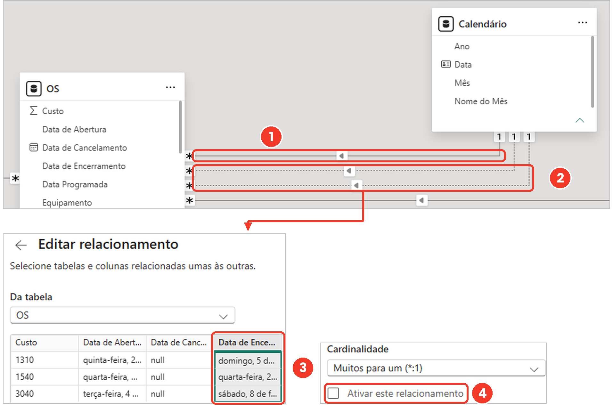
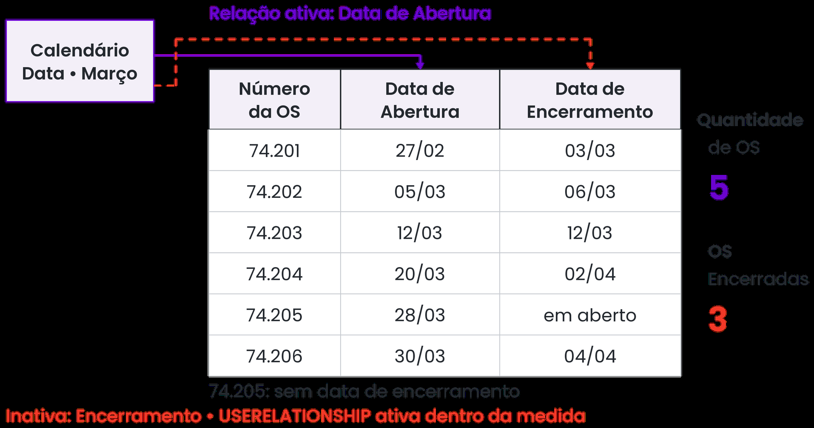
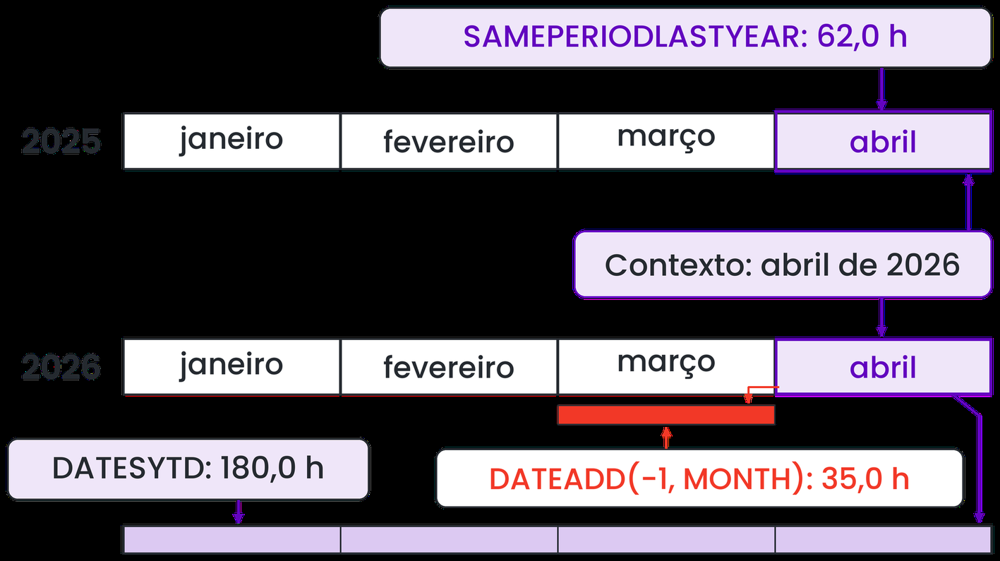
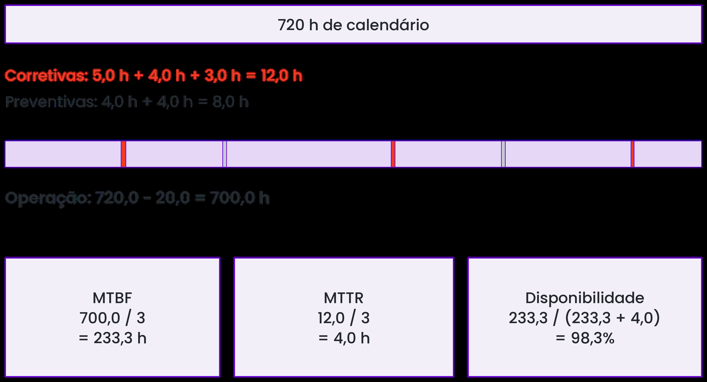
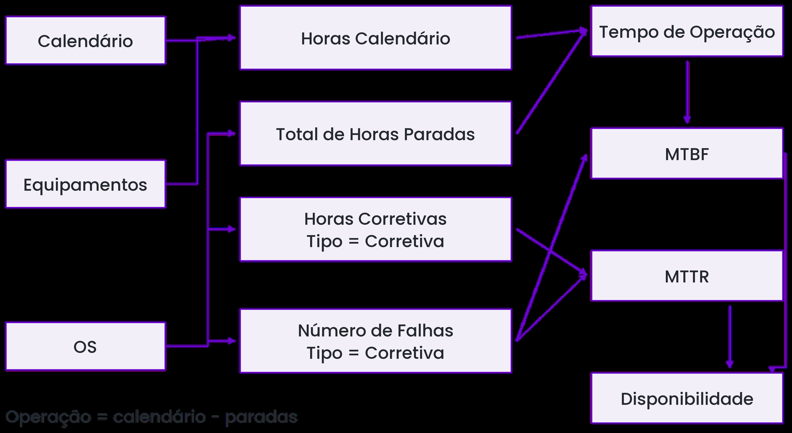
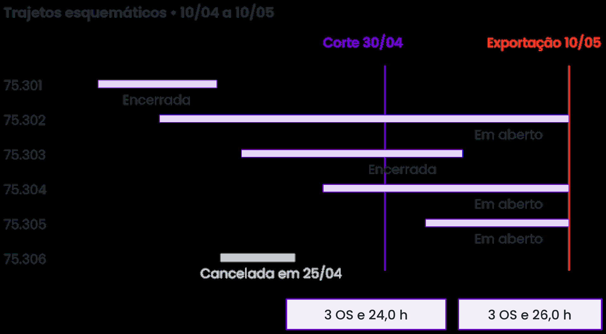
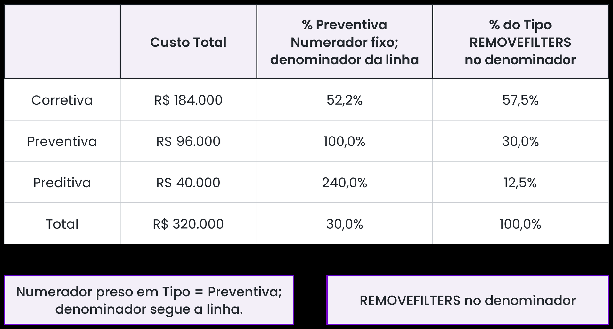
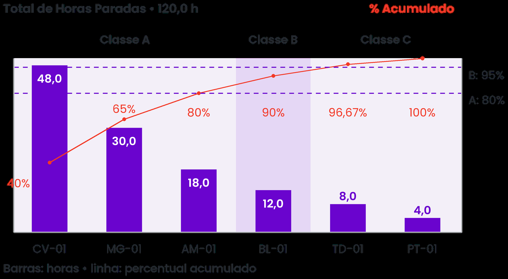

# Roteiro de Apoio para Explicação dos Temas — Aula 5 (Slide a Slide · Seções 5.3 a 5.10)
**Curso:** Power BI e DAX para Manutenção (CEDTEC Guarapari · Samarco)  
**Apresentação Oficial:** [`Aulas/Power BI e DAX para Manutenção — Dia 5 · Indicadores da manutenção.pptx`](../../Aulas/Power%20BI%20e%20DAX%20para%20Manuten%C3%A7%C3%A3o%20%E2%80%94%20Dia%205%20%C2%B7%20Indicadores%20da%20manuten%C3%A7%C3%A3o.pptx) *(28 Slides — Seções 5.3 a 5.10)*  
**Objetivo deste Guia:** Acompanhar a sequência dos **28 slides** da apresentação do Dia 5 (*Indicadores da manutenção*), fornecendo ao professor o discurso didático, as contas de quadro branco (para a Sala sem computador), as pegadinhas clássicas de engenharia de manutenção no Power BI e a condução da Galeria de Painéis e da Prova Final.

---

## Mapa da Aula 5 (Sexta-feira · 08:00 às 16:00)

```
┌────────────────────────────────────────────────────────────────────────────┐
│ MANHÃ — PARTE 1 (08:00–10:00 e 10:00–12:00): Seções 5.3 a 5.6              │
│ • 5.3: Tabela de Datas contínua (caso LR-02 sem falha em fevereiro)        │
│ • 5.4: Relacionamento Ativo × Inativo com USERELATIONSHIP (5 abertas vs 3) │
│ • 5.5: Acumulado no Ano (TOTALYTD), Ano Anterior e a Trava da Última OS    │
│ • 5.6: MTBF, MTTR e Disponibilidade calculados à mão e em DAX (caso DC-01) │
├────────────────────────────────────────────────────────────────────────────┤
│ TARDE — PARTE 2 (13:00–13:50 e 13:50–14:40): Seções 5.7 a 5.10 + Galeria   │
│ • 5.7: Backlog atual (Status) vs Carteira por Data de Corte e Aderência    │
│ • 5.8: Custo e Proporção de Preventivas (% Preventiva vs % do Tipo)        │
│ • 5.9: Ranking (RANKX), Curva de Pareto (% Acumulado) e Classe ABC         │
│ • 5.10: Casos Integrados 1 e 2 + Galeria de Painéis (10 min)               │
├────────────────────────────────────────────────────────────────────────────┤
│ PROVA FINAL IMPRESSA (14:45–15:45) + ENCERRAMENTO (15:45–16:00)            │
└────────────────────────────────────────────────────────────────────────────┘
```

---

# PARTE 1 (MANHÃ): Inteligência de Tempo, `USERELATIONSHIP` e `MTBF / MTTR` (Seções 5.3 a 5.6)

## 1. Seção 5.3 — Tabela de Datas para Inteligência de Tempo

### A Provocação Inicial no Quadro ("O Mês sem Falha que Sumiu do Gráfico")
- **História real de painel:** O lavador de rodas **`LR-02`** (Embarque) teve ordens de serviço abertas em **janeiro**, **março** e **abril**. Em **fevereiro**, ele rodou o mês inteiro sem nenhuma parada!
- **Pergunte para a turma:** *"Se você arrastar a coluna `OS[Data de Abertura]` direto para o eixo X do gráfico de linhas, o que aparece na tela?"*
  - A tabela `OS` só tem linhas quando algo quebrou ou parou. Como não houve OS em fevereiro, a data de fevereiro **não existe na tabela `OS`**!
  - Resultado: o eixo pula de janeiro direto para março, escondendo justamente o melhor mês da manutenção!


*Guia Visual 1 (Figura 5.7): Com a tabela `Calendário` contínua e "Mostrar itens sem dados" marcado, fevereiro aparece no eixo com valor vazio.*

### Os 4 Requisitos da Tabela de Datas Oficial (Microsoft Learn)
Explique no quadro por que funções como `TOTALYTD` e `SAMEPERIODLASTYEAR` exigem uma tabela `Calendário` própria:
1. **Todos os dias do ano presentes (contígua):** De `01/01` a `31/12`, sem pular feriado nem fim de semana.
2. **Valores únicos e sem vazios:** Exatamente uma linha por dia (`1:N` com `OS[Data de Abertura]`).
3. **`CALENDAR` vs `CALENDARAUTO`:**
   - `CALENDAR(DATE(2024,1,1), DATE(2026,12,31))` ➔ Você controla o início e o fim (`1.096 dias`).
   - `CALENDARAUTO()` ➔ Vasculha todas as datas do modelo. **Pegadinha:** Se alguém digitou uma data de encerramento errada no SAP como `2062`, o `CALENDARAUTO()` cria linhas até 2062!
4. **Ordenação do `Nome do Mês`:** Por padrão, texto ordena em ordem alfabética (*abril, agosto, dezembro...*). Por isso selecionamos `Nome do Mês` e aplicamos **Classificar por coluna ➔ `Mês` (`1` a `12`)**.


*Guia Visual 2 (Figura 5.8): Validação da coluna `Data` ao marcar a tabela como calendário oficial do modelo.*

---

## 2. Seção 5.4 — Relacionamento Inativo com `USERELATIONSHIP`

### A Conta no Quadro Branco (Tabela 5.6 — Área de Embarque)
Desenhe as 6 OS de Embarque no quadro e peça para a turma responder quantas OS pertencem a **março**:

| Número da OS | Data de Abertura | Data de Encerramento | Conta em março por **Abertura**? | Conta em março por **Encerramento**? |
| :---: | :---: | :---: | :---: | :---: |
| `74.201` | `27/02` | `03/03` | não | **sim** |
| `74.202` | `05/03` | `06/03` | **sim** | **sim** |
| `74.203` | `12/03` | `12/03` | **sim** | **sim** |
| `74.204` | `20/03` | `02/04` | **sim** | não |
| `74.205` | `28/03` | *em aberto* | **sim** | não |
| `74.206` | `30/03` | `04/04` | **sim** | não |
| **Total em Março** | — | — | **5 OS (demanda que entrou)** | **3 OS (serviço entregue)** |

- **O Dilema do Modelo:** Entre duas tabelas (`Calendário` e `OS`), o Power BI só permite **um relacionamento ativo por vez** (linha contínua, ligada na `Data de Abertura`).
- Os outros caminhos (`Data de Encerramento` e `Data Programada`) ficam **inativos (linha tracejada)**: existem no diagrama, mas ficam "desligados" até que uma medida chame `USERELATIONSHIP`:
  ```dax
  OS Encerradas = 
  CALCULATE(
      COUNT( OS[Data de Encerramento] ),
      USERELATIONSHIP( OS[Data de Encerramento], 'Calendário'[Data] )
  )
  ```
- **Pergunta de verificação para a turma:** *"Por que escrevemos `COUNT(OS[Data de Encerramento])` dentro da medida em vez de `COUNTROWS(OS)`?"*
  - Porque num cartão sem filtro de mês na página, `COUNTROWS(OS)` contaria todas as 6 linhas (incluindo a `74.205` que ainda está em aberto!). Já `COUNT(OS[Data de Encerramento])` ignora vazios e devolve apenas as 5 realmente encerradas!


*Guia Visual 3 (Figura 5.9): Linha contínua (`Data de Abertura`) e linhas tracejadas (`Data de Encerramento` e `Data Programada`).*


*Guia Visual 4 (Figura 5.10): `USERELATIONSHIP` desvia o filtro do calendário para a coluna `Data de Encerramento` apenas durante o cálculo daquela medida.*

---

## 3. Seção 5.5 — Acumulado no Ano (`YTD`) e Comparação entre Períodos

### Conta no Quadro: Grelha Móvel `GM-01` (Tabela 5.7)
Copie os 4 meses da `GM-01` no quadro e peça para os alunos preencherem a coluna `Horas YTD` e `Variação Anual`:

| Mês de 2026 | Horas Paradas (2026) | Horas YTD (2026) | Horas Ano Anterior (2025) | Variação Anual |
| :--- | :---: | :---: | :---: | :---: |
| **Janeiro** | `40,0` | `40,0` | `48,0` | `(40 - 48) / 48 = -16,67%` |
| **Fevereiro** | `55,0` | `40 + 55 = 95,0` | `50,0` | `(55 - 50) / 50 = +10,00%` |
| **Março** | `35,0` | `95 + 35 = 130,0` | `44,0` | `(35 - 44) / 44 = -20,45%` |
| **Abril** | `50,0` | `130 + 50 = 180,0` | `62,0` | `(50 - 62) / 62 = -19,35%` |

- **Mostre que `TOTALYTD` é açúcar sintático para `CALCULATE` + `DATESYTD`:**
  ```dax
  Horas YTD = TOTALYTD( [Total de Horas Paradas], 'Calendário'[Data] )
  -- equivale exatamente a:
  Horas YTD = CALCULATE( [Total de Horas Paradas], DATESYTD( 'Calendário'[Data] ) )
  ```
- **A Armadilha dos Meses Futuros (Trava de Data):**
  - Nosso calendário vai até `31/12/2026`, mas estamos em abril! O que `DATESYTD` faz na linha de maio, junho... dezembro? Soma de 1º de janeiro até dezembro e **repete `180,0` em linha reta até o fim do ano**!
  - Como travar para só mostrar até o último mês com OS registrada?
    ```dax
    Horas YTD = 
    IF(
        MIN( 'Calendário'[Data] ) <= CALCULATE( MAX( OS[Data de Abertura] ), REMOVEFILTERS() ),
        TOTALYTD( [Total de Horas Paradas], 'Calendário'[Data] )
    )
    ```


*Guia Visual 5 (Figura 5.11): Como `DATESYTD`, `SAMEPERIODLASTYEAR` e `DATEADD` transformam o filtro de abril de 2026.*

---

## 4. Seção 5.6 — `MTBF`, `MTTR` e `Disponibilidade` em Medidas DAX

### Conta à Mão Obrigatória no Quadro: O Decantador `DC-01` (Tabelas 5.8 e 5.9)
Antes de mostrar qualquer fórmula DAX, faça a conta de engenharia no quadro com a turma para **Abril (30 dias = `720 h`)** e **Maio (31 dias = `744 h`)**:

- **Abril de 2026 no `DC-01`:**
  - `3 Corretivas` (`5,0 h + 4,0 h + 3,0 h = 12,0 h`) e `2 Preventivas` (`4,0 h + 4,0 h = 8,0 h`). Total parado = **`20,0 h`**.
  - **1. Tempo de Operação:** $720\text{ h} - 20,0\text{ h} = \mathbf{700,0\text{ h}}$ *(toda parada reduz o tempo operado!)*.
  - **2. MTBF (Tempo Médio Entre Falhas):** $\frac{700,0\text{ h}}{3\text{ falhas}} = \mathbf{233,3\text{ h}}$.
  - **3. MTTR (Tempo Médio de Reparo):** $\frac{12,0\text{ h corretivas}}{3\text{ reparos}} = \mathbf{4,0\text{ h}}$.
  - **4. Disponibilidade Inerente:** $\frac{\text{MTBF}}{\text{MTBF} + \text{MTTR}} = \frac{233,3}{233,3 + 4,0} = \frac{700,0}{712,0} = \mathbf{98,3\%}$.
- **E em Maio de 2026 (`744 h` de calendário)?**
  - Foram `2 Corretivas` (`6,0 h + 10,0 h = 16,0 h`) e `1 Preventiva` (`4,0 h`). Total parado = **`20,0 h`**.
  - Tempo de Operação = $744 - 20 = \mathbf{724,0\text{ h}}$.
  - **MTBF subiu:** $\frac{724,0}{2} = \mathbf{362,0\text{ h}}$ (quebrou menos vezes!).
  - **MTTR dobrou:** $\frac{16,0}{2} = \mathbf{8,0\text{ h}}$ (quando quebrou, demorou o dobro para consertar!).
  - **Disponibilidade caiu:** $\frac{362,0}{362,0 + 8,0} = \mathbf{97,8\%}$!
  - **Moral da história para a turma:** *Olhar só para o MTBF engana! Em maio o equipamento quebrou menos vezes, mas ficou menos disponível porque os reparos foram muito mais longos!*


*Guia Visual 6 (Figura 5.13): Decomposição das 720 horas de abril do decantador `DC-01`.*


*Guia Visual 7 (Figura 5.15): Árvore de dependência das 6 medidas de confiabilidade no DAX.*

---

# PARTE 2 (TARDE): Backlog, Aderência, Custos, Pareto e Casos (Seções 5.7 a 5.10)

## 5. Seção 5.7 — Backlog e Aderência ao Plano

### 1º Conceito: Backlog de "Hoje" vs Carteira na "Data de Corte" (Tabela 5.10)
- **Por que `OS[Status] = "Aberta"` só serve para o cartão de hoje?** Porque o status é sobrescrito! A OS `75.303` foi aberta em `22/04` e encerrada em `05/05`. No dia `30/04` ela estava na carteira (`8,0 h`), mas se você olhar a coluna `Status` hoje (`10/05`), está escrito `"Encerrada"`.
- Para o gráfico de evolução mensal da carteira, precisamos testar as datas contra a data de corte (`Corte = MAX('Calendário'[Data])`):
  1. `Data de Abertura <= Corte`
  2. `Data de Encerramento > Corte` ou em branco (`ISBLANK`)
  3. `Data de Cancelamento > Corte` ou em branco (`ISBLANK`)


*Guia Visual 8 (Figura 5.17): A linha vertical da data de corte (`30/04` vs `10/05`) mostra exatamente quais barras (OS) estavam abertas naquele dia.*

### 2º Conceito: Aderência ao Plano (`USERELATIONSHIP` na `Data Programada`)
- **Regra da Aderência:** $\frac{\text{Preventivas encerradas até a Data Programada}}{\text{Preventivas com Data Programada no mês}}$.
- Destaque a pegadinha clássica do `BLANK` em comparações `<=` no DAX:
  - Se não escrevermos `NOT ISBLANK(OS[Data de Encerramento])`, uma OS em aberto tem `Data de Encerramento = BLANK` (que vale `0` = `30/12/1899`), que é menor que qualquer data de 2026! A preventiva não executada entraria como executada no prazo!

---

## 6. Seção 5.8 — Custo e Proporção de Preventivas (`% Preventiva` vs `% do Tipo`)

- Mostre a Tabela 5.11 (Pelotamento no 1º trimestre: Corretiva `R$ 184 mil` = `57,5%`, Preventiva `R$ 96 mil` = `30,0%`, Preditiva `R$ 40 mil` = `12,5%`).
- **Por que `% Preventiva` dá `240,0%` na linha Preditiva da matriz (Figura 5.19)?**
  - Porque o numerador (`Custo Preventiva`) usa `CALCULATE(..., OS[Tipo de Manutenção] = "Preventiva")`, que **sobrescreve** o filtro da linha e trava o numerador em `R$ 96.000`.
  - Já o denominador (`Custo Total`) obedece à linha Preditiva (`R$ 40.000`). E $96.000 \div 40.000 = \mathbf{240,0\%}$!
  - **Solução:** Na matriz por tipo, usa-se `% do Tipo` com `REMOVEFILTERS(OS[Tipo de Manutenção])` no denominador!


*Guia Visual 9 (Figura 5.19): Comparação lado a lado entre `% Preventiva` e `% do Tipo` na matriz por tipo de manutenção.*

---

## 7. Seção 5.9 — Ranking e Pareto das Falhas com `RANKX`

### Conta no Quadro: Os 6 Equipamentos de Embarque (Tabela 5.12)
Monte a tabela no quadro e mostre como o Pareto responde onde focar a engenharia de confiabilidade:

| Posição | Equipamento | Horas Paradas | Horas Acumuladas | `% Acumulado` | Classe ABC |
| :---: | :---: | :---: | :---: | :---: | :---: |
| **1º** | `CV-01` (Carregador de vagões) | `48,0 h` | `48,0 h` | `40,00%` | **A** |
| **2º** | `MG-01` (Moega) | `30,0 h` | `78,0 h` | `65,00%` | **A** |
| **3º** | `AM-01` (Amostrador) | `18,0 h` | `96,0 h` | **`80,00%`** | **A** |
| **4º** | `BL-01` (Balança rodoviária) | `12,0 h` | `108,0 h` | `90,00%` | **B** |
| **5º** | `TD-01` (Tanque de diesel) | `8,0 h` | `116,0 h` | `96,67%` | **C** |
| **6º** | `PT-01` (Portão automático) | `4,0 h` | `120,0 h` | `100,00%` | **C** |

- **Por que `ALL(Equipamentos[Equipamento])` é obrigatório dentro do `RANKX`?**
  - Sem `ALL`, na linha do `AM-01` o contexto de filtro só enxerga o próprio `AM-01` (uma lista de 1 equipamento só), e **todos os equipamentos empatam em 1º lugar**!
- **Como funciona a soma acumulada do Pareto no DAX?**
  - Para cada equipamento (`VAR Atual = [Total de Horas Paradas]`), o `FILTER(ALL(Equipamentos[Equipamento]), [Total de Horas Paradas] >= Atual)` separa todos os equipamentos que empatam ou estão acima dele no ranking, e o `SUMX` soma as horas deles!


*Guia Visual 10 (Figura 5.21): Três equipamentos (`CV-01`, `MG-01` e `AM-01`) respondem por 80% das horas paradas da área de Embarque.*

---

## 8. Seção 5.10 — Discussão Curta dos 2 Casos Integrados + Galeria de Painéis

### Caso 1: O Acumulado que Fechou o Ano em Junho (Moagem — Figura 5.23)
Pergunte à turma quais dos 3 sintomas do supervisor são bugs e quais são corretos:
1. **Gráfico de `Horas YTD` reto de junho a dezembro em `312,0 h`:** **É defeito!** Faltou a trava da última data de abertura.
2. **Célula de `MTBF` vazia em maio no `LC-01`:** **Está certo!** Zero falhas em maio $\Rightarrow$ `DIVIDE` retorna `BLANK`.
3. **Cartão de Disponibilidade em `99,1%` (vs `98,2%`):** **Ambos estão certos para o que medem!** `99,1%` é a disponibilidade inerente (`MTBF / (MTBF + MTTR)`), que só desconta corretivas; `98,2%` é a disponibilidade física sobre as horas de calendário, descontando também preventivas e preditivas.

### Caso 2: A Aderência de Abril que Deu `63,6%` em vez de `84,0%` (Filtragem — Figura 5.24)
- O planejamento programou **25 preventivas** para abril e cumpriu **21 no prazo** (`21 / 25 = 84,0%`).
- Mas no fim de abril já deixaram abertas no sistema **8 preventivas programadas para maio**.
- Como o painel contava pelo relacionamento ativo (`Data de Abertura`), somou $25 + 8 = 33$ no denominador (`21 / 33 = 63,6%`).
- **Correção:** Usar `USERELATIONSHIP(OS[Data Programada], 'Calendário'[Data])` nas medidas `OS Programadas` e `OS no Prazo`.

### Condução da Galeria de Painéis (10 minutos antes da Prova Final)
- Convide 3 a 4 alunos para projetarem seus painéis (`.pbix`) construídos ao longo dos 5 dias.
- Faça a **Pergunta de Encerramento do Curso** para cada apresentação:
  > **"Olhando para o seu painel agora, qual equipamento pede atenção primeiro, e por quê?"**
