# Roteiro Prático: Interação com os Datasets da Aula 5 no Power BI Desktop
**Curso:** Power BI e DAX para Manutenção (CEDTEC Guarapari · Samarco)  
**Apresentação de Referência:** [`Aulas/Power BI e DAX para Manutenção — Dia 5 · Indicadores da manutenção.pptx`](../../Aulas/Power%20BI%20e%20DAX%20para%20Manuten%C3%A7%C3%A3o%20%E2%80%94%20Dia%205%20%C2%B7%20Indicadores%20da%20manuten%C3%A7%C3%A3o.pptx) *(Slides 1 a 28 — Seções 5.3 a 5.10)*  
**Arquivos de Dados na Pasta `Dataset/Aula 5/`:**
- [`Dataset_PowerBI_Manutencao.xlsx`](./Dataset_PowerBI_Manutencao.xlsx) *(Modelo completo do curso para o painel principal)*
- [`Casos_Indicadores_Dia5.xlsx`](./Casos_Indicadores_Dia5.xlsx) *(Planilha com as tabelas exatas da apostila — Tabelas 5.6 a 5.12 e Caso 5.10.2 — para conferência rápida à mão e no Power BI)*
- [`COLA_DE_INDICADORES_DAX_DIA5.md`](./COLA_DE_INDICADORES_DAX_DIA5.md) *(Folha de consulta rápida das medidas de Inteligência de Tempo e Indicadores de Manutenção)*

---

## Mapa Prático da Aula 5 (Manhã e Tarde)

| Bloco | Seções | O que construir no Power BI Desktop |
| :--- | :---: | :--- |
| **Bloco 1 (Manhã)** | **5.3 · 5.4** | Criar a tabela **`Calendário`** com `ADDCOLUMNS` e `CALENDAR`, marcar como tabela de datas, criar relacionamentos inativos (`Data de Encerramento` e `Data Programada`) e usar **`USERELATIONSHIP`** (`5 abertas` vs `3 encerradas` em março). |
| **Bloco 2 (Manhã)** | **5.5 · 5.6** | Calcular acumulado no ano (**`TOTALYTD`**), comparação anual (**`SAMEPERIODLASTYEAR`**), trava da última OS e a pilha completa de confiabilidade: **`MTBF` (`233,3 h`)**, **`MTTR` (`4,0 h`)** e **`Disponibilidade` (`98,3%`)** no caso do decantador `DC-01`. |
| **Bloco 3 (Tarde)** | **5.7 · 5.8** | Medir **Backlog** em horas (`Backlog HH`), reconstruir **OS em Carteira** por data de corte (`CALCULATETABLE` + `FILTER`), calcular **Aderência ao Plano (`84,0%`)** e comparar **`% Preventiva`** (cartão) vs **`% do Tipo`** (matriz). |
| **Bloco 4 (Tarde)** | **5.9 · 5.10** | Construir o **Ranking (`RANKX`)**, **Curva de Pareto (`% Acumulado`)** e **Classe ABC (`80% / 95%`)** da área de Embarque, auditar os **2 Casos Integrados (5.10)** e apresentar na **Galeria de Painéis**. |

---

# BLOCO 1: Tabela de Datas e `USERELATIONSHIP` (Seções 5.3 e 5.4)

### Passo 1.1: Por que o Eixo Precisa de uma Tabela de Datas Contínua (Seção 5.3)
*Caso do lavador de rodas `LR-02` (Embarque): teve OS em janeiro, março e abril, e nenhuma em fevereiro.*

1. Abra o seu arquivo `.pbix` com [`Dataset_PowerBI_Manutencao.xlsx`](./Dataset_PowerBI_Manutencao.xlsx) (ou importe [`Casos_Indicadores_Dia5.xlsx`](./Casos_Indicadores_Dia5.xlsx) para conferir cada tabela isoladamente).
2. Se você montar um gráfico de linhas usando diretamente `OS[Data de Abertura]` no Eixo X, o mês de **fevereiro** (sem OS) some do eixo e a linha liga janeiro direto a março.

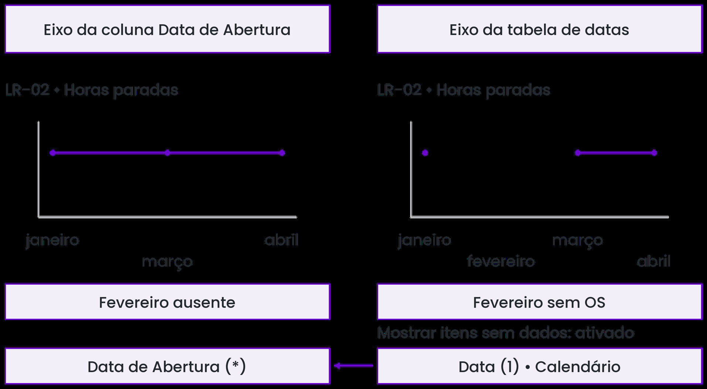
*Figura 1 (Figura 5.7): Sobre a coluna `Data de Abertura`, o mês sem OS desaparece do eixo; sobre a tabela de datas contínua, com "Mostrar itens sem dados" ativado, fevereiro aparece vazio no lugar certo.*

3. **Criando a Tabela `Calendário` em DAX:**
   - Na guia **Modelagem**, clique em **Nova tabela** e digite na barra de fórmulas:
     ```dax
     Calendário = 
     ADDCOLUMNS(
         CALENDAR( DATE(2024, 1, 1), DATE(2026, 12, 31) ),
         "Ano", YEAR ( [Date] ),
         "Mês", MONTH ( [Date] ),
         "Nome do Mês", FORMAT ( [Date], "MMMM" ),
         "Ano-Mês", FORMAT ( [Date], "YYYY-MM" )
     )
     ```
   - No painel **Dados**, dê um clique duplo na coluna `Date` gerada dentro de `Calendário` e renomeie para **`Data`**.

| Coluna | Fórmula na tabela | Para que serve no painel |
| :--- | :--- | :--- |
| **`Data`** *(renomeada de `Date`)* | Gerada por `CALENDAR` | Chave (`1`) do relacionamento com `OS[Data de Abertura]` |
| **`Ano`** | `YEAR([Date])` | Segmentação e eixo anual |
| **`Mês`** | `MONTH([Date])` | Ordenar cronologicamente o nome do mês (`1` a `12`) |
| **`Nome do Mês`** | `FORMAT([Date], "MMMM")` | Rótulo legível no eixo e na matriz (*janeiro, fevereiro...*) |
| **`Ano-Mês`** | `FORMAT([Date], "YYYY-MM")` | Eixo contínuo que atravessa a virada do ano (`2025-12` ➔ `2026-01`) |

4. **Ordenar o `Nome do Mês` (para abril não vir antes de janeiro):**
   - No painel **Dados**, clique sobre a coluna `Calendário[Nome do Mês]`.
   - Na guia superior **Ferramentas de coluna**, clique em **Classificar por coluna** ➔ escolha **`Mês`**.
5. **Marcar como Tabela de Datas e Desligar Data/Hora Automática:**
   - Clique com o botão direito na tabela `Calendário` ➔ **Marcar como tabela de data** ➔ selecione a coluna **`Data`** e confirme quando aparecer *"Validado com êxito"*.
   - Em **Arquivo** ➔ **Opções e configurações** ➔ **Opções** ➔ **Arquivo Atual › Carregamento de Dados**, desmarque **Data/hora automática** para remover tabelas ocultas e deixar o arquivo leve.

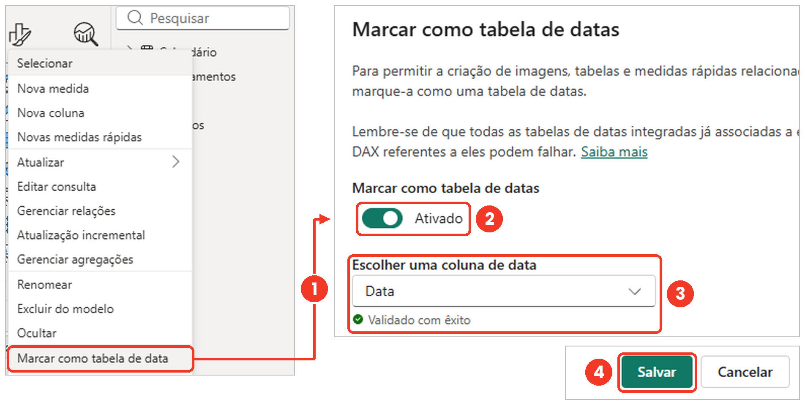
*Figura 2 (Figura 5.8): Janela "Marcar como tabela de datas" validando a coluna `Data` como única, sem vazios e contínua.*

---

### Passo 1.2: Relacionamento Ativo × Inativo com `USERELATIONSHIP` (Seção 5.4)
*Pergunta da Manutenção: "Quantas OS entraram em março (abertura) e quantas foram entregues em março (encerramento)?"*

1. Vá para a **Exibição de Modelo** (3º ícone à esquerda).
2. Crie (ou confira) os **três relacionamentos** entre `Calendário[Data]` e a tabela `OS`:
   - **1º (Ativo — linha contínua):** Arraste `Calendário[Data]` até `OS[Data de Abertura]`.
   - **2º (Inativo — linha tracejada):** Arraste `Calendário[Data]` até `OS[Data de Encerramento]`.
   - **3º (Inativo — linha tracejada):** Arraste `Calendário[Data]` até `OS[Data Programada]`.

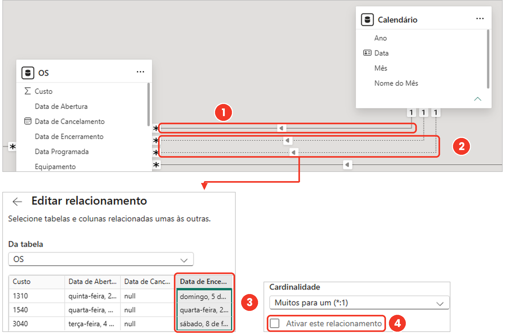
*Figura 3 (Figura 5.9): Exibição de modelo com um relacionamento ativo (linha contínua em `Data de Abertura`) e dois inativos (linhas tracejadas em `Data de Encerramento` e `Data Programada`).*

3. **Conferindo na aba `Tab5_6_Embarque_Datas` (as 6 OS de Embarque — Tabela 5.6):**

| Número da OS | Data de Abertura | Data de Encerramento | Conta em março por **abertura**? | Conta em março por **encerramento**? |
| :---: | :---: | :---: | :---: | :---: |
| `74.201` | `27/02` | `03/03` | não | **sim** |
| `74.202` | `05/03` | `06/03` | **sim** | **sim** |
| `74.203` | `12/03` | `12/03` | **sim** | **sim** |
| `74.204` | `20/03` | `02/04` | **sim** | não |
| `74.205` | `28/03` | *em aberto* | **sim** | não |
| `74.206` | `30/03` | `04/04` | **sim** | não |
| **Total em Março** | — | — | **5 OS abertas** | **3 OS encerradas** |

4. Crie a medida que ativa o caminho tracejado de encerramento apenas durante o cálculo:
   ```dax
   OS Encerradas = 
   CALCULATE(
       COUNT( OS[Data de Encerramento] ),
       USERELATIONSHIP( OS[Data de Encerramento], 'Calendário'[Data] )
   )
   ```
   > [!IMPORTANT]
   > - Usamos `COUNT(OS[Data de Encerramento])` em vez de `COUNTROWS(OS)` para que uma OS ainda sem data de encerramento (`74.205`) jamais seja contada como encerrada mesmo num cartão sem filtro de mês!
   > - Coloque numa Matriz com `'Calendário'[Nome do Mês]` nas linhas: `[Quantidade de OS]` mostra **5** em março e `[OS Encerradas]` mostra **3** (a carteira cresceu em 2 OS no mês!).

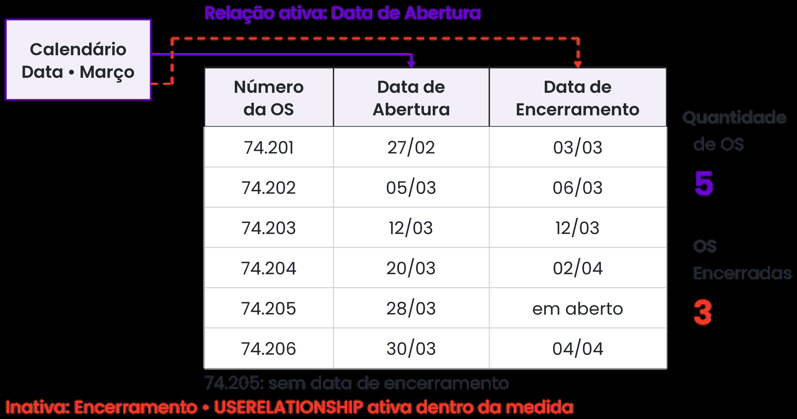
*Figura 4 (Figura 5.10): O filtro de março chega por padrão pela `Data de Abertura` (5 OS) e, dentro da medida com `USERELATIONSHIP`, desce pela `Data de Encerramento` (3 OS).*

---

# BLOCO 2: Inteligência de Tempo (`YTD`, `YoY`) e `MTBF / MTTR` (Seções 5.5 e 5.6)

### Passo 2.1: Acumulado no Ano (`TOTALYTD`), Ano Anterior (`SAMEPERIODLASTYEAR`) e Trava de Data (Seção 5.5)
*Caso da grelha móvel `GM-01` (Forno — Tabela 5.7, aba `Tab5_7_GM01_YTD`):*

| Mês de 2026 | Total de Horas Paradas (2026) | Horas YTD (Acumulado 2026) | Horas Ano Anterior (2025) | Variação Anual (%) |
| :--- | :---: | :---: | :---: | :---: |
| **Janeiro** | `40,0` | `40,0` | `48,0` | `-16,67%` |
| **Fevereiro** | `55,0` | `95,0` | `50,0` | `+10,00%` |
| **Março** | `35,0` | `130,0` | `44,0` | `-20,45%` |
| **Abril** | `50,0` | **`180,0`** | `62,0` | **`-19,35%`** |

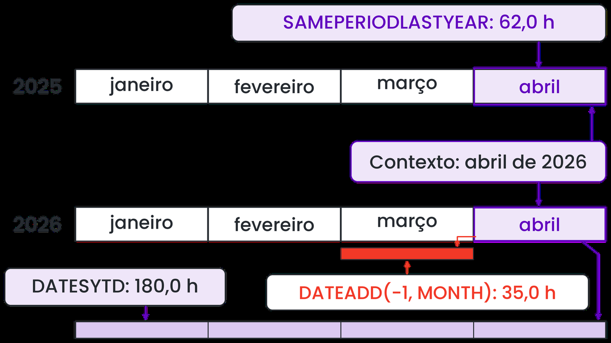
*Figura 5 (Figura 5.11): A partir de abril de 2026, `DATESYTD` estende o intervalo até 1º de janeiro, `SAMEPERIODLASTYEAR` recua 1 ano (abril/2025) e `DATEADD(..., -1, MONTH)` recua 1 mês (março/2026).*

1. Crie as medidas de Inteligência de Tempo na sua tabela de medidas (já **com a trava da última OS registrada**, para que os meses futuros de maio a dezembro não repitam `180,0` em linha reta!):
   ```dax
   Horas YTD = 
   IF(
       MIN( 'Calendário'[Data] ) <= CALCULATE( MAX( OS[Data de Abertura] ), REMOVEFILTERS() ),
       TOTALYTD( [Total de Horas Paradas], 'Calendário'[Data] )
   )
   ```
   ```dax
   Horas Ano Anterior = 
   IF(
       MIN( 'Calendário'[Data] ) <= CALCULATE( MAX( OS[Data de Abertura] ), REMOVEFILTERS() ),
       CALCULATE(
           [Total de Horas Paradas],
           SAMEPERIODLASTYEAR( 'Calendário'[Data] )
       )
   )
   ```
   ```dax
   Variação Anual = 
   DIVIDE(
       [Total de Horas Paradas] - [Horas Ano Anterior],
       [Horas Ano Anterior]
   )
   ```
   ```dax
   Horas Mês Anterior = 
   CALCULATE(
       [Total de Horas Paradas],
       DATEADD( 'Calendário'[Data], -1, MONTH )
   )
   ```
   ```dax
   Média Móvel 30 Dias = 
   CALCULATE(
       [Total de Horas Paradas],
       DATESINPERIOD( 'Calendário'[Data], MAX( 'Calendário'[Data] ), -30, DAY )
   ) / 30
   ```

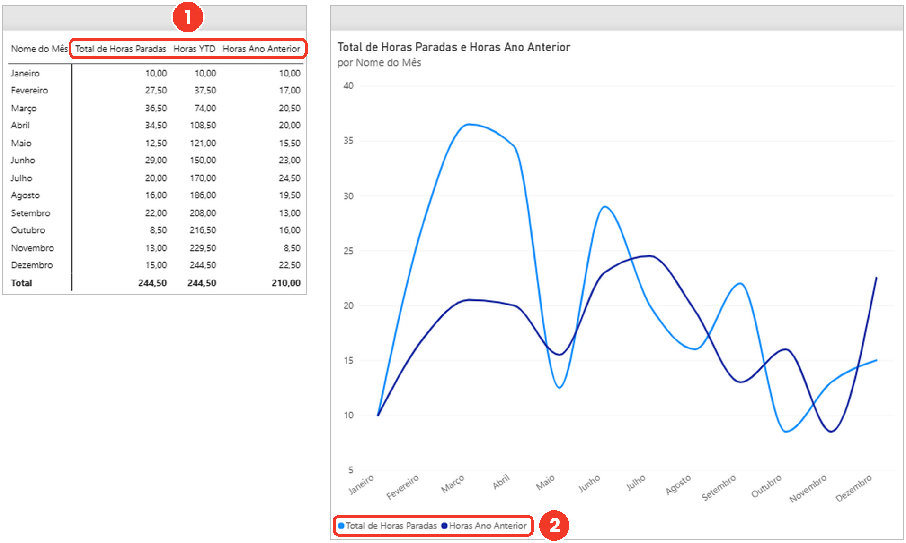
*Figura 6 (Figura 5.12): Matriz mensal com `Total de Horas Paradas`, `Horas YTD` e `Horas Ano Anterior`, acompanhada do gráfico de linhas comparativo.*

---

### Passo 2.2: Construindo a Pilha de `MTBF`, `MTTR` e `Disponibilidade` (Seção 5.6)
*Caso do decantador `DC-01` (Filtragem — Tabelas 5.8 e 5.9, aba `Tab5_8_DC01_MTBF_MTTR`):*

| Mês | Horas Calendário | Total Horas Paradas | Tempo de Operação | Nº de Falhas (Corretivas) | Horas Corretivas | **MTBF** | **MTTR** | **Disponibilidade** |
| :--- | :---: | :---: | :---: | :---: | :---: | :---: | :---: | :---: |
| **Abril** (30d) | `720 h` | `20,0 h` *(12h corr + 8h prev)* | **`700,0 h`** | `3` | `12,0 h` | **`233,3 h`** | **`4,0 h`** | **`98,3%`** |
| **Maio** (31d) | `744 h` | `20,0 h` *(16h corr + 4h prev)* | **`724,0 h`** | `2` | `16,0 h` | **`362,0 h`** | **`8,0 h`** | **`97,8%`** |

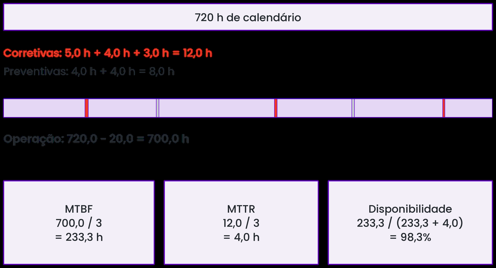
*Figura 7 (Figura 5.13): Nas 720 horas de abril, o `DC-01` parou 20,0 h (sendo 12,0 h em 3 corretivas) e operou 700,0 h: MTBF = `233,3 h`, MTTR = `4,0 h` e Disponibilidade = `98,3%`.*

1. Crie as **6 medidas empilhadas** (uma apoiada na outra):
   ```dax
   Horas Calendário = 
   COUNTROWS( 'Calendário' ) * 24 * DISTINCTCOUNT( Equipamentos[Equipamento] )
   ```
   ```dax
   Número de Falhas = 
   CALCULATE(
       COUNTROWS( OS ),
       OS[Tipo de Manutenção] = "Corretiva"
   )
   ```
   ```dax
   Tempo de Operação = 
   [Horas Calendário] - CALCULATE(
       [Total de Horas Paradas],
       REMOVEFILTERS( OS[Tipo de Manutenção] )
   )
   ```
   ```dax
   MTBF = DIVIDE( [Tempo de Operação], [Número de Falhas] )
   ```
   ```dax
   MTTR = DIVIDE( [Horas Corretivas], [Número de Falhas] )
   ```
   ```dax
   Disponibilidade = DIVIDE( [MTBF], [MTBF] + [MTTR] )
   ```
   > [!WARNING]
   > **Dois cuidados essenciais na Seção 5.6:**
   > 1. **Por que `REMOVEFILTERS(OS[Tipo de Manutenção])` dentro de `Tempo de Operação`?** Porque toda parada (corretiva, preventiva ou preditiva) desconta do tempo em que a máquina operou (`720 - 20 = 700 h`), mesmo se alguém filtrar a página por tipo!
   > 2. **Cuidado com corretiva sem horas apontadas (Figura 5.14):** Uma OS corretiva com `Horas Paradas` em branco ou zero entra no denominador (`Número de Falhas`), mas não soma no numerador (`Horas Corretivas`), derrubando artificialmente o `MTTR`!

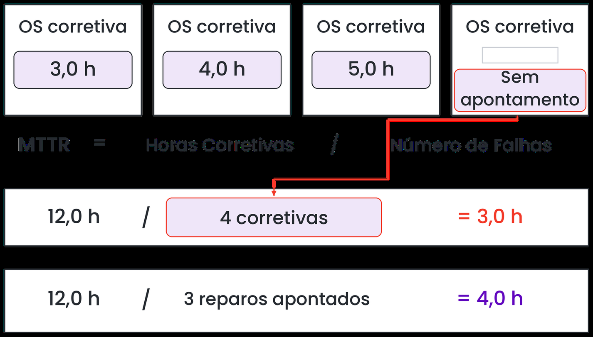
*Figura 8 (Figura 5.14): Corretiva sem horas apontadas infla o divisor e faz o MTTR cair artificialmente.*

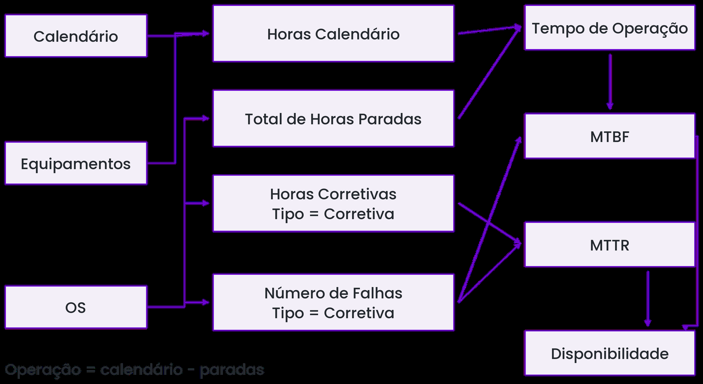
*Figura 9 (Figura 5.15): Empilhamento das medidas: `Horas Calendário` e `Total de Horas Paradas` formam o `Tempo de Operação`, que alimenta `MTBF`, `MTTR` e `Disponibilidade`.*

2. Formate `MTBF` e `MTTR` como **Número decimal (1 casa)** e `Disponibilidade` como **Porcentagem (`0,0%`)**. Monte os 3 cartões e a matriz por equipamento e mês:

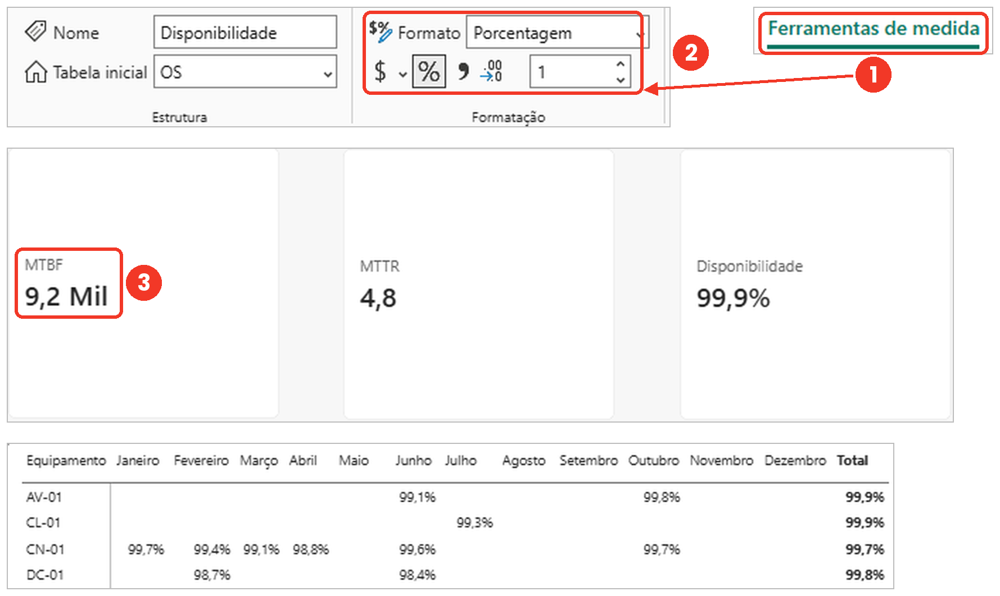
*Figura 10 (Figura 5.16): Cartões de MTBF, MTTR e Disponibilidade ao lado da matriz mensal no Power BI Desktop.*

---

# BLOCO 3: Backlog, Carteira por Corte, Aderência e Custos (Seções 5.7 e 5.8)

### Passo 3.1: Backlog Hoje (`Status = "Aberta"`) vs Evolução da Carteira por Data de Corte (Seção 5.7)
*Caso da área de Utilidades (Tabela 5.10 — aba `Tab5_10_Utilidades_Backlog`):*

| Nº da OS | Abertura | Encerramento | Cancelamento | Status em 10/05 | Horas Previstas | Em carteira em **30/04**? | Aberta em **10/05**? |
| :---: | :---: | :---: | :---: | :---: | :---: | :---: | :---: |
| `75.301` | `10/04` | `18/04` | — | Encerrada | `6,0 h` | não | não |
| `75.302` | `15/04` | *em aberto* | — | **Aberta** | `12,0 h` | **sim** | **sim** |
| `75.303` | `22/04` | `05/05` | — | Encerrada | `8,0 h` | **sim** | não |
| `75.304` | `28/04` | *em aberto* | — | **Aberta** | `4,0 h` | **sim** | **sim** |
| `75.305` | `02/05` | *em aberto* | — | **Aberta** | `10,0 h` | não | **sim** |
| `75.306` | `20/04` | — | `25/04` | Cancelada | `5,0 h` | não | não |
| **Total** | — | — | — | — | — | **3 OS (`24,0 h`)** | **3 OS (`26,0 h`)** |

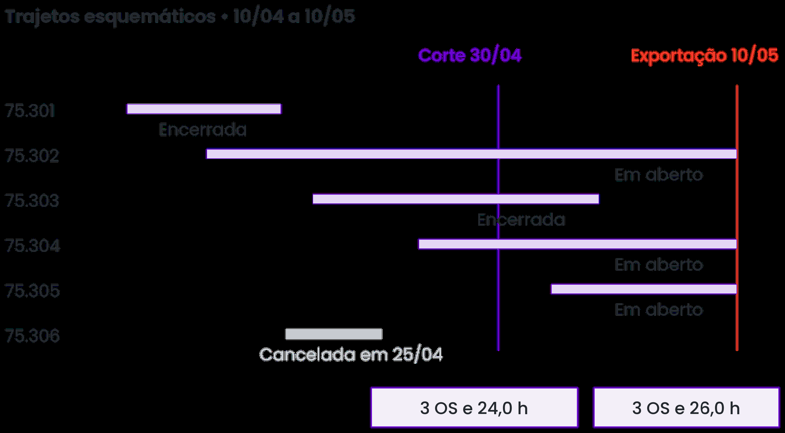
*Figura 11 (Figura 5.17): A carteira numa data de corte reúne as OS cuja barra de vida cruza aquela data (`24,0 h` em 30/04 vs `26,0 h` em 10/05).*

1. **Medidas para o Cartão de Hoje (fotografia atual da coluna `Status`):**
   ```dax
   OS Abertas = 
   CALCULATE(
       COUNTROWS( OS ),
       OS[Status] = "Aberta",
       REMOVEFILTERS( 'Calendário' )
   )
   ```
   ```dax
   Backlog HH = 
   CALCULATE(
       SUM( OS[Horas Previstas] ),
       OS[Status] = "Aberta",
       REMOVEFILTERS( 'Calendário' )
   )
   ```
2. **Medidas para o Gráfico Histórico (reconstruindo a carteira em qualquer data de corte):**
   ```dax
   OS em Carteira = 
   VAR Corte = MAX( 'Calendário'[Data] )
   VAR Base = CALCULATETABLE( OS, REMOVEFILTERS( 'Calendário' ), REMOVEFILTERS( OS[Status] ) )
   VAR Abertas = 
       FILTER(
           Base,
           OS[Data de Abertura] <= Corte
               && ( OS[Data de Encerramento] > Corte || ISBLANK( OS[Data de Encerramento] ) )
       )
   RETURN
       COUNTROWS(
           FILTER(
               Abertas,
               OS[Data de Cancelamento] > Corte || ISBLANK( OS[Data de Cancelamento] )
           )
       )
   ```

---

### Passo 3.2: Aderência ao Plano de Preventiva com `USERELATIONSHIP` (Seção 5.7)
*Em abril, 25 preventivas tinham `Data Programada` no mês e 21 foram encerradas até a data programada (`21 / 25 = 84,0%`).*

1. Crie as 3 medidas da **Aderência ao Plano** ativando o relacionamento inativo com `OS[Data Programada]`:
   ```dax
   OS Programadas = 
   CALCULATE(
       COUNT( OS[Data Programada] ),
       OS[Tipo de Manutenção] = "Preventiva",
       USERELATIONSHIP( OS[Data Programada], 'Calendário'[Data] )
   )
   ```
   ```dax
   OS no Prazo = 
   CALCULATE(
       COUNTROWS( OS ),
       OS[Tipo de Manutenção] = "Preventiva",
       NOT ISBLANK( OS[Data de Encerramento] )
           && OS[Data de Encerramento] <= OS[Data Programada],
       USERELATIONSHIP( OS[Data Programada], 'Calendário'[Data] )
   )
   ```
   ```dax
   Aderência = DIVIDE( [OS no Prazo], [OS Programadas] )
   ```
   > [!CAUTION]
   > **Por que `NOT ISBLANK(OS[Data de Encerramento])` é obrigatório?**  
   > Em DAX, uma data vazia (`BLANK`) comparada com `<= OS[Data Programada]` equivale a `30/12/1899` e passa no teste como verdadeira! Sem `NOT ISBLANK`, uma preventiva que nem foi executada contaria como feita no prazo!

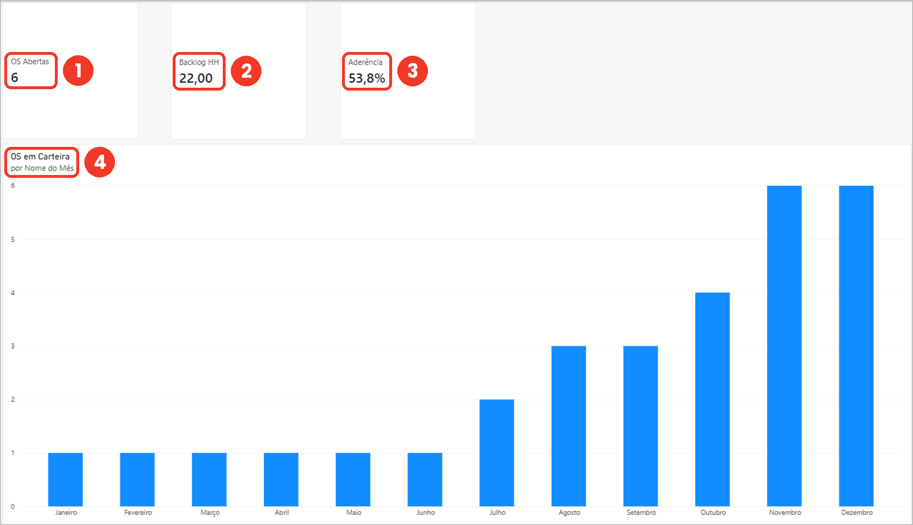
*Figura 12 (Figura 5.18): Cartões de `OS Abertas`, `Backlog HH` e `Aderência` (`84,0%`) com o gráfico de evolução mensal da carteira.*

---

### Passo 3.3: Custo e Proporção de Preventivas — Cartão vs Matriz (Seção 5.8)
*Caso da área de Pelotamento no 1º trimestre de 2026 (Tabela 5.11 — aba `Tab5_11_Pelotamento_Custos`): Corretiva = `R$ 184.000` (`57,5%`), Preventiva = `R$ 96.000` (`30,0%`), Preditiva = `R$ 40.000` (`12,5%`), Total = `R$ 320.000`.*

1. Crie as medidas de custo e proporção:
   ```dax
   Custo Preventiva = CALCULATE( [Custo Total], OS[Tipo de Manutenção] = "Preventiva" )
   ```
   ```dax
   Custo Corretiva = CALCULATE( [Custo Total], OS[Tipo de Manutenção] = "Corretiva" )
   ```
   ```dax
   % Preventiva = DIVIDE( [Custo Preventiva], [Custo Total] )
   ```
   ```dax
   % do Tipo = 
   DIVIDE(
       [Custo Total],
       CALCULATE( [Custo Total], REMOVEFILTERS( OS[Tipo de Manutenção] ) )
   )
   ```
   ```dax
   % Horas Corretivas = DIVIDE( [Horas Corretivas], [Total de Horas Paradas] )
   ```
   ```dax
   Custo Médio por Falha = DIVIDE( [Custo Corretiva], [Número de Falhas] )
   ```
2. **Veja a diferença na Matriz por `Tipo de Manutenção` (Figura 5.19):**
   - A medida `% Preventiva` serve para o **Cartão** (`30,0%`) ou para uma matriz por **Equipamento**. Colocada numa matriz por `Tipo de Manutenção`, ela dá `52,2%`, `100,0%` e `240,0%` porque o numerador fica preso em Preventiva (`96.000`) enquanto o denominador muda em cada linha!
   - Na matriz por `Tipo de Manutenção`, use sempre **`% do Tipo`** (`57,5%`, `30,0%`, `12,5%`, somando `100,0%`).

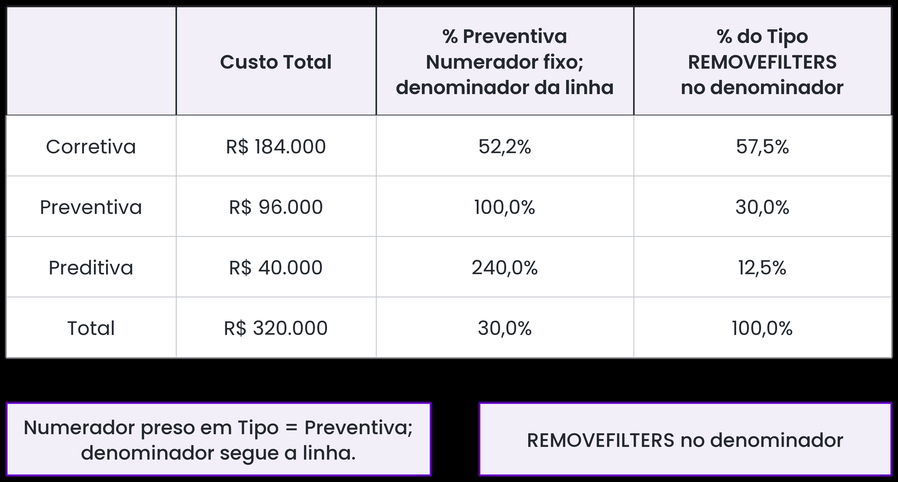
*Figura 13 (Figura 5.19): Na matriz por tipo, `% Preventiva` distorce as linhas (`52,2%`, `100%`, `240%`), enquanto `% do Tipo` entrega a participação exata de cada linha.*

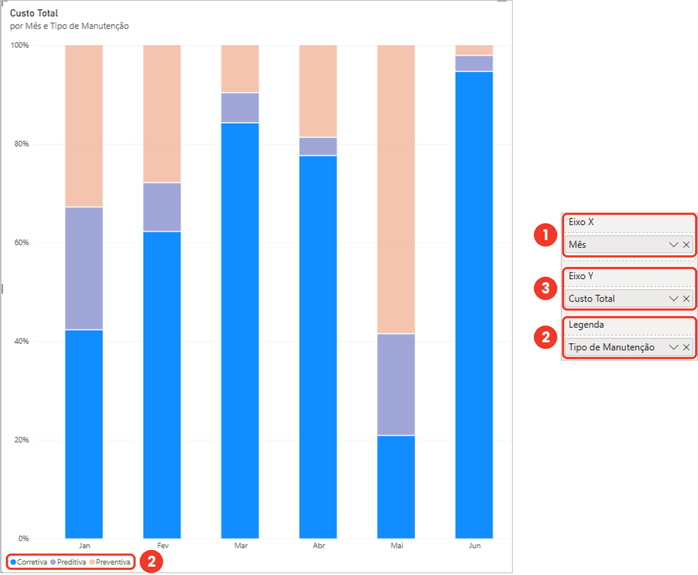
*Figura 14 (Figura 5.20): Gráfico de colunas 100% empilhadas com os meses no eixo e `Tipo de Manutenção` na legenda.*

---

# BLOCO 4: Ranking, Curva de Pareto (`RANKX`) e Casos Integrados (Seções 5.9 e 5.10)

### Passo 4.1: Ranking, Curva de Pareto e Classe ABC (Seção 5.9)
*Caso dos 6 equipamentos da área de Embarque no 4º trimestre de 2025 (Tabela 5.12 — aba `Tab5_12_Embarque_Pareto`):*

| Posição (`RANKX`) | Equipamento | Descrição | Total de Horas Paradas | Horas Acumuladas | `% Acumulado` | Classe ABC (`80% / 95%`) |
| :---: | :---: | :--- | :---: | :---: | :---: | :---: |
| **1** | `CV-01` | Carregador de vagões | `48,0` | `48,0` | `40,00%` | **A** |
| **2** | `MG-01` | Moega | `30,0` | `78,0` | `65,00%` | **A** |
| **3** | `AM-01` | Amostrador | `18,0` | **`96,0`** | **`80,00%`** | **A** |
| **4** | `BL-01` | Balança rodoviária | `12,0` | `108,0` | `90,00%` | **B** |
| **5** | `TD-01` | Tanque de óleo diesel | `8,0` | `116,0` | `96,67%` | **C** |
| **6** | `PT-01` | Portão automático | `4,0` | `120,0` | `100,00%` | **C** |

1. Crie as **5 medidas do Pareto e ABC**:
   ```dax
   Ranking Horas = 
   IF(
       ISINSCOPE( Equipamentos[Equipamento] ),
       RANKX( ALL( Equipamentos[Equipamento] ), [Total de Horas Paradas] )
   )
   ```
   ```dax
   Horas Top 3 = 
   CALCULATE(
       [Total de Horas Paradas],
       TOPN( 3, ALL( Equipamentos[Equipamento] ), [Total de Horas Paradas] )
   )
   ```
   ```dax
   % Acumulado = 
   VAR Atual = [Total de Horas Paradas]
   RETURN
       IF(
           ISINSCOPE( Equipamentos[Equipamento] ),
           DIVIDE(
               SUMX(
                   FILTER(
                       ALL( Equipamentos[Equipamento] ),
                       [Total de Horas Paradas] >= Atual
                   ),
                   [Total de Horas Paradas]
               ),
               CALCULATE( [Total de Horas Paradas], ALL( Equipamentos[Equipamento] ) )
           )
       )
   ```
   ```dax
   Classe ABC = 
   IF(
       NOT ISBLANK( [% Acumulado] ),
       SWITCH(
           TRUE(),
           [% Acumulado] <= 0.80, "A",
           [% Acumulado] <= 0.95, "B",
           "C"
       )
   )
   ```
   ```dax
   Corte A = 0.8
   ```
2. **Montando o Gráfico de Pareto no Power BI Desktop:**
   - Escolha o visual **Gráfico de linhas e colunas empilhadas**.
   - **Eixo X:** `Equipamentos[Equipamento]`
   - **Eixo Y da coluna:** `[Total de Horas Paradas]`
   - **Eixo Y da linha:** `[% Acumulado]` e `[Corte A]` (formatados como porcentagem).

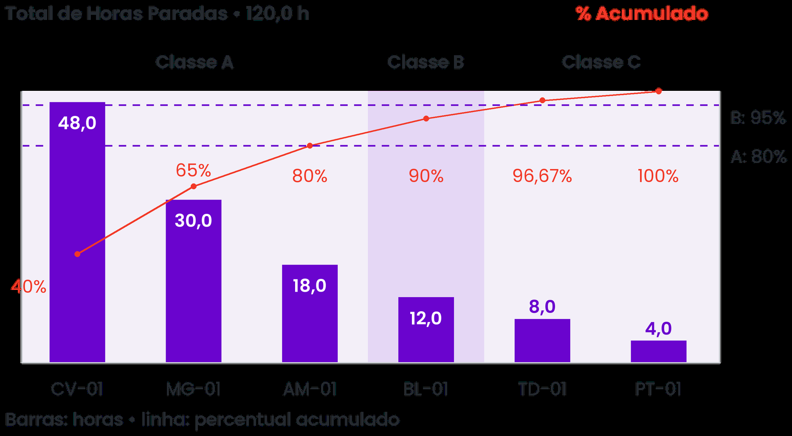
*Figura 15 (Figura 5.21): Curva de Pareto da área de Embarque: três equipamentos (`CV-01`, `MG-01` e `AM-01`) concentram 80% das horas paradas (Classe A).*

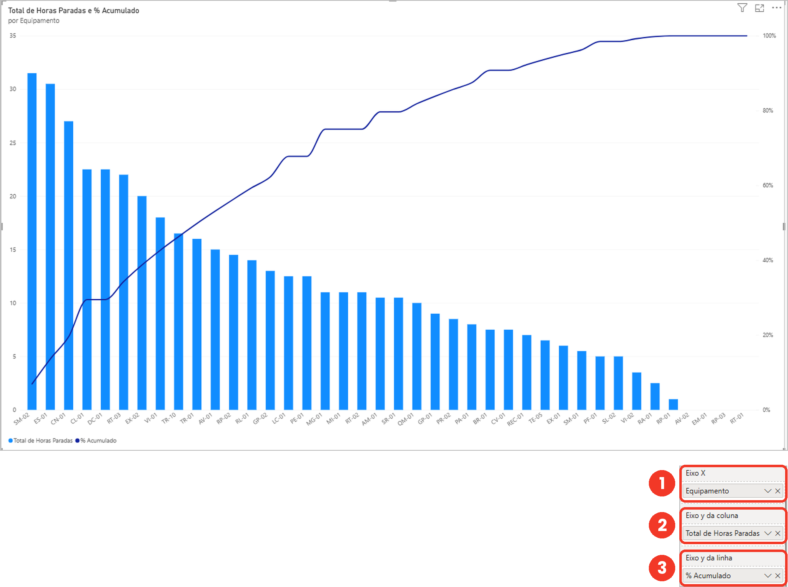
*Figura 16 (Figura 5.22): Gráfico de linhas e colunas empilhadas configurado no Power BI Desktop.*

---

### Passo 4.2: Auditoria dos Dois Casos Integrados (Seção 5.10)

#### Caso 1 — O Acumulado que "Fechou o Ano em Junho" (Moagem)
- **Sintoma 1 (Defeito real):** Linha reta de `312,0 h` no gráfico de `Horas YTD` de julho a dezembro ➔ Falta a trava `IF(MIN('Calendário'[Data]) <= CALCULATE(MAX(OS[Data de Abertura]), REMOVEFILTERS()), ...)`.
- **Sintoma 2 (Informação real, não é erro):** Célula de `MTBF` do `LC-01` vazia em maio ➔ Não houve falha (corretiva) em maio, logo `DIVIDE` devolve `BLANK` (zero falhas = melhor notícia do mês!).
- **Sintoma 3 (Definição da medida):** Cartão de `Disponibilidade` em `99,1%` vs `98,2%` ➔ `99,1%` mede a disponibilidade inerente (`MTBF / (MTBF + MTTR)`, descontando apenas corretivas no denominador), enquanto `98,2%` desconta também preventivas e preditivas sobre as horas de calendário (`17.064 / 17.376`).

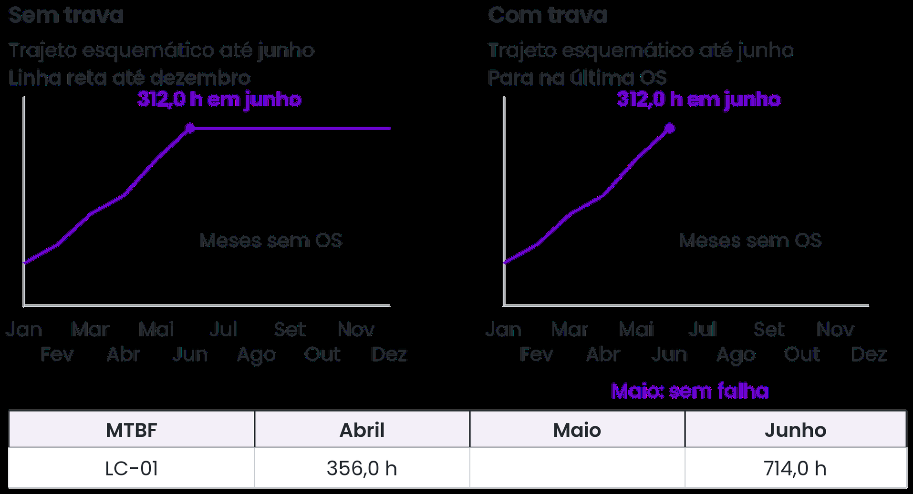
*Figura 17 (Figura 5.23): Com a trava da última OS, a linha de YTD para em junho; o vazio de MTBF em maio indica mês sem falha.*

#### Caso 2 — A Aderência de Abril que Deu `63,6%` em vez de `84,0%` (Filtragem — aba `Caso5_10_2_Filtragem_Aderencia`)
- **Por que o painel mostrava `63,6%` (`21 / 33`)?** Porque contava `OS Programadas` pelo relacionamento ativo (`Data de Abertura`), incluindo 8 preventivas abertas no fim de abril mas programadas para maio (`25 + 8 = 33`).
- **Correção:** Ativar `USERELATIONSHIP(OS[Data Programada], 'Calendário'[Data])` em `OS Programadas` e `OS no Prazo` ➔ O denominador volta para **25** e a aderência crava **`84,0%`** (`21 / 25`)!

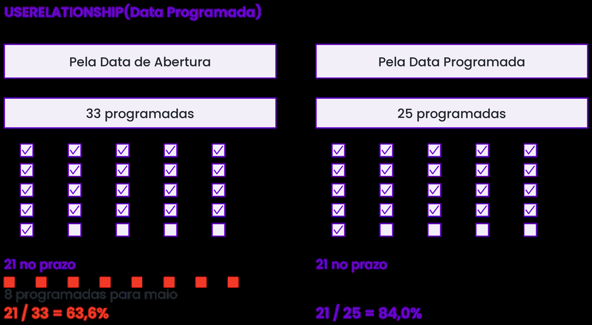
*Figura 18 (Figura 5.24): Pela `Data de Abertura` entram 33 preventivas (`63,6%`); pela `Data Programada` com `USERELATIONSHIP` entram as 25 programadas para abril (`84,0%`).*

---

## Checkpoint Final e Galeria de Painéis
- [ ] Tabela `Calendário` criada, marcada como tabela de datas e `Nome do Mês` ordenado por `Mês`.
- [ ] Relacionamento ativo (`Data de Abertura`) e inativos (`Data de Encerramento` e `Data Programada`) funcionando com `USERELATIONSHIP`.
- [ ] Medidas de `Horas YTD`, `Horas Ano Anterior`, `MTBF`, `MTTR`, `Disponibilidade`, `Backlog HH`, `Aderência`, `% do Tipo`, `Ranking Horas`, `% Acumulado` e `Classe ABC` validadas.
- [ ] **Pergunta de encerramento na Galeria de Painéis:** *"Olhando para o seu painel agora, qual equipamento pede atenção primeiro, e por quê?"*
